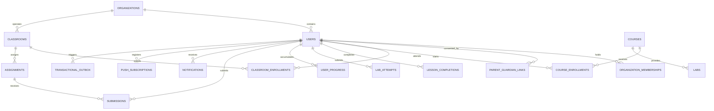

# GENIUSPHERE — DATABASE DESIGN SPECIFICATION

**Date:** 2026-10-20  
**Engine:** PostgreSQL 16+  
**Tables:** 19 Relational Entities with Foreign Keys, Constraints, and Row-Level Security  

---

## 1. Entity-Relationship Overview



---

## 2. Table Responsibilities & Schema Definitions

### 2.1 Core Identity & Organization Layer
1. **`public.organizations`**
   - *Responsibility:* Multitenant educational institutions (schools, colleges, learning centers).
   - *Primary Key:* `id UUID PRIMARY KEY DEFAULT gen_random_uuid()`.
   - *Keys & Constraints:* `name TEXT NOT NULL`, `slug TEXT UNIQUE NOT NULL`, `is_active BOOLEAN DEFAULT true`.
2. **`public.users`**
   - *Responsibility:* User profiles with role capabilities and minor protection flags.
   - *Primary Key:* `id UUID PRIMARY KEY DEFAULT gen_random_uuid()`.
   - *Attributes:* `email TEXT UNIQUE NOT NULL`, `full_name TEXT NOT NULL`, `date_of_birth DATE`, `is_minor BOOLEAN DEFAULT false`, `account_status TEXT DEFAULT 'active'`.
3. **`public.organization_memberships`**
   - *Responsibility:* Association of users to organizations with scoped roles (`learner`, `teacher`, `institution_admin`).
   - *Keys:* `user_id REFERENCES public.users(id) ON DELETE CASCADE`, `organization_id REFERENCES public.organizations(id) ON DELETE CASCADE`.
   - *Constraint:* `UNIQUE(user_id, organization_id)`.
4. **`public.parent_guardian_links`**
   - *Responsibility:* DPDP and COPPA compliant parental consent tracking for minor students.
   - *Attributes:* `student_id REFERENCES public.users(id)`, `parent_email TEXT NOT NULL`, `consent_status TEXT NOT NULL`, `verification_token_hash TEXT`.

### 2.2 Curriculum & Learning Progression Layer
5. **`public.courses`**
   - *Responsibility:* Canonical learning topics and courses.
   - *Attributes:* `id TEXT PRIMARY KEY`, `stream_id TEXT NOT NULL`, `title TEXT NOT NULL`, `slug TEXT UNIQUE NOT NULL`, `modules_count INTEGER NOT NULL`, `is_published BOOLEAN DEFAULT true`.
6. **`public.course_enrollments`**
   - *Responsibility:* Student enrollment records with lifecycle tracking.
   - *Keys:* `user_id REFERENCES public.users(id)`, `course_id REFERENCES public.courses(id)`.
   - *Attributes:* `enrolled_at TIMESTAMPTZ DEFAULT NOW()`, `progress_percent INTEGER DEFAULT 0`.
   - *Constraint:* `UNIQUE(user_id, course_id)`.
7. **`public.lesson_completions`**
   - *Responsibility:* Idempotent verification of video lesson completions.
   - *Keys:* `user_id REFERENCES public.users(id)`, `lesson_id TEXT NOT NULL`, `course_id REFERENCES public.courses(id)`.
   - *Attributes:* `completed_at TIMESTAMPTZ DEFAULT NOW()`, `score INTEGER DEFAULT 100`.
   - *Constraint:* `UNIQUE(user_id, lesson_id)`.
8. **`public.labs`**
   - *Responsibility:* Interactive simulation lab definitions and parameter specifications.
   - *Attributes:* `id TEXT PRIMARY KEY`, `course_id REFERENCES public.courses(id)`, `title TEXT NOT NULL`, `lab_type TEXT NOT NULL`, `challenge_spec JSONB NOT NULL`.
9. **`public.lab_attempts`**
   - *Responsibility:* Recorded student simulation attempts, verified scores, and execution logs.
   - *Attributes:* `user_id REFERENCES public.users(id)`, `lab_id REFERENCES public.labs(id)`, `score INTEGER NOT NULL`, `passed BOOLEAN NOT NULL`, `created_at TIMESTAMPTZ DEFAULT NOW()`.
10. **`public.user_progress`**
    - *Responsibility:* Centralized progression state (XP, streaks, study minutes).
    - *Attributes:* `user_id REFERENCES public.users(id) UNIQUE`, `total_xp INTEGER DEFAULT 0`, `current_streak_days INTEGER DEFAULT 0`, `last_activity_date DATE`, `total_study_minutes INTEGER DEFAULT 0`.

### 2.3 Operational & Realtime Reliability Layer
11. **`public.classrooms`** — Teacher cohorts with Crockford Base32 join codes.
12. **`public.classroom_enrollments`** — Active classroom rosters.
13. **`public.assignments`** — Classroom assigned lab deadlines.
14. **`public.submissions`** — Cryptographically hashed student lab submissions.
15. **`public.notifications`** — Central notification inbox.
16. **`public.push_subscriptions`** — W3C VAPID device endpoints.
17. **`public.transactional_outbox`** — Atomically queued events (`SELECT ... FOR UPDATE SKIP LOCKED`).
18. **`public.durable_background_jobs`** — Scheduled background worker jobs.
19. **`public.audit_events`** — Immutable compliance audit log.

---

## 3. Row-Level Security (RLS) Policy Architecture

All 19 tables have PostgreSQL Row Level Security enabled. Example policies enforced at the database engine level:

```sql
-- Course Enrollments RLS
ALTER TABLE public.course_enrollments ENABLE ROW LEVEL SECURITY;

CREATE POLICY "Learners can view and modify their own enrollments"
ON public.course_enrollments
FOR ALL
USING (auth.uid() = user_id)
WITH CHECK (auth.uid() = user_id);

CREATE POLICY "Teachers can inspect enrollments for their organization students"
ON public.course_enrollments
FOR SELECT
USING (
  EXISTS (
    SELECT 1 FROM public.organization_memberships m
    WHERE m.user_id = auth.uid()
      AND m.role IN ('teacher', 'institution_admin')
      AND m.organization_id = (
        SELECT organization_id FROM public.organization_memberships
        WHERE user_id = public.course_enrollments.user_id
        LIMIT 1
      )
  )
);
```
