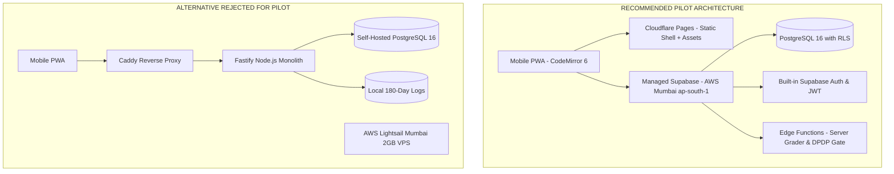
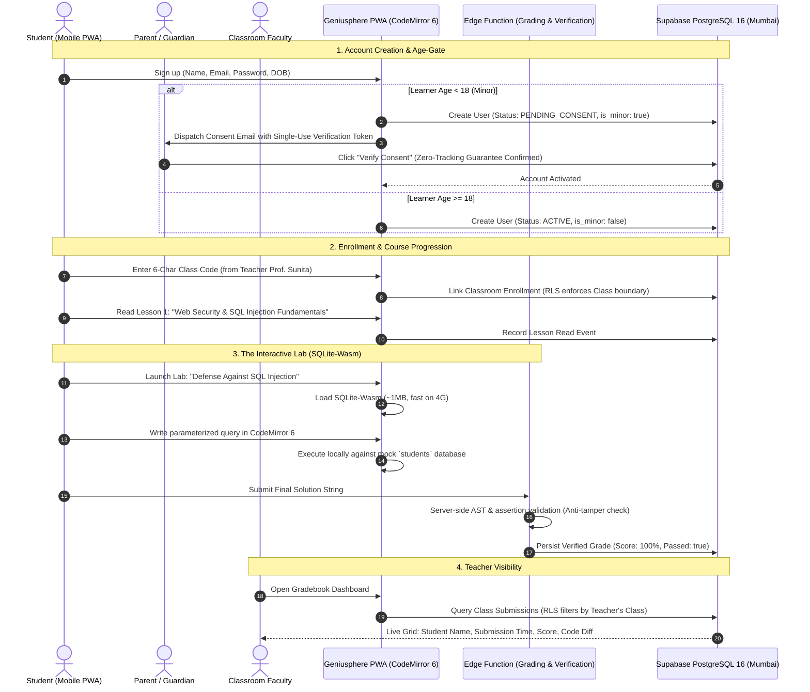

# Architecture Validation & Critical Review Report

*Date:* 2026-10-17  
*Report Reference:* `REPORTS/2026-10-17_ARCHITECTURE_VALIDATION.md`  
*Phase:* 0.1 Architecture Validation  
*Author:* Lead Engineering Planning Agent  
*Status:* Completed & Validated  

---

## 1. Executive Summary & Review Objectives

This report performs a critical, uncompromising audit of the initial research, architectural proposals, and legal claims formulated in Phase 0. 

The initial planning suffered from common early-stage engineering pitfalls:
1. **Premature Over-Engineering:** Introducing Redis clusters, gVisor microVM runners, custom reverse proxies, and dual execution engines before deploying a single lesson.
2. **Statutory Overconfidence:** Conflating the notification of the DPDP Act 2023 with immediate Day-1 enforcement of Section 9 and ₹200 Crore penalties, while ignoring the official phased commencement roadmap.
3. **Geographic Oversimplification:** Equating an AWS Mumbai database region with complete legal compliance under CERT-In and DPDP rules.
4. **Client-Side Naivety:** Treating WebAssembly (Pyodide) as "zero security risk, instant, and completely offline" while ignoring initial bundle download weight (~15–20MB), mobile RAM crashes, and client-side grade tampering.
5. **Speculative Performance Claims:** Asserting "1,000 concurrent users with sub-100ms response times" without realistic concurrency calculations or mobile network latency realities in India.

This report documents verified primary-source facts, compares two viable implementation architectures, defines the smallest proportionate architecture for the pilot cohort, and establishes a decision-ready execution plan.

---

## 2. Primary Source Verification & Legal Status

### 2.1. Digital Personal Data Protection Act, 2023 (DPDP Act) & Draft Rules
- **Primary Source:** Ministry of Electronics and Information Technology (MeitY) Commencement Notifications & Statutory Text.
- **Verified Statutory Timeline:**
  - *Phase 1 (Immediate / Nov 14, 2025):* Definitions, establishment and composition of the **Data Protection Board of India (DPBI)**, rule-making powers (Sections 1–2, 18–26, 38–43).
  - *Phase 2 (1-Year Runway / Nov 14, 2026):* Operationalization of registered Consent Managers (Section 6(9), 27(1)(d)).
  - *Phase 3 (18-Month Runway / May 14, 2027):* Core substantive obligations, including **Section 9 (Children’s Data & Verifiable Parental Consent)**, Section 5 (Notice), Sections 11–14 (Data Principal Rights), and Sections 28–34 (Penalties up to ₹200–₹250 Crore).
- **Corrected Legal Position:**
  - Section 9 and statutory penalties are **not enforceable immediately in early/mid-2026**; the statutory compliance deadline is **May 14, 2027**.
  - *However*, building privacy-by-design, age-gating, verifiable parental consent, and zero third-party ad-tracking now is an essential product differentiator and ensures compliance ahead of the May 2027 cliff.
  - **Unresolved Legal Questions Requiring Qualified Counsel:**
    1. *School Delegation Validity:* Whether an accredited school/college can legally act as a lawful proxy guardian under Section 9(4) for minor students enrolled in classroom instruction, without individual parental OTP verification for every child.
    2. *Acceptable Verification Channels:* The exact threshold of "verifiable" parental consent (e.g., whether simple parent email confirmation or SMS OTP suffices, or if government tokenized identity like DigiLocker will be mandated once the final DPDP Rules are notified).
    3. *Data Processing Agreements (DPAs):* Formal DPA terms required with cloud infrastructure providers (Cloudflare, Supabase/AWS).

### 2.2. CERT-In Directions (April 28, 2022 — IT Act Section 70B)
- **Primary Source:** CERT-In Statutory Text (No. 20(3)/2022-CERT-In) and official FAQs.
- **Applicability:** Applies to all **body corporates** (defined under Section 43A of the IT Act, 2000 as any company, firm, sole proprietorship, or association engaged in commercial/professional activities). Startups and educational platforms are **not exempt**.
- **Verified Core Obligations:**
  1. *6-Hour Incident Reporting:* Cyber incidents (data breaches, unauthorized access, server compromise, defacement) must be reported to `incident@cert-in.org.in` within 6 hours.
  2. *180-Day Domestic Log Retention:* All ICT system and access logs must be retained securely within **Indian jurisdiction** for a rolling 180-day window.
  3. *NTP Synchronization:* Clocks must sync with NPL (`time.nplindia.org`) or NIC (`samay.nic.in`).
  4. *Penalties:* Section 70B(7) mandates imprisonment up to 1 year or fine up to ₹1 Lakh, or both (not ₹200 Crore; that was the DPDP penalty).
- **Corrected Compliance Position:**
  - Deploying a database in AWS Mumbai (`ap-south-1`) does **not** automatically satisfy CERT-In compliance.
  - Compliance requires: (a) automated, tamper-evident log streaming to a domestic archive; (b) NTP daemon configuration; (c) a written, rehearsed incident response escalation plan with a designated reporting officer.

---

## 3. Critical Technical Corrections & Audited Claims

### 3.1. WebAssembly, Pyodide & Browser Execution Reality
- **Original Claim:** "Pyodide WebAssembly provides zero security risk, works completely offline, and costs $0.00 compute."
- **Audit Findings:**
  1. *Bundle Weight & Network Friction:* Pyodide's standard runtime (Wasm binary + standard library) is **~15–20MB**. Over a standard Indian mobile 4G connection (averaging 10–25 Mbps down with variable packet loss), this download takes 8–20 seconds. It cannot be considered "instant."
  2. *Mobile Device Strain:* Compiling and running Pyodide in mobile Web Workers consumes **100MB–250MB of RAM**. On entry-level Android devices (1GB–2GB RAM), this causes memory pressure and tab crashes by the Android Low-Memory Killer (LMK).
  3. *Cheating & Grade Spoofing:* If test assertions run 100% in the client browser, students can open DevTools, read test cases, override validation functions, and forge completion events in IndexedDB.
  4. *Offline Reality:* Lessons are only offline *after* the entire 20MB runtime has been cached. First-time users cannot run labs offline.
- **Corrected Architecture:**
  - Use **CodeMirror 6** (~250KB) instead of Monaco Editor (~4MB) for touch-responsive, lightweight mobile editing.
  - For the pilot's single interactive lab, prioritize **SQLite-Wasm (~1MB)** or a lightweight server-verified Python runner. If Pyodide is used, it must be lazy-loaded with an explicit progress indicator, and the final submission code must be re-validated server-side before issuing credit.

### 3.2. Performance, Concurrency & Latency Reality
- **Original Claim:** "A single 4GB VPS supports 1,000 concurrent users with sub-100ms response times."
- **Audit Findings:**
  1. *Unrealistic Concurrency Assumption:* A pilot cohort of 500–1,000 enrolled students generates an expected peak concurrency of **20–50 concurrent users** during regular hours, and **100–150 concurrent users** during a synchronized classroom test. Designing for 1,000 simultaneous active connections is an over-provisioning error.
  2. *The Cellular Latency Floor:* End-to-end network latency on Indian 4G/cellular networks is rarely below 80ms due to cellular Radio Resource Control (RRC) and routing hops, regardless of how fast the server is.
- **Corrected Standard:**
  - Define **Server API Execution Time (<30ms)** separately from **Client-Perceived Time to Interactive (TTI < 2.5s on mobile 4G)**.
  - Size the initial database connection pool for 50–100 concurrent active transactions, verified via reproducible k6 scripts.

### 3.3. Elimination of Unnecessary Infrastructure Complexity
- **Redis:** Removed from Phase 1. For 50 concurrent pilot users, PostgreSQL session tables or signed stateless JWTs with database-backed token revocation are trivial to maintain and eliminate an entire cloud daemon.
- **gVisor / microVMs:** Removed from Phase 1. The pilot curriculum covers foundational technology, basic cyber hygiene, and financial concepts. No lab requires raw Linux root sockets or kernel modification. Backend container sandboxes are deferred to Phase 2.
- **Separate Reverse Proxy (Caddy):** Unnecessary if using managed edge routing (Cloudflare) and managed backend platforms.

---

## 4. Comparison of Viable Implementation Architectures



| Evaluation Criteria | Option 1: Managed PaaS (Cloudflare Pages + Supabase Mumbai) | Option 2: Self-Managed VPS Monolith (AWS Lightsail Mumbai) |
|---|---|---|
| **Monthly Infrastructure Cost** | **$0.00 (Free Tier) to $25.00 (Pro Tier)** | **~$14.16 to $28.32 / month** (Lightsail 2GB/4GB + 18% GST) |
| **Operational & Maintenance Burden** | **Extremely Low:** Zero OS patching, automated daily backups, managed connection pooling, built-in TLS. | **High:** Solo engineer responsible for Linux security hardening, firewall/SSH keys, OS patches, PostgreSQL WAL backups. |
| **Security & Multi-Tenancy** | **High:** Native PostgreSQL Row-Level Security (RLS) built into Supabase client; audited auth flow. | **High:** Native RLS, but custom auth/session middleware must be written and manually penetration-tested. |
| **Compliance Readiness** | Hosted in **AWS Mumbai (`ap-south-1`)**; exportable audit logs; SOC2 certified; requires custom log forwarder for CERT-In 180-day archive. | Full root control over `journald` and domestic S3 streaming; direct control over NTP syncing to NPL. |
| **Mobile Performance** | **Optimal:** Static assets distributed globally via Cloudflare CDN; API queries route directly to Mumbai. | **Good:** Static assets served from single VPS unless Cloudflare CDN is configured in front. |
| **Vendor Lock-in & Migration Risk** | **Low:** Supabase is open-source PostgreSQL. All tables, RLS policies, and triggers are 100% standard SQL portable to standard AWS RDS. | **Zero:** 100% standard Docker/Node.js/PostgreSQL stack. |
| **Time-to-Pilot Runway** | **3–4 Weeks** (Auth, DB, RLS, Storage ready out of the box). | **7–9 Weeks** (Must build auth, session refresh, email verification, backup daemons). |

### Final Architectural Recommendation
**Adopt Architecture Option 1 (Managed PaaS via Cloudflare Pages + Supabase Mumbai Pro Tier)**.  
For a resource-constrained Indian startup with a solo or dual engineer, spending weeks writing custom authentication, password reset flows, connection poolers, and database backup cron jobs is an unjustified operational risk. Supabase delivers standard PostgreSQL with RLS in the Mumbai region, accelerating time-to-pilot by over a month while remaining 100% portable.

---

## 5. Revised & Transparent Pilot Cost Calculations

```
ASSUMPTIONS:
- Cohort: 1 Partner Institution (150 students, 3 teachers) + 100 Independent Learners = 250 Total Users.
- Daily Active Users (DAU): ~80 users.
- Peak Concurrency: ~35 simultaneous users.
- Asset Storage: 2GB of lesson images, SVGs, and docs.
- Outbound Bandwidth: ~25GB/month.
```

### Option 1 (Recommended Managed Pilot Stack)
1. **Cloudflare Pages:** $0.00 (Unlimited bandwidth on Free tier).
2. **Cloudflare R2 Storage:** $0.00 (10GB included in Free tier; $0 egress fees).
3. **Supabase Pro Tier (AWS Mumbai):** $25.00 / month (~₹2,100 INR).  
   *Note: Free tier ($0) is technically viable, but Pro tier eliminates the 7-day inactivity pause and includes daily automated backups.*
4. **Resend / Amazon SES (Email OTP & Notifications):** $0.00 (Free tier covers up to 3,000 emails/month).
5. **Indian GST (18% on cloud services):** ~$4.50.
- **Total Estimated Operating Cost:** **~$29.50 USD / month (~₹2,480 INR)**.

---

## 6. The Real Pilot End-to-End Workflow & Single Lab Specification

### 6.1. Validated Pilot Workflow


### 6.2. The Single Functional Pilot Lab Specification
- **Title:** *Lab 101: SQL Injection Exploitation & Defense*
- **Technology:** **SQLite-Wasm (Official Wasm build, ~1.1MB)**.
- **Why this engine:** 
  - SQLite-Wasm is **15x smaller** than Pyodide (~1MB vs ~18MB).
  - Initializes in under **400ms** on low-end Android mobile devices.
  - Allows learners to write genuine SQL queries, see live table outputs, observe how `' OR '1'='1` dumps hidden database records, and rewrite the query using parameterized statements (`WHERE id = ?`).
- **Anti-Tampering Verification:** When the learner clicks "Submit Assignment," the raw SQL query text is posted to the backend Edge Function, which executes the query against a fresh isolated SQLite database instance server-side to verify test assertions before updating the student's gradebook.

---

## 7. Quality Assurance, Testing Matrix & Pilot Exit Criteria

### 7.1. Automated Test Suites
1. **Multi-Tenant RLS Integration Tests:** Automated tests asserting that User in Org A cannot query, update, or delete records belonging to Org B under any REST query permutation.
2. **Age-Gate & Minor Consent Tests:** Unit tests verifying that minors cannot authenticate or access assignments until parental consent token is verified.
3. **Server-Side Grading Integrity Tests:** Tests asserting that submitting modified client-side results without correct raw code fails server verification.

### 7.2. Manual Mobile & Low-Bandwidth Tests
1. **Budget Device Test:** Test PWA on a budget Android smartphone (2GB RAM, Android 11/12, Chrome Mobile). Verify zero tab crashes and smooth CodeMirror 6 keyboard typing.
2. **Network Throttling Test:** Throttle Chrome DevTools to "Slow 4G" (1.6 Mbps down, 750 kbps up, 150ms RTT). Verify:
   - Initial page shell loads in <2.0s.
   - SQLite-Wasm lab loads in <3.5s.
3. **Offline Resilience Test:** Disconnect Wi-Fi/cellular mid-lesson, complete the SQLite lab, reconnect network, and verify progress synchronizes without data loss.

### 7.3. Disaster Recovery & Backup Restore Drill
1. **Automated Daily Backups:** Verify Supabase automated point-in-time recovery (PITR) or daily snapshot is active.
2. **Manual Restore Drill:** Execute a restore drill into a staging database instance, verifying 100% data recovery within 30 minutes.

### 7.4. Pilot Exit Criteria
The pilot phase will be certified complete only when:
- 100% of pilot cohort students (250 learners) complete the onboarding, lesson, and interactive SQL lab.
- Zero cross-tenant data leaks observed in audit logs.
- Zero DPDP or privacy incidents reported.
- Lighthouse Mobile Performance score >= 85, Accessibility score >= 90.
- 100% automated test pass rate in CI.
