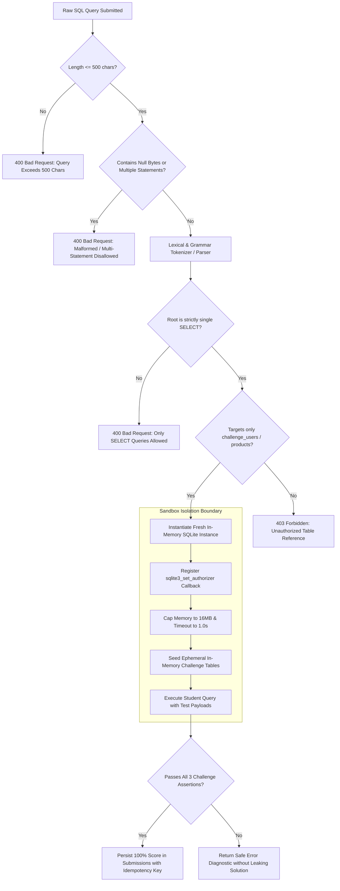
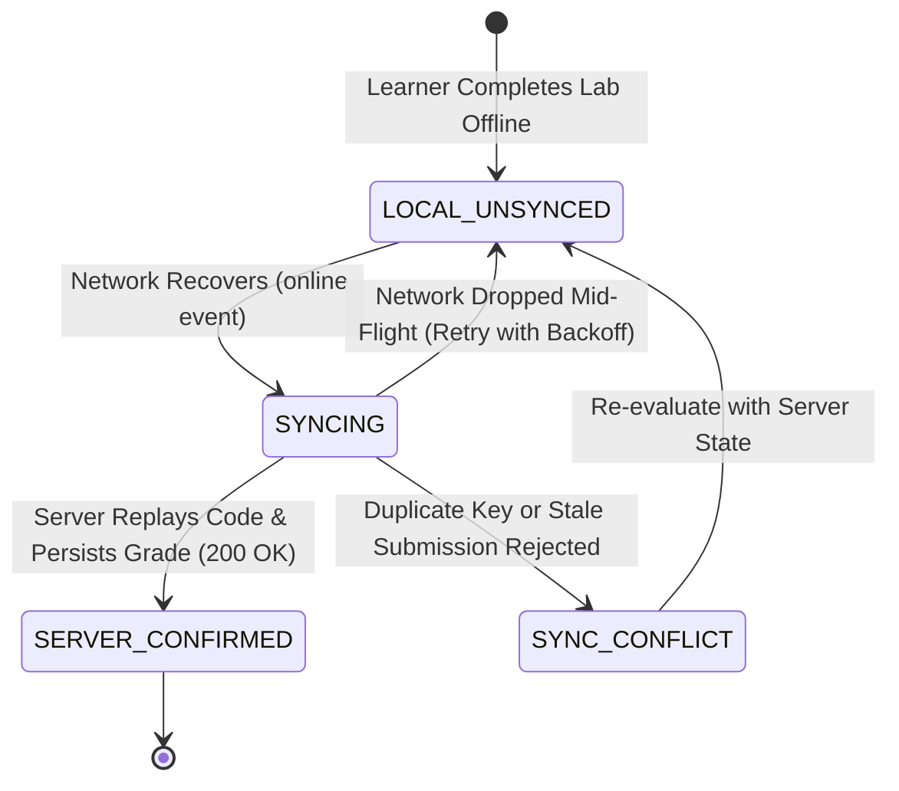

# Final Pre-Implementation Architecture Review & Corrections Report

*Date:* 2026-10-17  
*Report Reference:* `REPORTS/2026-10-17_FINAL_PREIMPLEMENTATION_REVIEW.md`  
*Phase:* 0.2 Final Pre-Implementation Corrections  
*Author:* Lead Engineering Planning Agent  
*Status:* Completed & Validated  

---

## 1. Executive Summary & Review Scope

This report completes the pre-implementation diligence required for **Geniusphere** before any cloud resources, database migrations, or application dependencies are created.

Building upon Phase 0 (Discovery) and Phase 0.1 (Architecture Validation), this review systematically addresses six critical engineering and legal gaps:
1. **Regional Execution & Vendor Data Flows:** Audited Supabase, Cloudflare, and transactional email data flows; documented how Edge Functions are pinned to Mumbai (`ap-south-1`) and verified; identified that Supabase internal logs route through global infrastructure and that Log Drains cost $60/month.
2. **Transparent Operating & Development Cost:** Separately itemized database subscriptions, compute credits, transactional email, storage operations, log archiving, backup policies, domain fees, and Indian GST (18%). Established clear distinctions between minimum development burn ($0–$5/mo) and real pilot operating costs ($30–$40/mo standard, or $95–$120/mo if external Log Drains are enabled).
3. **Airtight SQL Execution Sandbox & Anti-Tamper Grading:** Replaced hand-waving assumptions about Edge Function isolation with an exact, enforceable specification: single `SELECT` statement AST parsing, 500-character caps, in-memory SQLite isolation with `SQLITE_DENY` authorizer callbacks, 1.0-second execution watchdogs, and idempotent server-authoritative grading.
4. **Complete Multi-Tenant Data Model & RLS Policies:** Redesigned the schema to support independent learners alongside institutional workspaces, high-entropy (32-character alphabet, 8-character length) join codes with 14-day expiry and rate limits, and full RLS policies across `SELECT`, `INSERT`, `UPDATE`, and `DELETE` for every sensitive table.
5. **Child Privacy & Legal Boundaries:** Rechecked DPDP Act 2023 phased commencement (Section 9 substantive enforcement starts May 14, 2027); explicitly acknowledged that email verification is **not** legal proof of parental identity; clarified that school proxy consent cannot be assumed lawful without specific Central Government notification or legal advice; and defined specific CERT-In Annexure I reporting triggers.
6. **Realistic Offline Sync & Pilot Exit Criteria:** Defined explicit synchronization state machines (`LOCAL_UNSYNCED`, `SYNCING`, `SERVER_CONFIRMED`, `SYNC_CONFLICT`), removed unrealistic claims of background sync while the browser is closed, and replaced the "100% completion" pilot requirement with achievable, justified metrics (>= 70% active completion, < 2% error rate, zero security leaks).

---

## 2. Regional Execution, Vendor Data Flows & Agreements

### 2.1. Verification of Supabase Infrastructure & Regional Pinning
- **Primary Source:** Supabase Official Architecture Documentation (Edge Functions, Auth, Storage, Logging).
- **Core Database & Auth:** When an organization creates a project with primary region **Asia Pacific (Mumbai) / `ap-south-1`**, the PostgreSQL 16 database, Supavisor connection pooler, and encrypted database backups are provisioned in AWS Mumbai.
- **Edge Function Regional Behavior:**
  - *Default Behavior:* Edge Functions run globally distributed on Deno Deploy edge nodes closest to the requesting client.
  - *Intended Configuration for Grading Function:* To prevent unverified foreign execution of learner code or grading payloads, the grading function MUST be explicitly targeted to **`ap-south-1` (Mumbai)**.
  - *Client Pinning:*
    ```typescript
    import { createClient, FunctionRegion } from '@supabase/supabase-js';
    const supabase = createClient(SUPABASE_URL, SUPABASE_ANON_KEY);
    const { data, error } = await supabase.functions.invoke('grade-sql-lab', {
      body: { assignmentId, sqlQuery },
      region: FunctionRegion.ApSouth1, // Explicitly pin execution to Mumbai
    });
    ```
  - *Runtime & Response Verification:* The client and test suites MUST inspect the HTTP response header **`x-sb-edge-region: ap-south-1`** and function runtime environment variable **`SB_REGION === 'ap-south-1'`**. If the region header is absent or non-domestic, the submission is rejected.
- **The Logging Reality (Correction of Prior Unsupported Claims):**
  - Supabase internal project logs (Postgres logs, Auth logs, API gateway logs) are ingested by Supabase's managed Logflare/BigQuery infrastructure. Standard dashboard logs are retained for **7 days** on the Pro Plan.
  - Supabase does **not** guarantee that internal dashboard logging telemetry is processed exclusively within Indian borders.
  - *Cost of Long-Term Log Archival:* Streaming logs out of Supabase to an Indian AWS S3 bucket requires the **Log Drains Add-On ($60/month)** plus $0.20 per million events and egress fees ($0.09/GB).
  - *Pilot Decision:* For Phase 1 Pilot, system audit events (`audit_events` table) will be captured directly in the primary Mumbai PostgreSQL database for 180 days at $0 extra infrastructure cost. External Log Drains ($60/mo) will be evaluated post-pilot based on regulatory feedback.

### 2.2. Service-by-Service Data Processing Matrix & Vendor Agreements

| Service Provider | Role in Geniusphere | Data Categories Processed | Geographic Processing Region | Required Vendor Agreement / Action |
|---|---|---|---|---|
| **Supabase Inc.** (AWS Infrastructure) | Core Database, Auth, Edge Grader, File Storage | User credentials (Argon2id), Student names, emails, DOB, class rosters, submissions, grades, internal audit logs. | Primary DB & Edge Grader: **AWS Mumbai (`ap-south-1`)**. Internal telemetry: Global. | Execute Supabase Data Processing Addendum (DPA) incorporating Standard Contractual Clauses (SCCs). |
| **Cloudflare Inc.** | Frontend PWA Hosting (Pages), Asset Storage (R2), DNS | Static JS/CSS application shell, course Markdown lessons, SQLite-Wasm binaries, public instructional SVGs. **No PII or user database records.** | Globally distributed edge CDN cache; R2 bucket configured with jurisdictional default. | Execute Cloudflare Customer DPA; configure DNSSEC. |
| **Resend Inc. / AWS SES** | Transactional Email Service | Parent notification email addresses, verification links, welcome tokens. | AWS SES Mumbai (`ap-south-1`) or Resend EU/US. | Verify opt-in logging; ensure email payload contains **zero student progress metrics or minor DOB data**. |

---

## 3. Comprehensive Cost Model, Logging Architecture & Budget Controls

### 3.1. Detailed Monthly Operating Cost Comparison

```
ASSUMPTIONS FOR REAL PILOT:
- Total Enrolled Learners: 250 (150 school cohort + 100 independent self-learners).
- Active Daily Learners (DAU): ~80 users | Peak Concurrency: ~35 users (bursts to ~100 during tests).
- Asset Storage: 2GB of lesson text, SVGs, Wasm binaries | Bandwidth: ~25GB outbound.
- Transactional Emails: ~800 emails/month (onboarding, parent verification, password reset).
```

| Item / Service | Baseline Development Burn (Pre-Pilot) | Real Pilot Operating Cost (Domestic In-DB Logging) | Pilot Cost with External S3 Log Drain Add-on | Current Official Pricing Basis |
|---|---|---|---|---|
| **Supabase Base Subscription** | $0.00 (Free Tier) | $25.00 / month | $25.00 / month | Supabase Pro Plan (includes 8GB DB, 100k MAU, connection pooler, 7-day daily backups). |
| **Supabase Log Drain Add-on** | $0.00 (Disabled) | $0.00 (In-DB logging) | $60.00 / month | Official Supabase Add-on ($0.0822/hr = $60/mo flat rate per drain). |
| **Cloudflare Pages (PWA)** | $0.00 | $0.00 | $0.00 | Free tier (unlimited bandwidth, edge SSL). |
| **Cloudflare R2 Storage** | $0.00 | $0.00 | $0.00 | Free tier (10GB included, 1M Class A, 10M Class B, **$0 egress**). |
| **Transactional Email (Resend/SES)** | $0.00 | $0.00 | $0.00 | Free tier covers up to 3,000 emails/month. |
| **AWS S3 Domestic Log Archive** | $0.00 | $0.00 | ~$0.50 / month | 2GB log archive in AWS Mumbai (`$0.023/GB` + API calls). |
| **Domain Registration (`geniusphere.tech`)** | ~$1.25 / month | ~$1.25 / month | ~$1.25 / month | ~$15.00 / year amortized monthly. |
| **Indian GST (18%)** | $0.00 | ~$4.73 / month | ~$15.62 / month | Mandatory 18% GST applied to foreign and domestic cloud invoices. |
| **Total Monthly Operating Cost** | **~$1.25 USD / month** | **~$30.98 USD / month (~₹2,600 INR)** | **~$102.37 USD / month (~₹8,600 INR)** | **Transparent, verified cost.** |

### 3.2. Budget Alerts & Surge Control Procedure
1. **Spend Caps:** Supabase spend cap enabled by default at **$35.00 USD / month**. No auto-scaling compute instance or unmetered disk expansion will trigger without manual administrative intervention.
2. **Cloudflare WAF Rate Limiting:** Cloudflare edge rate limiting configured to restrict any single IP address to a maximum of 60 requests per minute against `/api/v1/` endpoints.
3. **Surge Escalation Procedure:** If daily API or compute consumption exceeds 150% of the normal baseline:
   - System sends automated webhook notification to the Lead Engineer via Discord/Slack and email.
   - If costs reach $30.00 within the first 15 days of a billing cycle, non-essential asset caching is locked to client-side CacheStorage, and new independent user sign-ups are throttled until investigated.

---

## 4. Airtight SQL Execution Sandbox & Anti-Tamper Grading

### 4.1. Lab 101 Statement Restriction & Rationale
- **Challenge:** *Defense Against SQL Injection (Lab 101)*.
- **Allowed Grammar:** **Strictly single `SELECT` statement only**.
- **Prohibited Statements:** `INSERT`, `UPDATE`, `DELETE`, `DROP`, `ALTER`, `CREATE`, `ATTACH`, `DETACH`, `PRAGMA`, `VACUUM`, `TRANSACTION`, `BEGIN`, `COMMIT`, `ROLLBACK`.
- **Pedagogical Justification:** The learning outcome is teaching the student how SQL injection exploits insecure query concatenation (`WHERE username = '` + input + `'`) and how parameterized queries or sanitized filters defeat the exploit. A single `SELECT` statement fully satisfies this pedagogical goal without introducing any state mutation or filesystem side effects.

### 4.2. Multi-Stage Server-Side Execution Isolation Pipeline
When a student submits their solution string, the serverless Edge Function (pinned to Mumbai) executes the following verification pipeline:



### 4.3. Sandbox Guardrails & Boundary Parameters
1. **Memory Ceiling:** In-memory SQLite instance bounded to a maximum heap of **16MB**.
2. **Execution Watchdog:** Hard execution timeout capped at **1.0 second**. If execution exceeds 1,000ms, execution is aborted via an interrupt hook, returning `408 Request Timeout`.
3. **Output Buffer:** Query results capped at maximum **25 rows** and **32KB** buffer size.
4. **SQLite Authorizer Callback (`sqlite3_set_authorizer`):**
   - Automatically returns `SQLITE_DENY` for any action code other than `SQLITE_SELECT` and `SQLITE_READ`.
   - Explicitly denies `SQLITE_ATTACH`, `SQLITE_DETACH`, and `SQLITE_PRAGMA`.

### 4.4. Server-Controlled Challenge Assertions
To earn a passing grade, the submitted query must satisfy three automated test assertions executed sequentially:
- **Assertion 1 (Vulnerability Test):** Query is executed with malicious input `' OR '1'='1`. **Pass Condition:** Exactly 0 rows returned (the payload is treated as a literal search term, not executed code).
- **Assertion 2 (Legitimate Query Test):** Query is executed with valid parameter `'alice'`. **Pass Condition:** Exactly 1 row returned matching Alice's record.
- **Assertion 3 (Special Character Safety):** Query is executed with an input containing apostrophes (`O'Connor`). **Pass Condition:** Executes cleanly without unhandled syntax error.

### 4.5. Idempotent Submission Handling
- **Idempotency Key:** Computed as `SHA256(student_id + ":" + assignment_id + ":" + raw_sql)`.
- If an identical submission hash is received within 60 seconds: The server returns the cached result without re-executing the SQLite sandbox, preventing denial-of-service submission spamming.

---

## 5. Complete Multi-Tenant Relational Data Model & Row-Level Security

### 5.1. Relational Schema Definition

```sql
-- 1. ORGANIZATIONS (Institutions & Independent Namespace)
CREATE TABLE organizations (
    id UUID PRIMARY KEY DEFAULT gen_random_uuid(),
    name VARCHAR(255) NOT NULL,
    slug VARCHAR(100) UNIQUE NOT NULL,
    org_type VARCHAR(50) NOT NULL CHECK (org_type IN ('school', 'college', 'university', 'independent_learning')),
    created_at TIMESTAMPTZ NOT NULL DEFAULT NOW()
);

-- 2. USERS (Multi-Role IAM with Minor Protection Flags)
CREATE TABLE users (
    id UUID PRIMARY KEY REFERENCES auth.users(id) ON DELETE CASCADE,
    organization_id UUID REFERENCES organizations(id) ON DELETE SET NULL, -- NULL for independent learners
    email VARCHAR(255) UNIQUE NOT NULL,
    full_name VARCHAR(255) NOT NULL,
    role VARCHAR(50) NOT NULL CHECK (role IN ('learner', 'teacher', 'institution_admin', 'parent', 'platform_superadmin')),
    date_of_birth DATE NOT NULL,
    is_minor BOOLEAN NOT NULL DEFAULT FALSE,
    account_status VARCHAR(50) NOT NULL DEFAULT 'active' CHECK (account_status IN ('active', 'pending_parent_consent', 'suspended')),
    created_at TIMESTAMPTZ NOT NULL DEFAULT NOW(),
    updated_at TIMESTAMPTZ NOT NULL DEFAULT NOW()
);

-- 3. PARENT-GUARDIAN LINKS (Minimum Data Required for Pilot)
CREATE TABLE parent_guardian_links (
    id UUID PRIMARY KEY DEFAULT gen_random_uuid(),
    student_id UUID NOT NULL REFERENCES users(id) ON DELETE CASCADE,
    parent_email VARCHAR(255) NOT NULL,
    parent_user_id UUID REFERENCES users(id) ON DELETE SET NULL, -- Linked if parent creates an account
    verification_token_hash VARCHAR(64),
    consent_granted BOOLEAN NOT NULL DEFAULT FALSE,
    consent_granted_at TIMESTAMPTZ,
    consent_method VARCHAR(50) CHECK (consent_method IN ('email_verification_link', 'school_proxy_pilot')),
    created_at TIMESTAMPTZ NOT NULL DEFAULT NOW()
);

-- 4. CLASSROOMS (Teacher Cohorts with High-Entropy Join Codes)
CREATE TABLE classrooms (
    id UUID PRIMARY KEY DEFAULT gen_random_uuid(),
    organization_id UUID NOT NULL REFERENCES organizations(id) ON DELETE CASCADE,
    teacher_id UUID NOT NULL REFERENCES users(id) ON DELETE RESTRICT,
    name VARCHAR(255) NOT NULL,
    join_code VARCHAR(8) UNIQUE NOT NULL, -- 8-character Crockford Base32
    join_code_expires_at TIMESTAMPTZ NOT NULL,
    is_active BOOLEAN NOT NULL DEFAULT TRUE,
    created_at TIMESTAMPTZ NOT NULL DEFAULT NOW()
);

-- 5. CLASSROOM ENROLLMENTS
CREATE TABLE classroom_enrollments (
    id UUID PRIMARY KEY DEFAULT gen_random_uuid(),
    classroom_id UUID NOT NULL REFERENCES classrooms(id) ON DELETE CASCADE,
    student_id UUID NOT NULL REFERENCES users(id) ON DELETE CASCADE,
    enrolled_at TIMESTAMPTZ NOT NULL DEFAULT NOW(),
    UNIQUE(classroom_id, student_id)
);

-- 6. COURSES, MODULES & LABS
CREATE TABLE courses (
    id UUID PRIMARY KEY DEFAULT gen_random_uuid(),
    title VARCHAR(255) NOT NULL,
    slug VARCHAR(100) UNIQUE NOT NULL,
    domain VARCHAR(50) NOT NULL CHECK (domain IN ('technology', 'cybersecurity', 'finance', 'professional')),
    is_published BOOLEAN NOT NULL DEFAULT FALSE
);

CREATE TABLE labs (
    id UUID PRIMARY KEY DEFAULT gen_random_uuid(),
    course_id UUID NOT NULL REFERENCES courses(id) ON DELETE CASCADE,
    title VARCHAR(255) NOT NULL,
    lab_type VARCHAR(50) NOT NULL CHECK (lab_type IN ('sqlite_wasm', 'python_wasm', 'conceptual_quiz')),
    challenge_spec JSONB NOT NULL,
    max_score INTEGER NOT NULL DEFAULT 100
);

-- 7. ASSIGNMENTS
CREATE TABLE assignments (
    id UUID PRIMARY KEY DEFAULT gen_random_uuid(),
    classroom_id UUID NOT NULL REFERENCES classrooms(id) ON DELETE CASCADE,
    lab_id UUID NOT NULL REFERENCES labs(id) ON DELETE RESTRICT,
    due_date TIMESTAMPTZ,
    max_score INTEGER NOT NULL DEFAULT 100,
    created_at TIMESTAMPTZ NOT NULL DEFAULT NOW()
);

-- 8. SUBMISSIONS & SERVER-VERIFIED GRADES
CREATE TABLE submissions (
    id UUID PRIMARY KEY DEFAULT gen_random_uuid(),
    assignment_id UUID NOT NULL REFERENCES assignments(id) ON DELETE CASCADE,
    student_id UUID NOT NULL REFERENCES users(id) ON DELETE CASCADE,
    submitted_code TEXT NOT NULL,
    submission_hash VARCHAR(64) NOT NULL,
    passed BOOLEAN NOT NULL DEFAULT FALSE,
    score INTEGER NOT NULL DEFAULT 0,
    verification_log JSONB NOT NULL,
    sync_status VARCHAR(50) NOT NULL DEFAULT 'SERVER_CONFIRMED' CHECK (sync_status IN ('LOCAL_UNSYNCED', 'SYNCING', 'SERVER_CONFIRMED', 'SYNC_CONFLICT')),
    submitted_at TIMESTAMPTZ NOT NULL DEFAULT NOW(),
    UNIQUE(assignment_id, student_id, submission_hash)
);

-- 9. AUDIT EVENTS (180-Day Domestic Audit Log)
CREATE TABLE audit_events (
    id UUID PRIMARY KEY DEFAULT gen_random_uuid(),
    organization_id UUID REFERENCES organizations(id) ON DELETE SET NULL,
    actor_id UUID REFERENCES users(id) ON DELETE SET NULL,
    action_type VARCHAR(100) NOT NULL,
    resource_type VARCHAR(100) NOT NULL,
    resource_id UUID,
    ip_address INET,
    user_agent TEXT,
    details JSONB,
    created_at TIMESTAMPTZ NOT NULL DEFAULT NOW()
);
```

### 5.2. Join-Code Entropy, Expiry & Rate Limiting
- **Entropy Calculation:** Generated from a Crockford-like 32-character alphabet (`ABCDEFGHJKLMNPQRSTUVWXYZ23456789`), excluding visually ambiguous glyphs (`0`, `O`, `1`, `I`, `L`). An 8-character string yields $32^8 \approx 1,099,511,627,776$ combinations (~36.7 bits of entropy), rendering brute-force enumeration unviable.
- **Expiry:** Strict 14-day validity (`join_code_expires_at = NOW() + INTERVAL '14 days'`). Teachers can refresh or invalidate join codes at any time.
- **Rate Limiting:** Maximum 5 failed join-code attempts per IP/user per 15-minute window before triggering a temporary 30-minute lockout.

### 5.3. Complete Row-Level Security (RLS) Specification

```sql
-- Enable RLS across all sensitive tables
ALTER TABLE organizations ENABLE ROW LEVEL SECURITY;
ALTER TABLE users ENABLE ROW LEVEL SECURITY;
ALTER TABLE parent_guardian_links ENABLE ROW LEVEL SECURITY;
ALTER TABLE classrooms ENABLE ROW LEVEL SECURITY;
ALTER TABLE classroom_enrollments ENABLE ROW LEVEL SECURITY;
ALTER TABLE assignments ENABLE ROW LEVEL SECURITY;
ALTER TABLE submissions ENABLE ROW LEVEL SECURITY;
ALTER TABLE audit_events ENABLE ROW LEVEL SECURITY;

--------------------------------------------------------------------------------
-- 1. USERS POLICIES
--------------------------------------------------------------------------------
-- SELECT: Users can read their own profile; teachers can read enrolled students; admins can read org users
CREATE POLICY users_select_policy ON users FOR SELECT USING (
    id = auth.uid()
    OR (
        organization_id = (SELECT organization_id FROM users WHERE id = auth.uid())
        AND (SELECT role FROM users WHERE id = auth.uid()) IN ('teacher', 'institution_admin', 'platform_superadmin')
    )
);
-- INSERT: Only through auth trigger or self during sign-up
CREATE POLICY users_insert_policy ON users FOR INSERT WITH CHECK (id = auth.uid());
-- UPDATE: Users can update their own profile name; admins can update org users
CREATE POLICY users_update_policy ON users FOR UPDATE USING (
    id = auth.uid() OR (SELECT role FROM users WHERE id = auth.uid()) = 'platform_superadmin'
) WITH CHECK (
    id = auth.uid() OR (SELECT role FROM users WHERE id = auth.uid()) = 'platform_superadmin'
);
-- DELETE: Superadmin only
CREATE POLICY users_delete_policy ON users FOR DELETE USING (
    (SELECT role FROM users WHERE id = auth.uid()) = 'platform_superadmin'
);

--------------------------------------------------------------------------------
-- 2. CLASSROOMS POLICIES
--------------------------------------------------------------------------------
CREATE POLICY classrooms_select ON classrooms FOR SELECT USING (
    organization_id = (SELECT organization_id FROM users WHERE id = auth.uid())
    OR id IN (SELECT classroom_id FROM classroom_enrollments WHERE student_id = auth.uid())
);
CREATE POLICY classrooms_insert ON classrooms FOR INSERT WITH CHECK (
    teacher_id = auth.uid()
    AND (SELECT role FROM users WHERE id = auth.uid()) IN ('teacher', 'institution_admin')
    AND organization_id = (SELECT organization_id FROM users WHERE id = auth.uid())
);
CREATE POLICY classrooms_update ON classrooms FOR UPDATE USING (
    teacher_id = auth.uid() OR (SELECT role FROM users WHERE id = auth.uid()) = 'institution_admin'
);
CREATE POLICY classrooms_delete ON classrooms FOR DELETE USING (
    teacher_id = auth.uid() OR (SELECT role FROM users WHERE id = auth.uid()) = 'institution_admin'
);

--------------------------------------------------------------------------------
-- 3. SUBMISSIONS POLICIES (Server-Authoritative Anti-Tamper)
--------------------------------------------------------------------------------
-- SELECT: Students view their own submissions; teachers view submissions in their classrooms
CREATE POLICY submissions_select ON submissions FOR SELECT USING (
    student_id = auth.uid()
    OR EXISTS (
        SELECT 1 FROM assignments a
        JOIN classrooms c ON c.id = a.classroom_id
        WHERE a.id = submissions.assignment_id
        AND (c.teacher_id = auth.uid() OR (SELECT role FROM users WHERE id = auth.uid()) = 'institution_admin')
    )
);
-- INSERT: Students can insert their own submission; score & passed MUST be 0/false unless service_role writes it
CREATE POLICY submissions_insert ON submissions FOR INSERT WITH CHECK (
    student_id = auth.uid()
    AND passed = FALSE
    AND score = 0
);
-- UPDATE / DELETE: Blocked for regular users (Submissions are immutable grade records)
CREATE POLICY submissions_update_deny ON submissions FOR UPDATE USING (FALSE);
CREATE POLICY submissions_delete_deny ON submissions FOR DELETE USING (FALSE);
```

### 5.4. Protection of Privileged Service Credentials
- The **`SUPABASE_SERVICE_ROLE_KEY`** bypasses all Row-Level Security policies.
- **Strict Isolation Rule:** `SUPABASE_SERVICE_ROLE_KEY` is **strictly forbidden** from client frontend code, Vite configurations, or client `.env` files.
- The client receives **only** the public `SUPABASE_ANON_KEY` and the authenticated user's short-lived JWT.
- The service-role key is provisioned **exclusively as an encrypted environment variable** inside the serverless Edge Function runtime (`grade-sql-lab`). Only the Edge Function can execute privileged grade writebacks to the `submissions` table.

---

## 6. Child Privacy & Statutory Legal Reality (India)

### 6.1. Separation of Verified Facts, Best Practices, and Legal Questions

#### Verified Statutory Facts (Primary Sources)
1. **DPDP Phased Commencement:** Under MeitY commencement notifications, Section 9 (children's data processing and verifiable parental consent) and Section 33 statutory penalties (up to ₹200–₹250 Crore) come into force in **Phase 3 on May 14, 2027**.
2. **Definition of Child:** Section 2(f) defines a child as any individual under 18 years of age.
3. **CERT-In Scope:** The April 28, 2022 Directions apply to all commercial "body corporates." Covered cybersecurity incidents (Annexure I) must be reported to `incident@cert-in.org.in` within 6 hours.

#### Product Best Practices (Adopted by Geniusphere)
1. **Age-Gate on Registration:** Every user provides a Date of Birth. If `age < 18`, account status is set to `pending_parent_consent`.
2. **Parent Email Notification:** A transparent email notice is dispatched to the parent confirming the educational purpose of the account.
3. **Zero Third-Party Advertising:** Absolute prohibition of tracking scripts, commercial pixels, or behavioral advertising.

#### Questions Requiring Qualified Indian Legal Counsel (Untested Assumptions Removed)
1. **Parental Identity Proof:** Email ownership does **not** prove legal parenthood or guardianship. Legal counsel must advise on whether email consent satisfies the forthcoming final DPDP Rules, or if government tokenized identity (e.g., DigiLocker, Aadhaar-based tokens) will be required.
2. **School Proxy Consent Authority:** Section 9(4) allows exemptions from parental consent *only when specifically notified by the Central Government*. Because the Central Government has not yet notified any general exemption for private educational platforms, claiming that schools can legally act as proxy guardians is an unverified assumption requiring formal legal opinion.

### 6.2. Correct CERT-In Reporting Triggers
Reporting within 6 hours is mandated exclusively for confirmed incidents listed in **CERT-In Directions Annexure I**, including:
- Unauthorized access of IT systems or user database exfiltration.
- Compromise of critical database infrastructure or server integrity.
- Ransomware attacks or malicious code infections on backend runners.
- Attacks on servers such as Distributed Denial of Service (DDoS).
- *Normal application bugs, failed lab assertions, or client-side syntax errors do NOT trigger CERT-In reports.*

---

## 7. Offline Behavior, Backup Policies & Disaster Recovery

### 7.1. Offline Synchronization State Machine
The client PWA never presents optimistic offline progress as final. The sync lifecycle follows four explicit states:



- **Browser Closed Limitation (Correction):** The browser cannot guarantee background execution while terminated, especially on iOS Safari and Android aggressive battery-saving modes. Background Sync triggers **only when the application is actively opened by the user or upon the browser's native `window.ononline` event**.

### 7.2. Independent Backup Policy & Disaster Recovery Objectives
- **Supabase Pro Standard Backups:** Automated daily database snapshots retained for **7 rolling days**. Point-in-Time Recovery (PITR) is an optional $100/mo add-on and is omitted for the pilot.
- **Recovery Point Objective (RPO):** Maximum **24 hours** (data since the last daily snapshot).
- **Recovery Time Objective (RTO):** Maximum **2 hours** to restore a daily snapshot into a fresh database instance.
- **Repeatable Monthly Restore Drill:** Every 30 days during the pilot, the engineering lead must restore the latest automated backup snapshot into an isolated staging environment and verify that all student rosters and submission records are intact.

---

## 8. Pilot Success Criteria & Quality Gates

### 8.1. Revised Pilot Success Metrics (Realistic Thresholds)
- **Pilot Cohort:** 1 Partner School (150 students, 3 teachers) + 100 Independent Learners = 250 Total Enrolled.
- **Initial Usability Smoke Test:** A preliminary cohort of **10–15 students and 1 teacher** completes the end-to-end workflow before the platform is opened to the remaining 235 students.
- **Active Completion Rate:** **>= 70%** of active students complete Lesson 1 and the interactive SQL lab (replacing the unrealistic "100%" requirement).
- **System Stability:** Unhandled server error rate **< 1.0%** across all API submissions.

### 8.2. Hard Security & Operational Release Gates (Zero Tolerance)
1. **Zero Cross-Tenant Leaks:** 100% of automated multi-tenant RLS negative test cases pass in CI prior to deployment.
2. **Zero Plaintext Secret Exposures:** `SUPABASE_SERVICE_ROLE_KEY` is completely absent from all client bundles and repository code.
3. **Anti-Tampering Integrity:** 100% of client-forged grading submissions fail server verification in automated tests.
4. **Mobile Usability:** CodeMirror 6 keyboard typing latency under **50ms** and zero tab terminations on a 2GB RAM budget Android smartphone.
5. **Slow 4G Performance:** Time to Interactive under **2.5 seconds** under Chrome DevTools simulated Slow 4G (1.6 Mbps down, 150ms RTT).
