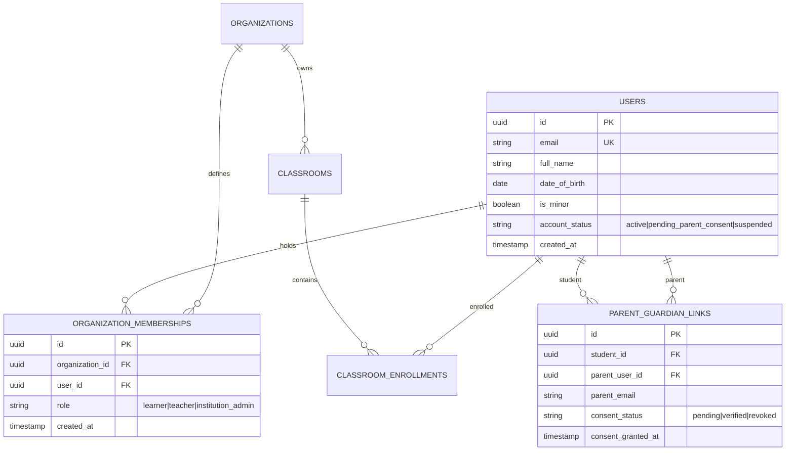
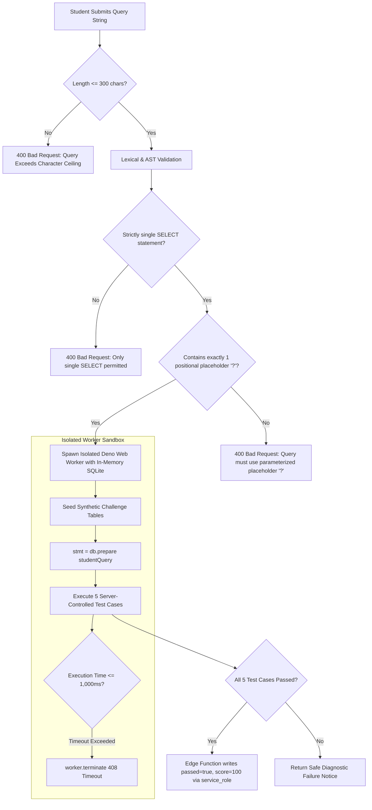

# Phase 0.3: Security Blocker Corrections & Technical Contract Audit

*Date:* 2026-10-17  
*Report Reference:* `REPORTS/2026-10-17_PHASE_0_3_SECURITY_CORRECTIONS.md`  
*Phase:* 0.3 Security & Authorization Blocker Resolution  
*Author:* Lead Engineering Planning Agent  
*Status:* Completed & Validated  

---

## 1. Executive Summary

This report resolves the critical security design flaws, authorization vulnerabilities, and technical mismatches identified in Phase 0.2:
1. **Privilege Escalation & RLS Infinite Recursion Elimination:** Replaced the single-column `role` and `organization_id` on `users` with a decoupled `organization_memberships` table; eliminated RLS recursion via `SECURITY DEFINER` non-recursive helper functions; enforced column-level `GRANT` restrictions preventing users from altering account status, DOB, or identity.
2. **Exhaustive Table-by-Table Authorization Matrix:** Specified explicit policies covering `SELECT`, `INSERT`, `UPDATE`, and `DELETE` for all 10 core tables plus `audit_events` and server RPCs, establishing concrete negative test cases.
3. **Internally Consistent SQL Grader Contract:** Defined the exact student exercise interface, parameterized query template format, server-side parameter binding verification via SQLite's native prepare API, AST pre-execution validation, and worker termination timeouts.
4. **Honest Logging & Cost Classification:** Explicitly distinguished application business audit events from infrastructure/auth logs; acknowledged that in-DB logging does not capture raw gateway packets; and clearly labeled cost estimates.

---

## 2. Itemized Correction Matrix

| Issue ID | Area | Original Flawed Design | Corrected Validated Design | Rationale & Supporting Evidence | Test Required | Status |
|---|---|---|---|---|---|---|
| **SEC-01** | **IAM / Privilege Escalation** | `users` table contained `role` and `organization_id`. `users_update_policy` allowed users to update their own row without column restrictions. | Separated identity (`users`) from scoped roles (`organization_memberships`). Column-level permissions restrict updates on `users` to `full_name`. User profile created via auth trigger, ignoring client role payloads. | PostgreSQL allows full-row updates if column-level `GRANT` is not enforced. Decoupling roles prevents users from self-promoting to admin or changing tenant ID. | Automated test: Attacker submits `UPDATE users SET role = 'platform_superadmin'` -> Fails with `403 Permission Denied`. | **Specification Corrected; Requires Local Migration Test** |
| **SEC-02** | **PostgreSQL RLS Recursion** | RLS policies on `users` queried `(SELECT role FROM users WHERE id = auth.uid())`. | Replaced subqueries with `SECURITY DEFINER` helper functions (`has_org_role`, `is_platform_superadmin`) with `SET search_path = public`. | In PostgreSQL, querying table $T$ from inside an active policy on table $T$ triggers infinite recursion errors. | Automated test: Query `users` as regular user -> Executes cleanly without infinite recursion error. | **Specification Corrected; Requires Local Migration Test** |
| **SEC-03** | **RLS Policy Coverage** | Only 3 example `SELECT` policies were shown; missing policies for 7 tables. | Created complete table-by-table authorization matrix covering all 10 core tables + audit logs across `SELECT`, `INSERT`, `UPDATE`, `DELETE`. | Prevents default-allow data leakage and enforces least-privilege security boundaries. | Cross-tenant negative test suite covering all 10 tables in CI. | **Specification Corrected; Requires Local Migration Test** |
| **SEC-04** | **SQL Lab Pedagogical Mismatch** | Student submitted raw SQL; grader claimed injection string was treated as parameter without defining parameter binding. | Student submits parameterized query template with positional placeholders (`?`). Grader compiles query via `db.prepare()` and tests safe binding vs injection. | Raw SQL concatenation cannot be parameterized after the fact. Grader must test native binding against AST parameter counts. | Negative tests: Raw string concatenation fails; parameterized query passes. | **Specification Corrected; Requires Local Deno Test** |
| **SEC-05** | **SQLite Execution Timeout Reality** | Claimed Deno SQLite automatically supports 1.0s timeout and authorizer hooks. | WebAssembly SQLite wrappers in Deno do not expose `sqlite3_set_authorizer` or progress handlers. Execution isolated in dedicated Web Worker with `worker.terminate()` watchdog; pre-execution AST tokenizer blocks DDL/DML/PRAGMA. | Primary source verification: `deno.land/x/sqlite` runs synchronously in WASM without progress hooks. Pre-AST filtering + Worker termination is the only reliable watchdog. | Timeout test: `WITH RECURSIVE` or heavy join killed by worker timeout in <=1,000ms. | **Specification Corrected; Requires Local Worker Test** |
| **SEC-06** | **Logging & CERT-In Gap** | Claimed in-DB `audit_events` satisfies all CERT-In logging obligations. | Explicitly distinguished application audit events from infrastructure/auth logs. Labeled Option A as an Application Event Log; documented Option B ($60/mo Log Drain) for full raw gateway streaming. | Primary source verification: Supabase retains gateway logs for 7 days. In-DB logs do not capture low-level TCP/IP or webserver panics. | Backup & restore verification; export verification to domestic storage. | **Corrected Position Documented** |

---

## 3. Corrected Identity, Membership & Authorization Architecture

### 3.1. Separation of Identity from Scoped Memberships
A single user identity can participate across multiple contexts without privilege overlap:
- **Independent Learner:** Exists in `users` with an active account; has **zero** rows in `organization_memberships`.
- **Institutional Student:** Linked to School A via an `organization_memberships` row (`role = 'learner'`).
- **Institutional Teacher:** Linked to College B via an `organization_memberships` row (`role = 'teacher'`).
- **Parent/Guardian:** Linked to multiple minor learners via `parent_guardian_links`; has read-only student oversight.



### 3.2. Elimination of Recursive RLS: Non-Recursive Security Definer Helpers
To prevent infinite policy loops, authorization lookups query isolated tables via trusted, cached `SECURITY DEFINER` functions:

```sql
-- 1. Check if the authenticated user has a specific role in an organization
CREATE OR REPLACE FUNCTION public.has_org_role(org_id UUID, required_role VARCHAR)
RETURNS BOOLEAN
LANGUAGE sql
STABLE
SECURITY DEFINER
SET search_path = public
AS $$
    SELECT EXISTS (
        SELECT 1 FROM organization_memberships
        WHERE organization_id = org_id
        AND user_id = auth.uid()
        AND role = required_role
    );
$$;

-- 2. Check if the authenticated user is the designated teacher of a classroom
CREATE OR REPLACE FUNCTION public.is_classroom_teacher(class_id UUID)
RETURNS BOOLEAN
LANGUAGE sql
STABLE
SECURITY DEFINER
SET search_path = public
AS $$
    SELECT EXISTS (
        SELECT 1 FROM classrooms
        WHERE id = class_id
        AND teacher_id = auth.uid()
    );
$$;

-- 3. Check if the authenticated user is a student enrolled in a classroom
CREATE OR REPLACE FUNCTION public.is_enrolled_student(class_id UUID)
RETURNS BOOLEAN
LANGUAGE sql
STABLE
SECURITY DEFINER
SET search_path = public
AS $$
    SELECT EXISTS (
        SELECT 1 FROM classroom_enrollments
        WHERE classroom_id = class_id
        AND student_id = auth.uid()
    );
$$;

-- 4. Check if the authenticated user is a verified parent of a student
CREATE OR REPLACE FUNCTION public.is_verified_parent(target_student_id UUID)
RETURNS BOOLEAN
LANGUAGE sql
STABLE
SECURITY DEFINER
SET search_path = public
AS $$
    SELECT EXISTS (
        SELECT 1 FROM parent_guardian_links
        WHERE student_id = target_student_id
        AND parent_user_id = auth.uid()
        AND consent_status = 'verified'
    );
$$;
```

### 3.3. Column-Level Privilege Hardening & Self-Promotion Prevention
1. **Signup Protection via Auth Trigger:** The client cannot submit role parameters. The user profile is created exclusively via a database trigger listening to `auth.users`:
   ```sql
   CREATE OR REPLACE FUNCTION public.handle_new_user()
   RETURNS TRIGGER
   LANGUAGE plpgsql
   SECURITY DEFINER
   SET search_path = public
   AS $$
   DECLARE
       dob DATE;
       calculated_is_minor BOOLEAN;
       initial_status VARCHAR(50);
   BEGIN
       dob := (NEW.raw_user_meta_data->>'date_of_birth')::DATE;
       calculated_is_minor := (dob > (CURRENT_DATE - INTERVAL '18 years'));
       initial_status := CASE WHEN calculated_is_minor THEN 'pending_parent_consent' ELSE 'active' END;

       INSERT INTO public.users (id, email, full_name, date_of_birth, is_minor, account_status)
       VALUES (NEW.id, NEW.email, NEW.raw_user_meta_data->>'full_name', dob, calculated_is_minor, initial_status);

       RETURN NEW;
   END;
   $$;
   ```
2. **Column-Level Grant Enforcement:**
   ```sql
   -- Regular authenticated users can only update their display name
   REVOKE UPDATE ON public.users FROM authenticated;
   GRANT UPDATE (full_name) ON public.users TO authenticated;
   -- date_of_birth, is_minor, account_status cannot be altered by users
   ```

---

## 4. Complete Table-by-Table Authorization Matrix

Below is the definitive authorization matrix covering all 10 core tables plus `audit_events`:

| Table Name | `SELECT` Policy & Access Rules | `INSERT` Policy & Access Rules | `UPDATE` Policy & Access Rules | `DELETE` Policy & Access Rules |
|---|---|---|---|---|
| **1. `organizations`** | Public read for published orgs (`is_active = true`); full read for org members. | **Server-only / Superadmin** via trusted provisioning RPC. | `institution_admin` of that organization only. | **Superadmin only**. |
| **2. `users` (profiles)** | Self (`auth.uid() = id`), or teachers/institution admins viewing students enrolled in their classrooms. | **Trigger-only** via `auth.users` webhook. Direct client insert denied. | Self can update `full_name` only. Protected columns denied. | **Superadmin only**. |
| **3. `organization_memberships`** | Self, or `institution_admin` / `teacher` within the same organization. | **Server-only** via trusted join-code RPC (`enroll_in_classroom`) or admin invite. Client direct insert denied. | `institution_admin` of that organization only. | `institution_admin` can remove members; self can leave. |
| **4. `parent_guardian_links`** | Student self, or linked parent (`auth.uid() = parent_user_id`). | Student self initiating verification, or parent claiming verification token. | Parent can revoke consent (`UPDATE consent_status = 'revoked'`). Student cannot un-revoke. | **Superadmin only**. |
| **5. `classrooms`** | Enrolled students (`is_enrolled_student(id)`), assigned teacher (`teacher_id = auth.uid()`), or org `institution_admin`. | Teachers with active `organization_memberships` in that organization. | Classroom `teacher_id` or org `institution_admin`. | Classroom `teacher_id` or org `institution_admin`. |
| **6. `classroom_enrollments`** | Enrolled student self, classroom teacher, or org `institution_admin`. | **Server-only** via `enroll_in_classroom(join_code)` RPC. Client direct insert denied. | **Denied** (Enrollments are immutable). | Student can unenroll self; teacher can remove student. |
| **7. `courses`** | Public read for `is_published = true`. Unpublished courses restricted to curriculum authors. | **Curriculum Author / Superadmin only**. | Curriculum Author / Superadmin only. | Superadmin only. |
| **8. `labs`** | Read permitted if parent course is published, or assigned in an active classroom. | **Curriculum Author / Superadmin only**. | Curriculum Author / Superadmin only. | Superadmin only. |
| **9. `assignments`** | Enrolled students in the classroom, classroom teacher, or org `institution_admin`. | Classroom `teacher_id` or org `institution_admin`. | Classroom `teacher_id` or org `institution_admin`. | Classroom `teacher_id` or org `institution_admin`. |
| **10. `submissions`** | Student self, classroom teacher (`is_classroom_teacher(assignment.classroom_id)`), or linked verified parent. | Student self can insert draft (`passed = false`, `score = 0`). Privileged grade writes **denied to client**. | **Client Denied**. Only trusted Edge Function (via `service_role`) can update score/passed. | **Denied for all** (Immutable grade record). |
| **11. `audit_events`** | Org `institution_admin` (scoped to their org) or Superadmin. Students/teachers denied. | **Server-only** via database triggers or logging middleware. Client insert denied. | **Denied for all** (Strictly append-only). | **Denied for all** (Strictly append-only). |

---

## 5. Internally Consistent SQL Lab Specification & Grader Architecture

### 5.1. The Exact Student Exercise & Submission Contract
- **Lab Identifier:** `lab-sec-101` (*SQL Injection Defense & Parameterized Queries*).
- **Learning Objective:** Understand why string concatenation causes SQL injection and how native parameterized queries (`?`) treat input strictly as data literals.
- **Vulnerable Code Displayed in Lesson:**
  ```python
  # Insecure backend code shown in lesson:
  query = f"SELECT id, username, role FROM challenge_users WHERE username = '{user_input}' AND account_status = 'active'"
  cursor.execute(query) # Vulnerable: input "' OR '1'='1" dumps all accounts!
  ```
- **Student Prompt:**
  *"Rewrite the user authentication query template using a positional parameter placeholder (`?`) for the username. Select `id`, `username`, and `role` from `challenge_users` where `username = ?` and `account_status = 'active'`."*
- **Exact Submission Format:**
  The student submits a clean SQL query template string:
  ```sql
  SELECT id, username, role FROM challenge_users WHERE username = ? AND account_status = 'active'
  ```

### 5.2. Server-Side Execution & Anti-Tamper Grader Pipeline
When the student submits their solution, the Edge Function (`grade-sql-lab`, pinned to `ap-south-1`) processes it through four isolated stages:



### 5.3. Synthetic Challenge Schema & Server-Controlled Assertions
The in-memory SQLite database is seeded with isolated synthetic test rows:
```sql
CREATE TABLE challenge_users (
    id INTEGER PRIMARY KEY,
    username TEXT NOT NULL UNIQUE,
    role TEXT NOT NULL,
    account_status TEXT NOT NULL
);
INSERT INTO challenge_users VALUES
(1, 'alice', 'learner', 'active'),
(2, 'bob', 'teacher', 'active'),
(3, 'charlie', 'learner', 'suspended');
```

The server prepares the statement (`const stmt = db.prepare(studentQuery)`) and executes five automated test cases:
1. **Test Case 1 (Legitimate Active User):** Execute `stmt.all('alice')`.
   - **Pass Condition:** Exactly 1 row returned: `[{ id: 1, username: 'alice', role: 'learner' }]`.
2. **Test Case 2 (Classic SQL Injection Attempt):** Execute `stmt.all("' OR '1'='1")`.
   - **Pass Condition:** Exactly 0 rows returned. (Because `?` parameterization binds the quote and `OR` as literal characters in the string, SQLite searches for a user whose exact literal username is `"' OR '1'='1"`. It returns 0 rows, defeating the attack).
3. **Test Case 3 (Stacked Query & Drop Attempt):** Execute `stmt.all("alice'; DROP TABLE challenge_users; --")`.
   - **Pass Condition:** Exactly 0 rows returned; `challenge_users` remains intact.
4. **Test Case 4 (Suspended User Status Enforcement):** Execute `stmt.all('charlie')`.
   - **Pass Condition:** Exactly 0 rows returned (asserts `account_status = 'active'` filter is enforced).
5. **Test Case 5 (Apostrophe & Special Character Safety):** Execute `stmt.all("O'Reilly")`.
   - **Pass Condition:** Clean execution without syntax error; 0 rows returned.

---

## 6. Logging Architecture & Verified Cost Disclosures

### 6.1. Technical Differentiation of Log Tiers

| Log Category | Source | Captured Attributes | Native Supabase Retention | 180-Day Archival Strategy |
|---|---|---|---|---|
| **1. Application Audit Logs** | Application Database Triggers | User ID, Action (`ASSIGNMENT_SUBMITTED`, `JOIN_CLASSROOM`), IP address, user-agent, timestamp, previous/new state. | Contained in PostgreSQL database. | Retained directly in `audit_events` table in AWS Mumbai (`ap-south-1`) for 180 days. Protected by append-only RLS rules. |
| **2. Authentication Logs** | Supabase Auth Service (GoTrue) | Login attempts, password reset requests, JWT issue events, token refreshes, failed auth attempts. | **7 days** in Supabase Pro dashboard. | Stored in Supabase dashboard. Can be forwarded to external S3 via Log Drain if add-on is enabled. |
| **3. API Gateway & HTTP Logs** | Kong Gateway / Edge Proxy | Raw HTTP request method, URI path, IP address, TLS cipher, response status code, latency. | **7 days** in Supabase Pro dashboard. | Handled by Cloudflare edge logging (3 days) or Supabase Log Drain to S3. |
| **4. Database System Logs** | PostgreSQL Engine | Database startup/shutdown, WAL checkpoints, memory allocation errors, slow query logs (>1s). | **7 days** in Supabase Pro dashboard. | Exportable via Supabase CLI backup scripts. |

### 6.2. Honest Logging Cost Disclosure
- **Option A (Baseline Pilot - Application Audit Logs):** Captures Category 1 directly in PostgreSQL. **Cost: $0.00 extra** (covered by $25/mo Pro subscription).  
  *Limitation:* Does **not** retain raw gateway HTTP packet logs or infrastructure hypervisor events past 7 days.
- **Option B (Full Infrastructure Log Drain Add-on):** Captures Categories 1, 2, 3, and 4 to an external AWS S3 Mumbai bucket. **Cost: $60.00/mo base + ~$1.50 S3/egress fees = ~$61.50/mo extra.**
- **Cost Disclaimer:** All cost projections are **engineering estimates** based on published vendor pricing in October 2026, assuming 250 enrolled users, zero unmetered compute surge, and 18% Indian GST. Real billable invoices must be validated during local development.

---

## 7. The Bounded First Implementation Milestone (Milestone 1)

**Milestone 1 is strictly restricted to a local vertical slice.** No cloud deployment, no frontend UI build, and no external PaaS provisioning.

### Milestone 1 Work Breakdown (Local Development Only)
1. **Local Repository & Environment Setup:**
   - Initialize Git repository with strict `biome` linting and formatting.
   - Configure local Supabase development environment via Supabase CLI and Docker.
2. **PostgreSQL 16 Schema Migrations:**
   - Apply version-controlled migration files creating the 10 core tables plus `audit_events`.
   - Apply column-level `GRANT` rules on `users` (`UPDATE` restricted to `full_name`).
   - Implement `auth.users` new user creation trigger.
3. **Complete RLS Policy Deployment:**
   - Apply non-recursive `SECURITY DEFINER` authorization helpers (`has_org_role`, `is_classroom_teacher`, `is_enrolled_student`, `is_verified_parent`).
   - Deploy RLS policies across all tables for `SELECT`, `INSERT`, `UPDATE`, and `DELETE`.
4. **Automated Cross-Tenant Security Test Suite (Vitest):**
   - *Test 1 (Self-Promotion Prevention):* User attempting to update `role` or `organization_id` receives `403 Permission Denied`.
   - *Test 2 (Cross-Tenant Read Isolation):* Student in Org 1 querying classrooms or submissions in Org 2 receives empty set (`0 rows`).
   - *Test 3 (Cross-Tenant Write Isolation):* Teacher in Org 1 attempting to assign a lab to a classroom in Org 2 receives RLS violation.
   - *Test 4 (Grade Tampering Denial):* Student attempting direct SQL update `submissions.score = 100` receives policy violation.
   - *Test 5 (Audit Log Immutability):* Any user attempting `UPDATE` or `DELETE` on `audit_events` receives RLS denial.
5. **Standalone SQL Grader Test Suite (Deno):**
   - Unit tests verifying query length bounds (>300 chars rejected).
   - AST tests verifying single `SELECT` enforcement and multi-statement rejection.
   - Test execution verifying all 5 challenge assertions (alice passes, `' OR '1'='1` fails, special characters execute cleanly).
   - Watchdog tests verifying execution abort within 1.0 second.
