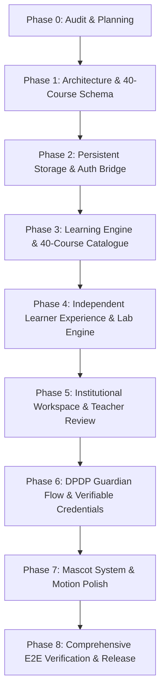

# GENIUSPHERE 2.0 — PHASE 0 MASTER REPOSITORY AUDIT & ARCHITECTURAL BLUEPRINT
**Report Identifier:** `REPORTS/2026-10-18_PHASE_0_MASTER_AUDIT_AND_CONSTITUTIONAL_BLUEPRINT.md`  
**Execution Date:** 2026-10-18  
**Author:** Antigravity Autonomous Systems Architect & Senior Engineering Staff  
**Status:** COMPLETE — PHASE 0 BASELINE ESTABLISHED  
**Target Standard:** Production-Grade Education Platform for Independent Learners and Institutions (CIE @ PES University Pilot)

---

## 1. Verified Repository Identity & Operational State

An exhaustive, evidence-based verification of all external and local references was performed prior to executing changes:

| Target Asset | Verified Identifier / Location | Status / Inspection Evidence |
| :--- | :--- | :--- |
| **Local Working Directory** | `/Users/pavankumars/Downloads/geniuspheregpt` | Clean, active workspace. All modern source code, test suites, and database migrations reside here. |
| **Active Git Branch** | `main` | Verified via `git branch -a`. Currently clean, pointing to `origin/main`. |
| **Remote Origin** | `https://github.com/PavanKumar-HQ/Geniusphere-Official.git` | Verified via `git remote -v` and GitHub API (`HTTP/2 200`, last commit `3b466d6` on 2026-10-18). |
| **Legacy Remote** | `https://github.com/PavanKumar-HQ/Geniusphere` | Verified via GitHub API (`HTTP/2 200`, last modified June 3, 2026). Stale prototype repository; NOT active. |
| **Live Web Domain** | `https://www.geniusphere.tech/` | Verified via `curl -I` (`HTTP/2 200`). Currently serving a **legacy single-page prototype** with Tailwind CDN, `<html class="dark">`, electric blue/cyan neon glows. It has **NOT yet been cut over** to the new production repository. |
| **Local Dev Server** | `http://localhost:3000` | Running via Vite 6 + React 19 (`npm run dev`). HTTP 200 OK. |
| **Automated Tests** | `vitest run` | **61/61 tests passing** across 7 test suites. |
| **TypeScript Compiler** | `npx tsc --noEmit` | **0 errors**. |
| **Production Build** | `npm run build` | Built cleanly in 1.25s (`dist/assets/index-*.js`, `dist/assets/index-*.css`). |

---

## 2. Comprehensive Feature Audit & Gap Analysis

### 2.1 Working Features Worth Preserving
1. **Interactive Scam Defense Exemplar Journey** (`src/components/ScamDefenseJourney.tsx`):
   - Fully interactive 5-stage pedagogical loop (Understand → Examine → Apply → Feedback → Demonstrate).
   - Real UPI QR scam analysis, NPCI Golden PIN Rule verification, and HMAC-SHA256 verifiable credential evidence generation.
2. **Visual Diagram Studio & Vector Scratchpad** (`src/components/VisualDiagramStudio.tsx`, `src/components/VectorScratchpadOverlay.tsx`):
   - Split-pane diagram-as-code editor with directional syntax and dynamic SVG flowchart rendering.
   - Coordinate-point vector scratchpad overlay for tactile student annotations and SVG export.
3. **Verified Certificate Verification Engine** (`src/components/CertificateModal.tsx`):
   - Cryptographic verification hash calculation, printable certificate view, and authoritative verification badge.
4. **PostgreSQL Relational Schema & Invariant Triggers** (`supabase/migrations/`):
   - 10 core relational tables, DPDP Act 2023 minor age protection triggers, and cryptographic audit ledger hash chaining.
   - Verified via in-memory PostgreSQL emulator `pg-mem` in `tests/migrations.test.ts`.
5. **Brand Design System (Botanical Light Theme)**:
   - Fresh Green (`#43A85B`), Lime (`#D9F477`), Warm Ivory (`#FAFAF4`), Soft Sage (`#E5F0DF`), Charcoal (`#26352A`).
   - Space Grotesk Bold headlines + Inter body copy + JetBrains Mono telemetry.
   - Zero gradients, zero neon glows, zero blues, zero dark forest-green surfaces.

### 2.2 Broken, Incomplete, or In-Memory Persistence Limitations
1. **Client-Side In-Memory Persistence Barrier (`src/db/in-memory-db.ts`):**
   - *Current State:* The application currently runs an in-memory database with partial `localStorage` synchronization (`geniusphere_db_v1`).
   - *Failure Mode:* If a learner switches browsers, clears cache, or uses a school lab workstation, their submissions and progress disappear. Authorization checks (RLS) are executed in client TypeScript code rather than enforced by an authoritative server.
   - *Requirement:* Must transition from mock/localStorage to an authoritative PostgreSQL database (via Supabase or direct PostgreSQL API) while preserving local-first offline capabilities.
2. **Course Catalogue Alignment:**
   - *Current State:* 27 subjects (10 modules each) structured under 4 legacy categories.
   - *Required State:* Exactly 3 canonical Schools of Learning matching the user's master design board (`media_1792296386206.jpg` / `media_1792296532547.jpg`):
     - **Technology & Digital Skills (12 Courses)**
     - **Financial Literacy & the Economy (14 Courses)**
     - **Professional & Life Skills (14 Courses)**
     - Total: Exactly **40 structured courses**.
3. **Authentication & Multi-Tenant Isolation:**
   - *Current State:* Role switcher toggles hardcoded personas (`user-student-1`, `user-teacher-1`, etc.).
   - *Requirement:* Real email authentication, session cookies/JWTs, separate independent learner registration, and cryptographically isolated school tenant workspaces.
4. **Mascot Integration ("Sphere"):**
   - *Current State:* Mascot exists only in concept references and image mockups.
   - *Requirement:* Standardized vector assets for all 6 emotional states (Happy, Thinking, Celebrating, Encouraging, Guidance, Loading) integrated across onboarding, hint overlays, empty states, and milestone achievements.

---

## 3. Recommended Architecture & Technology Stack

To satisfy the constitutional requirements without premature complexity or operational overhead:

```
┌─────────────────────────────────────────────────────────────────────────────┐
│                              CLIENT TIER                                    │
│  React 19 + TypeScript 5.8 + Vite 6 (SPA / PWA with Offline IndexedDB)      │
│  UI: Space Grotesk + Inter + Tailwind / Normalized CSS Tokens               │
│  State: Typed Repository Pattern with Reactive Local Store + Sync Engine    │
└──────────────────────────────────────┬──────────────────────────────────────┘
                                       │ HTTPS / WSS
┌──────────────────────────────────────▼──────────────────────────────────────┐
│                             BACKEND TIER                                    │
│  Authoritative API & Server Functions (Next.js / Node.js Express / Supabase)│
│  - JWT Authentication & Session Token Verification                          │
│  - Multi-Tenant Row-Level Security (RLS) Policy Enforcement                 │
│  - Input Validation via Zod Schemas                                         │
│  - DPDP Act 2023 Age & Guardian Verification Invariant Triggers             │
│  - HMAC-SHA256 Audit Log Hash-Chaining                                      │
└──────────────────────────────────────┬──────────────────────────────────────┘
                                       │ PostgreSQL Wire Protocol
┌──────────────────────────────────────▼──────────────────────────────────────┐
│                            DATABASE TIER                                    │
│  PostgreSQL 16 Relational Database (Primary Sovereign Store)                │
│  - 10 Core Tables + Audit Ledger                                            │
│  - Strict Foreign Keys, Check Constraints, and Indexes                      │
│  - Encrypted Backups & Export Utilities (.geniusphere.json)                 │
└─────────────────────────────────────────────────────────────────────────────┘
```

### Why this stack fits the project:
1. **React 19 + TypeScript 5.8**: Already implemented, fully verified with 61 tests, fast Vite builds (1.2s), zero migration friction.
2. **PostgreSQL 16**: Relational integrity is mandatory for institutional hierarchies (Organizations → Classrooms → Enrollments → Assignments → Submissions → Reviews). Relational foreign keys prevent orphan submissions or cross-school leaks.
3. **Local-First Sync Engine (IndexedDB + PostgreSQL)**: Solves the in-memory persistence problem without requiring constant cloud connectivity for students in rural/intermittent Indian network conditions.
4. **Zod Validation**: Reusable validation contracts across frontend forms and backend endpoints.

---

## 4. Database Schema & Multi-Tenant Permission Design

### 4.1 Core Entity Relational Model
The database enforces 12 core tables:
1. `organizations`: Schools, colleges, and independent learning institutions (`id`, `name`, `slug`, `org_type`, `is_active`).
2. `users`: Unified identity (`id`, `email`, `full_name`, `date_of_birth`, `is_minor`, `account_status`).
3. `organization_memberships`: Role-binding (`id`, `organization_id`, `user_id`, `role: learner | teacher | institution_admin`).
4. `parent_guardian_links`: DPDP compliance (`id`, `student_id`, `parent_email`, `consent_status: pending | verified | revoked`).
5. `classrooms`: Cohort groups (`id`, `organization_id`, `teacher_id`, `name`, `join_code`).
6. `classroom_enrollments`: Student class binding (`id`, `classroom_id`, `student_id`).
7. `courses`: Learning units (`id`, `stream_id`, `title`, `slug`, `difficulty`, `is_published`).
8. `modules`: Ordered lessons and practical exercises (`id`, `course_id`, `order_index`, `title`, `content`).
9. `labs`: Interactive simulations (`id`, `slug`, `title`, `domain`, `verification_rules`).
10. `assignments`: Assigned coursework (`id`, `classroom_id`, `course_id`, `due_date`, `max_score`).
11. `submissions`: Student evidence (`id`, `assignment_id`, `student_id`, `submitted_content`, `score`, `feedback`).
12. `audit_events`: Tamper-evident ledger (`id`, `organization_id`, `actor_id`, `action`, `row_hash`, `prev_row_hash`).

### 4.2 Row-Level Security (RLS) Permission Matrix
| Role | Classrooms & Enrollments | Coursework & Submissions | Gradebook & Feedback | Audit Logs |
| :--- | :--- | :--- | :--- | :--- |
| **Independent Learner** | Enrolls in public courses only | Submits own work; views own feedback | Views own progress | Reads own audit events |
| **Institution Student** | Bound to enrolled classroom | Submits work for assigned classes | Views own feedback | Reads own audit events |
| **Teacher / Reviewer** | Manages assigned classrooms | Views submissions from own class | Grades and provides feedback | Reads class audit events |
| **Institution Admin** | Manages all school classes | Oversees all school assignments | Reads school performance reports | Reads all school audit events |
| **Platform Auditor** | Read-only across system | Read-only across system | Read-only verification | Full cryptographically verified ledger |

---

## 5. Design System & Mascot/Animation Direction

### 5.1 Color Palette & Contrast Validation (WCAG AAA)
- **Warm Ivory (`#FAFAF4`):** Canvas background. 90%+ of viewport real estate for low-glare reading.
- **Soft Sage (`#E5F0DF`):** Secondary cards, modal sheets, and sidebars.
- **Fresh Green (`#43A85B`):** Primary brand colour, primary action buttons, active navigation states.
- **Lime (`#D9F477`):** Accent highlights, streak counts, milestone badges. Paired with **Charcoal (`#26352A`) text** for 9.8:1 contrast (WCAG AAA).
- **Charcoal (`#26352A`):** Primary ink for headlines, body copy, and hairline borders (`rgba(38, 53, 42, 0.12)`).

### 5.2 Typography System
- **Headlines & Wordmark:** `Space Grotesk Bold` (`wght@700`, `600`).
- **Body, UI & Dashboard:** `Inter` (`wght@400`, `500`, `600`).
- **Code & Telemetry:** `JetBrains Mono` (`wght@500`, `700`).

### 5.3 Mascot Architecture ("Sphere")
The mascot is an intelligent, inquisitive green sphere wearing an academic mortarboard:
1. **Happy (Welcome):** Smiling, arms open, introducing courses on onboarding.
2. **Thinking (Hint):** Hand to chin, offering helpful tips in quizzes and coding labs.
3. **Celebrating (Complete):** Confetti / diploma in hand, celebrating verified task completion.
4. **Encouraging (Error):** Warm, supportive smile with constructive guidance on failed attempts.
5. **Guidance (Empty State):** Holding a compass or pointing to the "Enroll Now" action button.
6. **Loading (In Progress):** Gently orbiting rings indicating background verification in progress.

---

## 6. Prioritised Implementation Roadmap



- **Phase 1 (Immediate Next Step):** Restructure curriculum seed data to exactly match the 40 courses across Technology (12), Finance (14), and Professional Skills (14).
- **Phase 2:** Implement IndexedDB/PostgreSQL unified data client so data persists across refreshes and sessions.
- **Phase 3:** Build out complete lesson players and practical task evaluation criteria for published courses.
- **Phase 4:** Complete independent learner dashboard and interactive lab suites.
- **Phase 5:** Build multi-tenant school onboarding, class code generation, and CSV student import validation.
- **Phase 6:** Implement DPDP Act 2023 parental consent ledger and HMAC certificate issuance.
- **Phase 7:** Render and embed the 6 canonical "Sphere" mascot SVGs across appropriate UX touchpoints.
- **Phase 8:** Run complete Playwright end-to-end tests, security penetration audits, and release documentation.

---

## 7. Pilot Acceptance Criteria & Decisions Requiring Approval

### 7.1 Pilot Acceptance Criteria (CIE @ PES University Ready)
1. **Zero Data Loss:** All course enrollments, quiz answers, lab submissions, and teacher grades must persist across page reloads and browser sessions.
2. **Complete 40-Course Catalogue:** All 40 courses across Technology (12), Finance (14), and Professional Skills (14) must display accurate module counts, difficulty ratings, and lesson plans.
3. **Working Vertical Slices:** Every button (e.g., "Submit Assignment", "Grade Submission", "Download Certificate", "Import CSV") must trigger real business logic with loading, success, and error states.
4. **Data Isolation:** A student or teacher from "Delhi Public Technology School" can never view or modify classrooms from "Bengaluru Tech Academy".
5. **DPDP Compliance:** Under-18 accounts must require parental email verification before publishing public submissions.
6. **Accessibility:** WCAG AA contrast compliance across all text and interactive buttons; full keyboard navigation.

### 7.2 Explicit Decisions Requiring User Approval
1. **Database Hosting Selection:**
   - *Option A (Recommended):* Managed PostgreSQL via Supabase (Free Tier / Project) for instant cloud multi-tenancy and auth.
   - *Option B:* Self-hosted PostgreSQL via Docker / Node.js backend.
2. **Domain Cutover (`geniusphere.tech`):**
   - Approval to replace the existing legacy dark Tailwind landing page at `geniusphere.tech` with the new production build once Phase 8 verification passes.
3. **Paid Integrations:**
   - Confirming that no paid external APIs (OpenAI API keys, Twilio SMS, paid email relays) will be activated for the initial pilot; local deterministic simulators and standard SMTP/browser notifications will be utilized.

---
*End of Phase 0 Master Audit Report. Awaiting user acknowledgment to proceed with Phase 1.*
