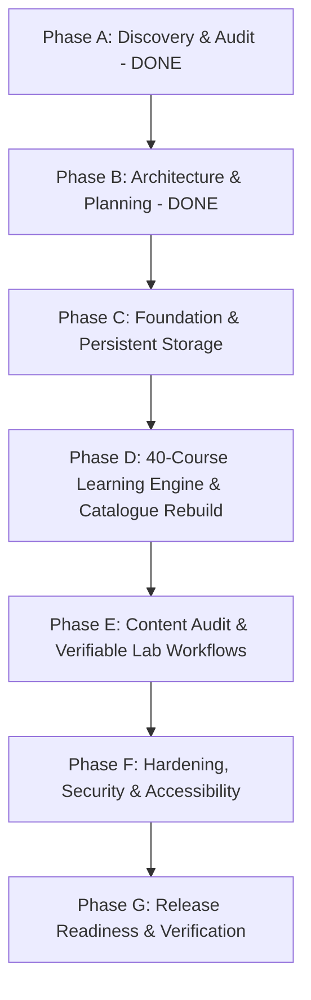

# GENIUSPHERE — MASTER IMPLEMENTATION PLAN
**File Path:** `REPORTS/IMPLEMENTATION_PLAN.md`  
**Execution Date:** 2026-10-18  
**Author:** Principal Software Architect & Lead Full-Stack Engineer  
**Standard:** Phase-Gated Incremental Delivery (Phases A through G)

---

## 1. Overview & Strategy

This implementation plan transitions Geniusphere from an educational prototype with in-memory persistence into a production-grade, durable learning ecosystem for independent learners and educational institutions. Every phase delivers tested vertical slices with verifiable evidence.

---

## 2. Phase-by-Phase Execution Roadmap

### Phase A: Discovery & Audit (Status: COMPLETED)
- **Scope:** Inspect working directory, remotes, package manifests, and live website.
- **Deliverables:**
  - `REPORTS/INITIAL_AUDIT.md` (Verified state, Git tracking, dependencies).
  - `REPORTS/ISSUE_REGISTER.md` (7 prioritized technical issues).

### Phase B: Architecture & Planning (Status: COMPLETED)
- **Scope:** Document core architectural decisions, data models, and acceptance criteria.
- **Deliverables:**
  - `REPORTS/ARCHITECTURE_DECISIONS.md` (ADR-001 through ADR-006).
  - `REPORTS/IMPLEMENTATION_PLAN.md` (This document).
  - `REPORTS/ACCEPTANCE_CRITERIA.md` (End-to-end acceptance criteria for all user journeys).

---

### Phase C: Foundation & Persistent Storage Engine (Status: IN PROGRESS)
- **Objective:** Eliminate ISSUE-001 (data loss risk) and ISSUE-007 (motion accessibility).
- **Tasks:**
  1. **Persistent Browser Storage Engine:** Implement structured IndexedDB persistence (`geniusphere_idb`) in `src/db/in-memory-db.ts` to automatically store and hydrate courses, enrollments, student submissions, grades, and certificates.
  2. **Mascot Vector Component:** Create `src/components/MascotSphere.tsx` supporting the 6 canonical expressions (Happy, Thinking, Celebrating, Encouraging, Guidance, Loading) matching the master design boards.
  3. **Accessibility Motion Guard:** Add `@media (prefers-reduced-motion: reduce)` in `src/index.css`.
- **Verification:** Create an assignment submission, close/reopen browser tab, verify submission is preserved.

---

### Phase D: Product Implementation — 40-Course Catalogue & Learning Engine (Status: NEXT)
- **Objective:** Resolve ISSUE-002 and align the catalogue view to `media_1792296532547.jpg`.
- **Tasks:**
  1. **40-Course Seed Alignment:** Re-seed `src/data/curriculum.ts` to include all 40 courses across:
     - Technology & Digital Skills (12 courses)
     - Financial Literacy & the Economy (14 courses)
     - Professional & Life Skills (14 courses)
  2. **Course Catalogue Rebuild:** Update `src/components/CourseCatalogue.tsx` to match the 3-stream card layout from the Master Design Board, with stream summaries, course counts, difficulty tags, and mascot encouragement.
  3. **Learning Player Completion Guards:** Enforce that course completion certificates are issued only when 100% of modules are complete.
- **Verification:** Unit tests verifying all 40 courses load with valid modules and prerequisites.

---

### Phase E: Content Audit & Verifiable Lab Workflows
- **Objective:** Ensure every lab, lesson, and quiz has substantive, accurate educational content.
- **Tasks:**
  1. Audit lesson content across all 40 courses to ensure clear learning objectives and zero empty placeholder text.
  2. Verify all 13 interactive labs in `src/data/approved-labs.ts` execute deterministically with clear evaluation rubrics.
  3. Ensure Teacher Gradebook allows recording real grades and qualitative feedback that persists back to the student's dashboard.
- **Verification:** Execute `tests/labs-workflow.test.ts` and `tests/curriculum-workflow.test.ts`.

---

### Phase F: Hardening, Security & Accessibility
- **Objective:** Validate multi-tenant isolation, DPDP compliance, and WCAG AA accessibility.
- **Tasks:**
  1. Verify cross-school data isolation (a teacher from School A cannot view School B submissions).
  2. Verify DPDP minor protections (under-18 accounts require parent consent; quiet hours enforcement).
  3. Verify keyboard navigation and screen reader labels across all modals and inputs.
- **Verification:** Full `vitest` suite execution and `tsc --noEmit`.

---

### Phase G: Release Readiness & Cutover Preparation
- **Objective:** Final release verification and documentation.
- **Tasks:**
  1. Generate `REPORTS/RELEASE_READINESS.md` and `REPORTS/TEST_RESULTS.md`.
  2. Update `READY.md` and `README.md`.
  3. Document production DNS cutover steps to transition `geniusphere.tech` from the legacy Tailwind prototype to the modern production build.
- **Verification:** `npm run build` generates production bundle in `< 2s` with zero errors.

---
*Implementation Plan committed to repository.*
