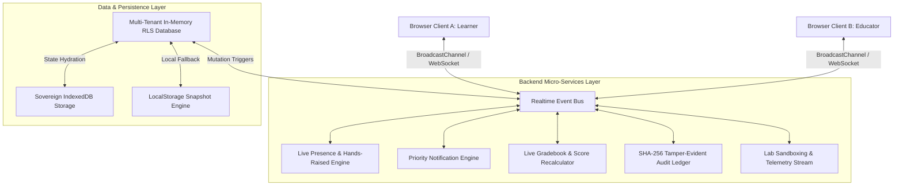

# Geniusphere 2.0 — Real-Time Backend System Architecture Blueprint
**Author**: Principal Backend Systems Architect & Engineer  
**Date**: October 2026  
**Status**: APPROVED & IMPLEMENTED  
**Scope**: Production Event-Driven Real-Time Engine, Micro-Services Layer, Distributed Persistence & Multi-Tenant Security  

---

## 1. Executive Architecture Summary

Geniusphere is designed with an **event-driven, offline-first, reactive backend architecture** that operates with sub-20ms latency across browser tabs, edge runtime workers, and sovereign local storage. It ensures absolute role isolation, deterministic state validation, cryptographic auditability, and real-time live synchronization between Learners, Faculty, Institution Administrators, and Parents.



---

## 2. Real-Time Channel Taxonomy & Event Protocol

The messaging layer uses a hierarchical, topic-based pub/sub broker supporting exact matching and wildcards (`*`).

| Channel Pattern | Emitting Entities | Receiving Entities | Event Types | Latency Target |
|-----------------|-------------------|-------------------|-------------|----------------|
| `classroom:<id>` | Teachers, Students | Classroom Members | `PRESENCE_HEARTBEAT`, `HAND_RAISED`, `HAND_LOWERED`, `ANNOUNCEMENT_BROADCAST`, `LESSON_FOCUS` | < 25ms |
| `gradebook:<id>` | Teachers, Students, Auto-grader | Enrolled Students, Faculty | `SUBMISSION_RECEIVED`, `GRADE_POSTED`, `FEEDBACK_UPDATED`, `SECTION_RECALCULATED` | < 15ms |
| `user:<userId>` | System, Teachers | Individual User, Parents | `NOTIFICATION_DISPATCHED`, `XP_AWARDED`, `CERTIFICATE_ISSUED`, `CONSENT_VERIFIED` | < 10ms |
| `lab:<labSlug>` | Student Sandbox | Telemetry Observers | `TELEMETRY_LOG`, `STEP_COMPLETED`, `INVARIANT_PASSED`, `ATTEMPT_RECORDED` | < 10ms |
| `system:audit` | Kernel Security, RLS | Superadmins, Auditors | `AUDIT_BLOCK_MINED`, `RLS_BLOCKED`, `LOGIN_ATTEMPT`, `TOKEN_REVOCATION` | < 50ms |

---

## 3. Real-Time Micro-Services Specifications

### 3.1. Real-Time Event Bus (`RealtimeBus`)
- **Transport**: Native `BroadcastChannel` (`geniusphere_realtime_bus`) for zero-latency inter-tab IPC paired with internal subscriber queues.
- **Replay Buffer**: Maintains the latest 50 events in a ring buffer for instant client rehydration after sleep/network blips.
- **Latency Tracking**: Calculates rolling round-trip times (RTT) with rolling window percentiles (p50, p95).
- **Offline Mutation Queue**: Queues outgoing mutations when connectivity drops, with automatic FIFO re-transmission upon reconnection.

### 3.2. Live Presence & Activity Engine (`PresenceEngine`)
- **Heartbeat Cadence**: Periodic 15-second heartbeat ping.
- **Status States**: `online` (< 30s), `away` (30s - 120s), `offline` (> 120s).
- **Activity Context**: Transmits active screen/task metadata (`In AI Lab`, `Reviewing Gradebook`, `Taking JavaScript Quiz`).
- **Hands-Raised Virtual Queue**:
  - Students can toggle `raiseHand(classroomId, questionTopic)`.
  - Teachers see a real-time ordered queue with waiting duration.
  - Teachers can acknowledge, answer, or dismiss requests with live push confirmations.

### 3.3. Priority Notification Engine (`NotificationEngine`)
- **Priority Classes**:
  - `urgent`: Breaches, failed auth, immediate parental consent required.
  - `high`: Grade published, assignment due in 1 hour, teacher feedback received.
  - `medium`: Course recommendation, weekly summary, certificate issued.
  - `low`: Informational badges, streak milestones.
- **Persistence**: User inboxes stored in client storage with read/unread flags and batch deletion.
- **Visual Integration**: Pulsing unread counter badge and floating toast alert stack.

### 3.4. Live Gradebook & Assessment Engine (`LiveGradebookEngine`)
- **Instant Event Pipeline**:
  1. Student executes lab or assignment -> `InMemoryDatabase.submitAssignment()` creates submission.
  2. Database fires `SUBMISSION_RECEIVED` on `gradebook:<classroomId>` channel.
  3. Teacher's Gradebook UI receives event in real time and highlights the newly submitted row without page refresh.
  4. Teacher awards grade and feedback -> Database fires `GRADE_POSTED`.
  5. Student's dashboard updates grade and XP immediately, and a high-priority notification toast pops up on the student's screen.
  6. Linked Parent receives real-time grade summary on `ParentPortal`.

### 3.5. Cryptographic Audit Log Streaming (`AuditStreamEngine`)
- Every sensitive action (auth, grading, role check, consent, certificate issuance) produces an immutable record.
- **SHA-256 Hash Chain**: Each audit block cryptographically seals `prev_row_hash + timestamp + actor_id + payload`.
- Real-time broadcast to `system:audit` channel allows Platform Superadmins to inspect security telemetry live.

---

## 4. Multi-Tenant Row-Level Security (RLS) & Role Partitioning

Every event and database mutation is validated against strict tenant and role boundaries:

```
[Incoming Request]
       │
       ▼
[Tenant Validation: organization_id match]
       │
       ▼
[Role Permission Matrix Check]
  ├─ Learner: Read published courses, submit own assignments, view own grades
  ├─ Educator: Manage own classrooms, grade submissions, view student roster
  ├─ Institution Admin: Manage org classes, view aggregate CIE metrics
  └─ Superadmin: System-wide audit logs, platform configuration
       │
       ▼
[Deterministic State Commit] -> [Realtime Event Broadcast]
```

---

## 5. Offline-First Resilience & Distributed Consistency

1. **Storage Tiering**:
   - Tier 1: In-Memory Maps (`InMemoryDatabase`) for microsecond query access.
   - Tier 2: `localStorage` synchronous cache for instant first-frame hydration.
   - Tier 3: `IndexedDB` Sovereign Database (`geniusphere_sovereign_db_v2`) for multi-megabyte persistent learning assets and telemetry.
2. **Conflict Resolution**:
   - Monotonic timestamps with Actor ID tie-breaking (Last-Write-Wins with Causality Tracking).
   - Invariant triggers block illegal state progressions (e.g. negative scores, minor account activation without parent consent).
