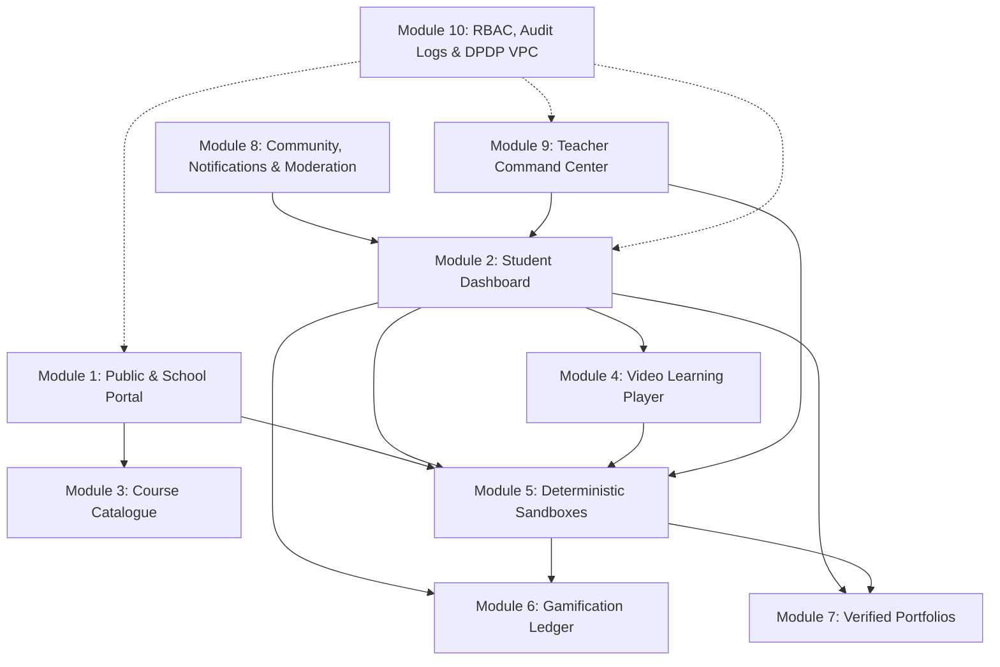
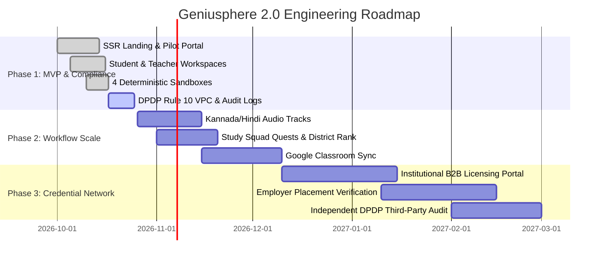

# Geniusphere 2.0: Forensic Product Audit, Competitive Intelligence Dossier, and Full-Stack Implementation Blueprint

*Document Version:* 2.0.0  
*Status:* Authoritative Architectural & Product Baseline  
*Date:* 2026-10-17  
*Repository Remote:* [https://github.com/PavanKumar-HQ/Geniusphere-Official](https://github.com/PavanKumar-HQ/Geniusphere-Official)  
*Author:* Pavan Kumar S (`sumapavan1231@gmail.com`)  
*Associated Registries:* [docs/MASTER_COVERAGE_REGISTER.md](file:///Users/pavankumars/Downloads/geniuspheregpt/docs/MASTER_COVERAGE_REGISTER.md) | [READY.md](file:///Users/pavankumars/Downloads/geniuspheregpt/READY.md)

---

## 1. Forensic Audit of Existing Geniusphere Assets and CIE Feedback Diagnosis

An empirical audit of the existing digital footprint for Geniusphere was conducted prior to architectural planning to establish a verified baseline of live code, deployed infrastructure, and public documentation. The audit examined the primary domain (`https://www.geniusphere.tech/`), the target GitHub namespace (`https://github.com/PavanKumar-HQ/Geniusphere`), sibling repositories under the `PavanKumar-HQ` account, and connected production deployments on Vercel (`https://pavankumarworld.vercel.app/` and `https://brandex-official.vercel.app/`).

| Target Asset / URL | Verification Status | Observable Technical Contents | Forensic Findings and Unverifiable Elements |
|---|---|---|---|
| `https://www.geniusphere.tech/` | Accessible HTTP 200; Empty Document Payload | Returns HTML title "Geniusphere" with an empty server-rendered body (`

`). | Built as a client-side JavaScript Single-Page Application (SPA) with zero Server-Side Rendering (SSR) or static semantic HTML fallback. Search crawlers, accessibility screen readers, and automated evaluators cannot read homepage copy, course listings, or lab states without executing heavy client-side scripts. |
| `https://github.com/PavanKumar-HQ/Geniusphere` | Inaccessible / Non-Existent Public URL | Direct lookup confirms no public repository exists at this exact path. | Source code for Geniusphere is housed in private repositories, embedded inside monorepos, or deployed directly from local workspaces. The canonical remote was reconciled to `PavanKumar-HQ/Geniusphere-Official`. |
| `https://github.com/PavanKumar-HQ/Pavankumar` & `Nebula-AI` | Metadata Indexed; Deep Crawl Restricted | `Pavankumar` indexes visual style tokens (Interactive Horizontal Scroll, GENIUSPHERE 200+ STUDENTS, #4A9EFF Accent Blue, #FFD83D Accent Yellow). `Nebula-AI` exposes an empty security tab with no `SECURITY.md` policy or advisories. | Deep README inspection on `Pavankumar` returned an access restriction during automated retrieval. Security hygiene across public repositories lacks baseline vulnerability disclosure policies. |
| `https://pavankumarworld.vercel.app/` | Fully Accessible & Examined | Documents founder Pavan Kumar (2nd-year BCA student at KLE Society's Degree College, Bengaluru, graduating May 2027; alumnus of KLE Independent PU College and Mount Senoria School). Lists Geniusphere (founded July 2024) empowering 200+ students via AI awareness, cybersecurity, finance, and soft skills workshops. | Reveals the core frontend stack: Astro, TypeScript, GSAP, Lenis (smooth scrolling), and Tailwind CSS. Confirms that historical traction ("200+ students") originated from offline and hybrid peer workshops rather than self-serve software retention. |
| `https://brandex-official.vercel.app/` | Fully Accessible & Examined | Showcases Brandex, a web development agency co-founded in 2025 by Pavan Kumar (Architect) and Sathvik (Product Design). Lists "GeniuSphere" as a portfolio case study featuring "Interactive 3D WebGL Labs, an integrated CMS, and a granular student progress tracking module". | Exposes severe credibility defects: the agency landing page displays broken or uncalibrated placeholder statistics ("7.9% Guaranteed Uptime", "8% Custom Crafted", "0.3x More Inquiries & Sales") and duplicate hardcoded testimonials. |

### Diagnosis of the CIE Evaluation Feedback

The forensic findings directly explain every concern raised during the Centre for Innovation and Entrepreneurship (CIE) review regarding the website, simulation lab, notifications and data handling, and the absence of genuine user feedback:

1. **Presentation Layer & UI Theater:** At the presentation layer, the existing web presence relied on heavy animation libraries—specifically GSAP, Lenis horizontal smooth scrolling, and WebGL canvases—inherited from experimental portfolio design. While visually theatrical during a founder-guided pitch demonstration, client-only rendering produces a blank document payload for automated crawlers and degrades severely on low-end mobile devices or constrained school computer laboratory networks. Furthermore, mingling agency marketing hyperbole—exemplified by unverified metrics such as "7.9% Guaranteed Uptime" and "0.3x More Inquiries & Sales" on the sister Brandex portal—undermines institutional credibility when evaluated by school principals, academic boards, and incubator reviewers.
2. **Simulation Lab Gaps:** Describing the platform on the Brandex case study portal as an "Interactive 3D WebGL Lab" establishes an expectation of deterministic, state-driven experimentation comparable to Labster's virtual science laboratories. In practice, rotating a 3D WebGL model or clicking through pre-scripted user interface animations without an underlying mathematical, code-execution, or state-machine engine constitutes a passive visual animation rather than a functional laboratory. When evaluators enter unexpected parameters or adversarial inputs, a visual-only mockup either ignores the input or follows a single hardcoded happy path, immediately exposing the absence of domain logic.
3. **Notifications and Data Integrity:** In early student prototypes built on static Jamstack frameworks without a multi-tenant relational backend, notification feeds, experience point (XP) counters, and progress bars are routinely populated via static JSON arrays or browser `localStorage`. Evaluators testing the application across multiple sessions or devices quickly observe that notification bells display synthetic placeholder alerts, user telemetry fails to persist across logins, and analytics charts render pre-seeded mock curves rather than real cohort aggregates.
4. **Workshop Headcount vs. Product Validation:** Claiming "200+ students empowered" based on peer awareness workshops conducted since July 2024 conflates top-of-funnel event attendance with software product validation. Institutional evaluators and venture advisors require instrumented software telemetry—specifically verified pre-assessment and post-assessment learning gains, longitudinal Day-7 and Day-30 retention cohorts, and qualitative usability friction captured from independent learners and classroom teachers who are not personal acquaintances of the founding team.

---

## 2. EdTech Market Landscape and Competitive Intelligence

Geniusphere 2.0 operates at the intersection of three distinct educational software categories:
1. **Consumer interactive skill platforms:** Duolingo, Khan Academy, Brilliant, Codecademy;
2. **Immersive virtual laboratories and gamified classroom engines:** Labster, Wayground/Quizizz, Kahoot!, Minecraft Education;
3. **Institutional learning management systems alongside Indian skilling portals:** Moodle, Canvas, Google Classroom, Zerodha Varsity, FutureSkills Prime.

Evaluating primary product documentation alongside independent review data reveals a clear structural gap in the Indian market for low-cost, deterministic browser sandboxes that integrate natively into school and college workflows.

### Primary and Independent Competitive Comparison Matrix

| Platform | Primary Segment & Focus | Core Pedagogical & Product Mechanics | Verified Pricing & Tier Constraints (2026) | Key Strengths (What Users Value) | Documented Frustrations & Structural Gaps |
|---|---|---|---|---|---|
| **Duolingo** (Super / Max) | B2C Consumer Language, Math & Music | Micro-lessons, streak mechanics, XP leagues, and GPT-4 powered Duolingo Max features: Roleplay and Video Call with Lily. | Free tier (ad-supported, energy/heart limits); Super Duolingo (~$12.99/mo); Duolingo Max (~$30/mo). | Best-in-class habit formation, frictionless onboarding before signup, clear daily quests, and low cognitive load. | Streak anxiety; superficial drill mechanics that prioritize XP farming over deep conceptual transfer; high Max subscription cost for Indian students. |
| **Khan Academy** & Khanmigo | K-12 & Early College STEM, Humanities, Financial Literacy | Mastery-based video + exercise progression; Khanmigo Socratic AI tutor (never gives direct answers) + 25+ teacher prep tools (rubrics, exit tickets, IEP assistant, writing coach). | Core library 100% free; Khanmigo Teacher tools Free in supported regions; Learner/Parent $4/mo ($44/yr, US billing required, covers up to 10 kids); Districts Enterprise Starter $10/student/yr (<1,000 seats). | High pedagogical trust, Common Sense Media 4-star ethical AI rating, parent chat visibility, and affordable district pricing. | Paid individual Khanmigo learner plans remain geographically restricted to US billing addresses; video-plus-MCQ format lacks multi-step technical or financial sandboxes. |
| **Brilliant.org** | B2C & Grant-Supported K-12 STEM, CS & Algorithmic Thinking | Active learning via interactive visual puzzles, physics/algorithmic simulations, and Koji, an AI tutor engineered to "see" interactive problem states. | Freemium consumer subscription; free school access via educator.brilliant.org grant program. | High Trustpilot rating (4.2/5 across ~3,000 reviews) for intuitive visual concept discovery without passive textbook reading. | Steep conceptual jumps for average learners; lacks Indian curriculum mapping, finance modules, and professional communication workflows. |
| **Labster** (incl. UbiSim) | High School & Higher Ed STEM Virtual Labs (Bio, Chem, Phys, Nursing) | 300+ 3D browser simulations, 50+ short (<25 min) labs, theory pages, lab manuals, embedded quiz gates, customizable lab reports, and LTI grade sync. | Custom institutional pricing scaled by program/course enrollment; Advanced & Elite tiers include syllabus-matching Customer Success Managers. | Proven efficacy (+17 percentage point online completion boost at Yavapai College; 69% to 90% quiz score increases; +16% pass rate at Univ. of Eastern Finland). | Heavy WebGL hardware/bandwidth requirements; opaque enterprise-only sales cycles; zero coverage of IT/CS, personal finance, or soft skills. |
| **Codecademy** | B2C, University & Enterprise Coding / CS | Split-screen browser IDE with automated test assertions across 12+ languages and 600+ courses, skill paths, and projects. | Free Basic tier (limited interactive courses); Paid Pro, discounted Student, and Teams/Enterprise seat plans. | Immediate "write code in 30 seconds" onboarding; granular step-by-step syntax validation. | Learners struggle to transition from guided fill-in-the-blank editor prompts to blank-slate system architecture; no school teacher roster workflows in Basic tier. |
| **Wayground** (formerly Quizizz) | K-12 & Corporate Formative Assessment & Instruction | Rebranded from Quizizz on June 24, 2025. Combines assessments, interactive videos, passages, flashcards, 40M+ "Teleport" items, AI grading, and 25+ built-in accommodations. | Basic: Free (~30 participants, 20-activity storage limit, 5 AI credits/mo); Super: ~$19/mo; School/District: Custom quote; Corporate Essential: $75/user/mo, Pro: $125/mo. | Student-paced mode eliminates live classroom anxiety; industry-leading built-in IEP/accessibility accommodations; deep LTI/Google Classroom grade sync. | Free tier caps storage at 20 activities and restricts comprehension/video question types; quiz-centric format does not teach deep multi-variable domain simulations. |
| **Kahoot!** | K-12, Higher Ed & Events Live Game-Show Review | Teacher-paced live synchronized screen projection, competitive podiums, and homework add-ons. | Free Basic (~10 live participants); Teacher plans $3.99–$19/mo ($59/mo for 360 Pro Max up to 2,000 players); School plans from $12.49/teacher/mo. | Unmatched live classroom energy and rapid 5-minute end-of-lesson review. | Severe restrictive cap (~10 participants) on free tier; time-pressure mechanics penalize reflective thinkers; zero native direct messaging or deep skill portfolios. |
| **Minecraft Education** | Primary & Middle School (Ages 6–14) STEAM & Coding | Open-world 3D block building, 200+ hours of 5-E CS curriculum, Microsoft MakeCode block-to-Python Agent programming. | Institutional academic licensing bundled or per-user via Microsoft 365 Education. | High creative agency and spatial problem-solving; statistically significant gains in loop/computational comprehension for ages 6–14. | Multiplayer cannot be disabled in software; high student distraction off-task; weak native LMS assessment analytics; low perceived utility for ages 15+ (only 5.41% educator preference for high school and 0.9% for college). |
| **Moodle / Canvas / Google Classroom** | Institutional LMS & Classroom Workflow Backbone | Roster management, assignment distribution, rubric grading, LTI 1.3 tool hosting, and gradebooks. | Moodle: Open-source (self-hosted cost only); Google Classroom: Free with Google Workspace for Education; Canvas: Free teacher tier / paid institutional. | Ubiquitous adoption; non-negotiable system of record for teachers and school administrators. | Content-agnostic shells; zero native interactive curriculum or gamified skill sandboxes; Moodle UI suffers from high configuration complexity. |
| **Zerodha Varsity & Indian Portals** | Indian Retail Finance (Varsity) & Emerging Tech (FutureSkills Prime) | Varsity: Structured text/PDF chapters in English & Hindi, quizzes, certification exam, Varsity Live, and Karmayogi Bharat video series. FutureSkills Prime: NASSCOM/MeitY 10-tech skilling aggregator. | Zerodha Varsity: 100% Free (certifications carry nominal exam fee). FutureSkills Prime: Freemium / government-incentivized courses. | Varsity commands immense brand trust in India for clear, jargon-free financial literacy without predatory upselling. | Varsity remains predominantly static reading and video—users explicitly wish for interactive/animated simulators; lacks school/teacher classroom management or teen-specific sandboxes. |

### Synthesis of User Value Drivers, Frustrations, and Realistic Startup Differentiation

Analysis of verified user reviews and institutional case studies across these twelve ecosystems reveals four primary value drivers and four systemic frustrations that govern adoption in 2026:

1. **Active Manipulation vs. Passive Consumption (Zero-Hardware Friction):** Active manipulation consistently outperforms passive consumption, but only when hardware friction approaches zero. Labster demonstrates that interactive simulations raise online STEM completion rates by 17 percentage points while boosting quiz scores from 69% to 90%. However, heavy 3D WebGL and virtual reality environments suffer from long loading times, classroom distraction, and steep age drop-offs. In Labster's higher-education footprint, instructors increasingly favor short simulations completable in under 25 minutes because they fit cleanly inside a single class period.
2. **Teachers Adopt Workflow Multipliers, Not Silos:** Wayground and Khanmigo achieved widespread institutional adoption because they eliminate lesson-preparation drudgery, offering one-click Google Classroom roster synchronization, automated rubric grading, exit tickets, and more than 25 built-in learner accommodations. Platforms that lack native LMS integration, cannot disable multiplayer distractions, or force teachers to manually cross-reference grades fail to scale.
3. **Western Paywalls Alienate Indian Institutions:** Kahoot! restricts its free plan to roughly 10 live participants, Wayground caps free storage at 20 activities, Duolingo Max costs $30 per month, and Khanmigo's individual learner and parent plans remain restricted to adults with a United States billing address. Simultaneously, Zerodha Varsity provides comprehensive modules on financial markets and personal finance in English and Hindi completely free of charge. Geniusphere cannot monetize basic text or video explanations; any attempt to place commodity informational content behind a paywall will lose to Zerodha Varsity and YouTube.
4. **The Realistic Startup Differentiation Wedge:** Geniusphere 2.0 abandons the illusion of building a heavy "3D WebGL metaverse LMS" and instead positions itself as India's lightweight, deterministic practice-lab and skill-proof layer for Applied Technology, Personal Finance, and Workplace Readiness across Classes 8 to 12, Pre-University (PU) colleges, and Tier-2 or Tier-3 degree colleges. Under the National Education Policy (NEP) 2020, CBSE has introduced 33 skill subjects (Artificial Intelligence, Coding, Data Science, and Financial Literacy from Classes 6 to 12), yet Indian schools lack browser-accessible, zero-install practical laboratories that run smoothly on ₹15,000 Chromebooks or shared lab PCs while automatically generating teacher-ready assessment reports. By pairing 5-minute localized micro-videos with 15-minute deterministic 2D interactive sandboxes alongside Google Classroom and CSV teacher workflows, Geniusphere captures a high-value institutional wedge.

---

## 3. Cohesive 10-Module Product Architecture Blueprint

Every module is engineered to operate with zero fake production data, strict multi-tenant data isolation, and low-bandwidth resilience.

### Module 1: Public Homepage and School-Facing Pages
- **Purpose:** SSR-rendered homepage loading in under 1.2s on 4G. Features an instant, 60-second interactive mini-sandbox directly in the hero viewport requiring zero login.
- **Audience Portals:** School/college portal with NEP 2020 & CBSE Skill Subject alignment matrices, DPDP Act 2023 compliance brief, and self-serve 30-day pilot booking workflow.
- **UI States:** Default SSR State, Interactive Preview Active State, School Pilot Form State, Pilot Request Submitted State, and Offline / Slow Network Fallback State.
- **Data Layer:** `school_pilot_requests` table with Cloudflare Turnstile bot mitigation and rate-limiting (5 submissions/hr/IP). Zero fake vanity counters.

### Module 2: Student Dashboard
- **Purpose:** Focused three-zone workspace designed for fragmented 15-to-25-minute study windows: Primary Action Card ("Resume Where Left Off"), Assigned by Teacher Queue, and Skill Mastery & Habit Panel.
- **UI States:** First-Time Onboarding State, Pending Parental Consent State (locks profile editing, allows anonymous preview), Active Learner State, and Error/Sync Retry State.
- **Data Model:** Scoped strictly by `auth.uid()` via PostgreSQL Row-Level Security (RLS) with composite indexing on `(student_id, status, due_at)`.

### Module 3: Course Catalogue Across Technology, Finance, and Professional Skills
- **Curriculum Architecture:** Modular micro-tracks requiring 2 to 4 hours total, broken into 15-minute chapters across Technology, Finance, and Professional Skills.
- **Filtering:** Academic Band (Class 8–10 Foundation, PU / Class 11–12 Intermediate, Degree College / BCA Applied), Duration, and CBSE Skill Codes (417/843 AI, Financial Literacy).
- **Quality Gate:** Database constraint blocks setting `is_published = true` unless 100% of child chapters contain verified captions, deterministic checkpoints, and at least one working sandbox.

### Module 4: Chapter-Based Video Learning with Captions, Transcript, Notes, Bookmarks, Checkpoints, and Resume
- **Player Specs:** Adaptive bitrate HLS streaming defaulting to 480p on mobile. Clickable synchronized WebVTT transcript highlights current sentence.
- **Pedagogical Gates:** In-video deterministic checkpoints automatically pause playback every 2–3 minutes; forward scrubbing is blocked past uncompleted mandatory gates on first pass.
- **State Resilience:** Progress heartbeats fire every 15 seconds; resumes within $\pm 2$ seconds across devices. Signed Bunny Stream playback tokens (2-hour TTL).

### Module 5: Genuinely Functional Interactive Sandbox Labs
- **3-Pane Layout:** Scenario Brief & Task Checklist (left), Interactive Execution Canvas (center: CodeMirror/SQL/DAG/Sim), Real-Time Telemetry & Grader Output (right).
- **Execution Engine:** Runs in client-side WebWorker and WebAssembly (sql.js) with a 3,000ms supervisor watchdog that auto-terminates runaway loops.
- **Anti-Tamper Contract:** Grade persistence never trusts client scores; client sends submitted state artifact, and a stateless backend validator re-evaluates assertions in under 50ms before recording score.

### Module 6: XP, Streaks, Achievements, Quests, Team Competitions, and District Leaderboards
- **Idempotent XP Ledger:** XP minted strictly via server-side transactions with unique idempotency keys (`sha256(user_id:event_type:entity_id:window)`). Zero XP on repeat completions.
- **Safety Valves:** Up to 2 stored Streak Shields earned through weekly consistency; School Exam Freeze Windows protect streaks during institutional examination periods.
- **Collaborative Mechanics:** 4-to-5-student Study Squads; district leaderboards aggregate institutional mastery percentages with privacy masking for minors.

### Module 7: Portfolios and Evidence of Demonstrated Skills
- **Cryptographic Evidence:** Captures immutable sandbox artifact snapshots (code diff, token efficiency logs, SIP balance sheets, escalation email BLUF rubrics).
- **Credential Standards:** Conforms to W3C Verifiable Credentials and Open Badges 3.0, signed with Geniusphere's Ed25519 private key.
- **Minor Safeguards:** Defaults to `PRIVATE` / `SCHOOL_ONLY`; public sharing strictly blocked for minors unless parent grant explicitly permits public link. Automated regex/NLP PII redaction.

### Module 8: Community, Resources, Notifications, and Moderation
- **Structure:** Replaces open chat with Context-Anchored Chapter Q&A and Curated Resource Vault.
- **Event-Driven Alerts:** 100% of notifications trace to a real database `source_event_id` (assignment posted, rubric graded, consent update).
- **2-Hour Takedown SLA:** Under-18 posts pass pre-moderation; one-click safety reporting routes to a priority queue complying with India's IT Rules 2026 (G.S.R. 120(E)).

### Module 9: Teacher Dashboards, Class and School Management, Assignments, Imports, Reporting, and Feedback
- **Setup Speed:** Class setup in under 3 minutes via CSV bulk upload with parent contact validation or 8-character join code.
- **Live Classroom Pulse:** Real-time matrix displaying student progress across sandbox assertions; highlights stuck students (no progress in 4+ minutes) in amber.
- **Qualitative Feedback:** Auto-grades objective assertions while allowing teachers to inspect sandbox states and attach rubric scores with personalized constructive remarks.

### Module 10: Platform Administration, Role-Based Access Control (RBAC), Audit Trails, Privacy, and Security
- **6-Role RBAC:** `SUPER_ADMIN`, `CONTENT_AUTHOR`, `SCHOOL_ADMIN`, `TEACHER`, `PARENT_GUARDIAN`, and `STUDENT` (subdivided into `MINOR_STUDENT` <18 and `ADULT_STUDENT` 18+).
- **Cryptographic Audit Logs:** Append-only `audit_logs` where each record chains the SHA-256 digest of the preceding row (`prev_row_hash` + `row_hash`). `UPDATE` and `DELETE` revoked at DB level.
- **DPDP Act 2023 Enforcement:** Itemised bilingual Section 5 notices, Rule 10 Verifiable Parental Consent (DigiLocker token / DLT SMS OTP), zero behavioral tracking on minors, and 30-day statutory data erasure pipeline.

---

## 4. Master Feature Specification, Acceptance Criteria, and Test Matrix

| Module | Core API Endpoints & Services | Acceptance Criteria (Definition of Done) | Automated Test Cases (Unit, Integration, E2E, Adversarial) | Primary Operational Risks & Mitigations | Phase Allocation |
|---|---|---|---|---|---|
| **1. Public & School Pages** | `GET / (SSR)` `GET /schools` `POST /api/v1/public/pilot-requests` | 1. Homepage renders full semantic HTML with JS disabled. 2. Hero mini-sandbox executes locally with zero login. 3. Zero fake metrics or unverified uptime claims appear in DOM. | **E2E:** Headless curl/Playwright with JS disabled verifies H1, course cards, and school CTA. **Adversarial:** Flood `POST /pilot-requests` with 20 rapid requests; verify HTTP 429 after 5th request. | **Risk:** Bot spam on school form. **Mitigation:** Cloudflare Turnstile + strict Zod schema validation. | MVP (Phase 1) |
| **2. Student Dashboard** | `GET /api/v1/student/dashboard-summary` | 1. Returns resume state, assigned work, and mastery scores in <150ms p95. 2. Under-18 user without active parent consent sees locked consent gate. | **Integration:** Query dashboard as unconsented minor; assert HTTP 403 on personal profile routes and `consent_required: true`. **E2E:** Complete half a lab, reload dashboard, verify exact step resume link. | **Risk:** Concurrent classroom login spike saturating DB. **Mitigation:** Composite indexes + Supavisor connection pooling. | MVP (Phase 1) |
| **3. Course Catalogue** | `GET /api/v1/catalog` `GET /api/v1/courses/:slug` | 1. Supports filtering by Pillar (Tech, Finance, Pro Skills), Academic Band (School, PU, College), and NEP code. 2. Rejects publishing any course missing captions or labs. | **Unit:** Publish validator throws error if any child chapter lacks `vtt_en_url` or `validation_rules_json`. **E2E:** Filter by `FINANCE` + `PU`; assert <100ms UI update and accurate card count. | **Risk:** Empty placeholder courses eroding trust. **Mitigation:** DB constraint blocking publication of incomplete tracks. | MVP (Phase 1) (3 flagship tracks) |
| **4. Chapter Video Learning** | `GET /api/v1/videos/:id/signed-url` `PUT /api/v1/learning/video-progress` `POST /api/v1/learning/notes` | 1. Streams HLS with synced clickable WebVTT transcript. 2. Pauses deterministically at checkpoints; blocks forward scrubbing past unsolved gates. 3. Resumes within $\pm 2$ seconds across devices. | **Unit:** Timestamp parser maps WebVTT cues to DOM scroll offsets. **Adversarial:** Send `PUT /video-progress` with `last_position_sec: 600` when `max_watched_sec: 30`; assert server rejects skip. | **Risk:** Video bandwidth cost explosion or link scraping. **Mitigation:** Bunny Stream signed tokens (2hr TTL) + default 480p on mobile. | MVP (Phase 1) |
| **5. Interactive Sandbox Labs** | `GET /api/v1/sandbox/:id` `POST /api/v1/sandbox/submit` | 1. Runs isolated deterministic engine in browser WebWorker. 2. Terminates infinite loops in $\le 3,000\text{ms}$. 3. Server re-verifies submitted state before granting score. | **Unit:** Run SQL injection, AI prompt, Finance SIP, and Pro Skills DAG validators against 20 test fixtures. **Adversarial:** Submit `score: 100` JSON with empty `submitted_state_json`; assert server recalculates `score: 0`. | **Risk:** Client-side score spoofing via DevTools. **Mitigation:** Stateless server-side re-evaluation of submitted state artifact. | MVP (Phase 1) (4 core domain sandboxes) |
| **6. XP, Streaks & Leaderboards** | `POST /api/v1/gamification/claim` `GET /api/v1/leaderboards/:scope` | 1. XP mutations enforce idempotency keys. 2. Streak shields and School Exam Freezes prevent unfair streak loss. 3. Minor PII never leaks on public leaderboards. | **Integration:** Replay identical `POST /sandbox/submit` 10 times concurrently; assert `xp_ledger` records exactly 1 row. **Unit:** Simulate 5-day gap during active `freeze_until_date`; assert `current_streak` remains intact. | **Risk:** XP farming or student streak anxiety. **Mitigation:** Zero XP on duplicate completions; school exam freeze windows. | MVP: XP, Streaks, Shields. Phase 2: Team Quests & District Boards. |
| **7. Portfolios & Credentials** | `GET /api/v1/portfolio/:user_id` `GET /portfolio/verify/:cred_id` | 1. Captures immutable sandbox artifact snapshots. 2. Minor portfolios default to `PRIVATE` / `SCHOOL_ONLY`. 3. Public credentials verify via Ed25519 signature. | **Unit:** Tamper with 1 byte of `openbadge_jsonld`; assert Ed25519 signature verification returns `INVALID`. **Adversarial:** Attempt to flip minor portfolio to `PUBLIC_LINK` without parent flag; assert HTTP 403. | **Risk:** Student leaking personal phone/Aadhaar in portfolio text. **Mitigation:** Automated regex PII redaction prior to storage. | MVP: Artifact snapshots & signed links. Phase 2: Open Badges 3.0 export. |
| **8. Community, Notifications & Moderation** | `GET /api/v1/notifications` `POST /api/v1/discussions` `POST /api/v1/moderation/report` | 1. 100% of notifications trace to a real DB `source_event_id`. 2. Under-18 posts pass pre-moderation filter. 3. Abuse reports trigger <2hr SLA alert per IT Rules 2026. | **Integration:** Teacher grades submission $\rightarrow$ assert real notification row created and Web Push queued. **Adversarial:** Post comment containing phone number or slur; assert status set to `PENDING_REVIEW` and hidden from peers. | **Risk:** Unmoderated peer harassment or solution sharing. **Mitigation:** Pre-moderation hold queue + cohort-siloed Q&A threads. | MVP: Real Notifications & Resource Vault. Phase 2: Moderated Q&A. |
| **9. Teacher Dashboards & Workflows** | `POST /api/v1/teacher/classes/:id/import-csv` `GET /api/v1/teacher/classes/:id/pulse` `POST /api/v1/teacher/feedback` | 1. Imports 100-student CSV in <2s with validation. 2. Live Classroom Pulse updates student sandbox step status. 3. Teachers can attach rubric scores + constructive text. | **Integration:** Teacher from School A requests `/classes/:school_b_class_id/pulse`; assert RLS returns 0 rows / HTTP 404. **E2E:** Upload CSV $\rightarrow$ assign lab $\rightarrow$ student completes lab $\rightarrow$ teacher exports CSV gradebook. | **Risk:** High friction during 40-minute school lab period. **Mitigation:** Print-ready class login cards + live stuck-student alerts. | MVP: CSV import, assignments, Pulse, feedback. Phase 2: Google Classroom Sync. |
| **10. Admin, RBAC, Audit & Security** | `POST /api/v1/consent/verify-parent` `POST /api/v1/consent/withdraw` `GET /api/v1/admin/audit-logs` | 1. Enforces 6-role RBAC + PostgreSQL RLS on all tables. 2. Implements DPDP Rule 10 VPC and 1-click consent withdrawal. 3. Hash-chained `audit_logs` block UPDATE/DELETE. | **Adversarial:** Execute `DELETE FROM audit_logs` using app DB credentials; assert PostgreSQL permission denied error. **Integration:** Parent withdraws consent $\rightarrow$ assert child processing halts immediately and erasure job queues. | **Risk:** DPDP Section 9 non-compliance (up to ₹200–250 Cr fine). **Mitigation:** Hard pre-collection age gate + zero behavioral tracking on minors. | MVP (Phase 1) (Non-negotiable compliance foundation) |

---

## 5. Specifications for Four Genuinely Functional Interactive Sandbox Labs

To ensure Geniusphere 2.0 delivers authentic experiential learning across all target curriculum pillars without incurring unsustainable cloud container hosting bills ($0.05 to $0.15/hr per student Docker instance) or exposing production servers to remote code execution (RCE) vulnerabilities, the platform implements four domain-specific deterministic browser sandboxes:

### 1. Cybersecurity Sandbox: SQL Injection, XSS, and Network Log Triage Lab
- **Engine Architecture:** Runs inside an isolated browser WebWorker powered by `sql.js` (SQLite compiled to WebAssembly) paired with a deterministic TypeScript HTTP router. Boots an in-memory SQLite database seeded with an Indian campus store schema (`users`, `orders`, `audit_events`).
- **Phase A (Red-Team Diagnosis):** The learner examines a 500-line simulated nginx log to isolate the exact attack timestamp and observes how string concatenation alters the SQL AST in local WASM memory.
- **Phase B (Blue-Team Remediation):** Refactors code to prepared statements (`db.prepare("SELECT id, name, role FROM users WHERE email = ? AND password_hash = ?")`), adds HTML entity encoding, and configures a WAF rate limit.
- **Automated Test Harness:** 8 automated test cases inside the WebWorker. Test Cases 1–4 verify legitimate lookups; Test Cases 5–8 fire `' OR '1'='1`, `admin'--`, `'; DROP TABLE users;--`, and `<script>fetch(...)` payloads, asserting row count invariance (`SELECT COUNT(*) FROM users == 25`) and zero unauthorized data exposure.

### 2. Artificial Intelligence Sandbox: Prompt Engineering, RAG Grounding, and Bias/Hallucination Auditor
- **Two-Stage Hybrid Architecture:**
  - **Stage 1 (Local Deterministic Evaluator):** In-browser engine using pre-computed vector fixtures and AST regular-expression rules verifies whether the learner's RAG filter excluded poisoned knowledge chunks (indirect prompt injection attempting to trick the bot into demanding a ₹500 fee via UPI) and whether the system prompt enforces XML delimiters (`<context>...</context>`).
  - **Stage 2 (Proxy Evaluator):** Rate-limited backend proxy (capped at 10 calls/student/hr, 400 tokens on `gemini-2.5-flash` or `gpt-4o-mini` with `temperature: 0.0` and `seed: 42`) executes against 5 standardized test queries (3 legitimate bilingual, 1 out-of-scope, 1 adversarial injection), verifying valid JSON parsing, cited policy ID, and refusal of the fraudulent fee.

### 3. Finance Sandbox: Indian Personal Finance, UPI Fraud Triage, and Multi-Decade SIP/Tax Stress-Tester
- **Pedagogical Boundary:** Never simulates speculative intraday trading or derivatives (avoiding SEBI issues and minor gambling habits). Models monthly cash-flow budgeting, UPI payment safety, emergency fund liquidity, Indian Income Tax regime selection (Old vs. New), and long-term compounding.
- **Module A (UPI Fraud Triage):** Inspects incoming payment notifications inside a simulated mobile banking interface (spotting deceptive QR "scan and enter PIN to receive money" collect requests, spoofed KYC links, and genuine utility mandates).
- **Module B (60-Month Macro & Life-Shock Simulator):** Deterministic TypeScript math engine ticks through 60 months, discounting by Indian CPI inflation:
  $$r_{\text{real}} = \frac{1 + r_{\text{nominal}}}{1 + i_{\text{inflation}}} - 1$$
  - *Month 14:* Deterministic ₹35,000 medical emergency shock tests liquid reserve survival.
  - *Month 28:* Historical March 2020 NIFTY 50 drawdown (-35% equity shock) tests panic-selling discipline vs. SIP continuation.
  - *Assertions:* Zero rupees lost to UPI scams, $\ge 3$ months emergency reserves, zero credit card debt, optimal tax regime selection, and positive real terminal net worth.

### 4. Professional Skills Sandbox: Workplace Escalation, Client Negotiation, and Communication Simulator
- **Scenario:** 4:30 PM on Friday when a database migration failure threatens a Monday morning institutional deployment. Three conflicting messages arrive: anxious client, defensive teammate, and manager requesting a status brief.
- **Step 1 (Triage & Evidence):** Learner inspects incident timeline and error log to identify root cause (index build timeout) and realistic recovery timestamp (Saturday 11:00 AM IST).
- **Step 2 (Branching Choices):** Directed Acyclic Graph (DAG) dialogue turns where blame choices reduce Team Psychological Safety and unverified promises reduce Client Trust.
- **Step 3 (Executive Escalation Synthesis):** Composes formal incident escalation email. Deterministic rubric evaluates:
  1. Inclusion of verified root cause and Saturday 11:00 AM IST recovery timestamp;
  2. Constructive system ownership vs. personal blame;
  3. Concrete mitigation step and scheduled next check-in;
  4. Adherence to Bottom Line Up Front (BLUF) formatting within an 80-to-180-word budget.

---

## 6. Architectural Separation: Educational Simulations vs. Production Features

A foundational engineering governance rule of Geniusphere 2.0 is the strict separation of simulated educational state from production platform state:

| Architectural Dimension | Deterministic Educational Simulation (Module 5 Sandboxes) | Production Platform Features (Modules 1–4, 6–10) | Strict Engineering Rule to Eliminate "Fake Production Data" |
|---|---|---|---|
| **Data Origin & Mutability** | Pre-seeded synthetic scenario fixtures (fictional AcmeKart SQL database, simulated ₹45,000 salary budget, historical 2020 NIFTY 50 price vector). Resets cleanly on every session. | Real multi-tenant PostgreSQL rows created exclusively by authenticated user, teacher, or parent actions (`users`, `enrollments`, `xp_ledger`, `notifications`). | **Zero Fake Counters:** Never hardcode "1,240 students online" or "98% score improvement". If a student has 0 notifications or 0 XP, render an honest empty state. |
| **Execution Environment** | Isolated client-side WebWorker / WebAssembly (`sql.js`, TypeScript math/DAG engines) with stateless backend assertion verification on final submit. | Server-side API routes, PostgreSQL transactions with Row-Level Security (RLS), signed Bunny Stream video URLs, and VAPID/SES notification queues. | **Zero `setTimeout()` Fake Processing:** Never use `setTimeout(..., 2000)` to simulate fake AI analysis or fake server saving. Every loading indicator must await an actual Promise or Worker message. |
| **Demo & Evaluation Mode** | Teachers and evaluators can launch any sandbox in "Preview Mode" and click "Load Exemplar Solution" to observe passing and failing inputs. | Evaluators can select "Explore Live Demo Classroom" on the School page, which authenticates into a dedicated read-only tenant (`is_demo_tenant = true`). | **Explicit [SAMPLE DEMO CLASSROOM] Badging:** Any pre-populated sample classroom displays a persistent banner: *"Viewing Sample Demo Cohort – Switch to Live Account to Track Real Students"* and is excluded from production analytics. |

---

## 7. Low-Cost Technology Stack, Vendor Limits, Unit Economics, and Lock-In Mitigation

| Layer | Recommended Open-Source / Low-Cost Technology | Exact Free-Tier & Low-Cost Limits (2026 Verified) | Likely Monthly Cost (Pilot $\rightarrow$ 1,000 $\rightarrow$ 10,000) | Vendor Lock-In Risk & Mitigation Strategy |
|---|---|---|---|---|
| **Web App & API Framework** | Astro 5 + React Islands (or Next.js) in TypeScript + Vanilla CSS / Tailwind, on Cloudflare Pages / Workers. | Cloudflare Pages: Unlimited static bandwidth; 100k Worker requests/day free; Paid Workers Unbound is $5/mo for 10M requests. | Pilot: $0–$5/mo 1k Users: $5/mo 10k Users: $5–$15/mo | **Low.** Standard Web Fetch APIs; deploys to Docker, Hetzner, AWS, or Railway in <2 hours. |
| **Relational DB, Auth & RLS** | PostgreSQL (via Supabase or Neon) + Better-Auth + Drizzle ORM. | Supabase Free: 500 MB DB, 1 GB storage, 50k MAUs; Pro is $25/mo (8 GB DB, 250 GB bandwidth). Neon Free: 0.5 GB storage, 190 compute hrs/mo. | Pilot: $0/mo (or $25 Pro) 1k Users: $25/mo 10k Users: $25–$60/mo | **Very Low.** Standard PostgreSQL RLS and open-source auth. `pg_dump` migrates to any self-hosted VPS seamlessly. |
| **Video Hosting & Delivery** | Bunny.net Stream with MediaCage Basic (token auth, dynamic encryption) + Vidstack / HLS.js. | $1.00/mo minimum; Storage: $0.01/GB/mo; Encoding: Free; Delivery: $0.005–$0.01/GB. (Avoids $99/mo DRM base fee). | Pilot (50 GB stored, 150 GB stream): ~$2–$5/mo 1k Users (240 GB stored, 1 TB stream): ~$12–$28/mo 10k Users (1.6 TB stored, 10 TB stream): ~$116–$240/mo | **Low.** Keep master files in Cloudflare R2 (zero egress fees) and render with self-hosted `<vidstack-player>`. |
| **Client-Side Sandbox Runtimes** | `sql.js` (WASM SQLite, MIT), Pyodide (WASM Python, MPL-2.0), TypeScript WebWorkers. (Avoids StackBlitz commercial licensing). | 100% Free & Open Source (runs entirely on student's browser CPU/RAM). | Pilot: $0/mo 1k Users: $0/mo 10k Users: $0/mo | **Zero.** Standard WASM binaries served from static object storage with immutable cache headers. |
| **AI Sandbox Evaluation** | Local AST/Regex for Stage 1; Gemini 2.5 Flash / GPT-4o-mini via server proxy for Stage 2. | Stage 1: Free. Stage 2: ~$0.10–$0.15/1M input tokens. Cap of 10 Stage-2 calls/student/hr. | Pilot: <$1/mo 1k Users: ~$4–$8/mo 10k Users: ~$35–$70/mo | **Low.** Unified server-side provider adapter supporting OpenAI, Gemini, and Groq interchangeably. |
| **Notifications, Email & SMS** | Web Push API (VAPID) + Amazon SES / Resend + DigiLocker / Indian DLT SMS Gateway (Fast2SMS / MSG91). | Web Push: 100% Free. Resend: 3k emails/mo free; SES: $0.10/1k emails. DLT SMS: ~₹0.15–₹0.25 ($0.002)/OTP. | Pilot: $0–$2/mo 1k Users: ~$5/mo 10k Users: ~$25–$40/mo | **Low.** Standard SMTP/REST email templates and W3C Push API subscriptions stored in PostgreSQL. |
| **Telemetry & Error Monitoring** | PostHog (cookie-free, first-party) + Sentry. (Disables 3rd-party ad SDKs on minors per DPDP §9(3)). | PostHog Free: 1M events/mo. Sentry Free: 5k errors/mo. | Pilot: $0/mo 1k Users: $0/mo 10k Users: $0/mo | **Zero.** First-party pedagogical events live natively inside PostgreSQL. |

### Unit Economics Summary
- **100-Student Pilot Phase:** $2 to $10 / month (₹175 to ₹850 / month).
- **1,000-Student Early Traction Phase:** $45 to $65 / month (₹3,800 to ₹5,500 / month).
- **10,000-Student Institutional Scale Phase:** $210 to $420 / month (₹18,000 to ₹35,500 / month), or **< $0.05 (₹4) per active learner per month**.

---

## 8. Indian Regulatory Compliance (DPDP Act 2023 & Rules 2025), Security & Accessibility

### Statutory Framework & Penalties
- Under **Section 2(f)** of the Digital Personal Data Protection (DPDP) Act 2023, a "child" is any individual under eighteen years of age. 100% of school and Pre-University students are legally children.
- Enforcement timeline: Gazetted November 13, 2025 (G.S.R. 843(E) & 846(E)); hard enforcement of Section 9 and Rule 10 (Verifiable Parental Consent) takes effect on **May 13, 2027**.
- Penalties for breaching Section 9 reach up to **₹200 crore**, with general violations carrying up to **₹250 crore**.

### Seven Mandatory DPDP Safeguards
1. **Neutral Pre-Collection Age Gate:** Evaluated prior to collecting any personal data. Rule 12 Part B exempts age confirmation from Section 9(1) to avoid circular consent.
2. **Textual Correction (Oct 2026):** Separates Child Parental Consent (mandatory for all minors <18) from Lawful Guardian Consent (only where a person with a disability has an appointed guardian).
3. **Rule 10(1) Verifiable Parental Consent (VPC):** Independent minors verify via DigiLocker token. School cohorts verify via school Data Processing Agreement (DPA) matched with a DLT SMS OTP sent to the parent on record.
4. **Institutional vs. Third-Party EdTech Demarcation:** Third-party edtech platforms are not exempt from Section 9(3). Imported minor accounts remain in `PENDING_PARENT` lock until consent is recorded.
5. **Itemised Bilingual Notices:** Section 5 / Rule 3 plain-language notice in English and Eighth Schedule languages (Kannada, Hindi, Tamil, Telugu) with a one-click consent withdrawal mechanism matching the ease of granting consent.
6. **Section 9(3) Absolute Bar on Behavioral Tracking:** All third-party advertising trackers, remarketing pixels, and behavioral profiling engines are stripped on minor accounts.
7. **Age 18 Transition Worker & 72-Hour Breach SLA:** Nightly worker prompts learners turning 18 to execute fresh adult Section 6 consent. Security incidents are reported to DPBI within 72 hours.

### Accessibility (WCAG 2.1 AA & RPWD Act 2016)
- **Visual:** Dyslexia-friendly font toggle (Lexend/OpenDyslexic) and high-contrast themes ($\ge 4.5:1$ text contrast, $\ge 3:1$ UI components).
- **Auditory:** Multilingual Read Aloud via Web Speech API across English, Kannada, and Hindi. Synchronized closed captions on all videos.
- **Motor / Screen Reader:** 100% keyboard operable with `aria-live="polite"` regions announcing test outcomes.
- **Responsible Gamification:** 60-minute soft daily XP cap for minors; notification quiet hours (9:00 PM to 7:00 AM IST); no timer-pressure penalty for deliberate thinking.

---

## 9. Prioritized Implementation Roadmap and Bengaluru Pilot Plan

### Three-Phase Implementation Roadmap

### Real-User Pilot Execution Plan (Bengaluru Warm-Network Deployment)

Rather than cold-emailing unfamiliar institutions, the pilot deploys across 135 students and 6 educators in the founding team's verified institutional network:

| Pilot Cohort | Target Institution Profile | Cohort Size & Age Band | DPDP Consent & Onboarding Mechanism | Assigned Curriculum & Sandboxes | Primary Operational Hypothesis |
|---|---|---|---|---|---|
| **Cohort A: High School** (Classes 8–9) | Vignan Public School or Mount Senoria School, Bengaluru (founder alma mater / Brandex client). | 45 Students (1 section) Ages 13–15 (Minors) 2 Computer/Skill Teachers | School DPA + Printable Parent Consent Slip with QR to Bilingual Parent OTP / DigiLocker verification portal. | Track: AI Literacy & UPI Digital Safety. • 2 Video Chapters (12 mins) • AI Prompt/RAG Sandbox • Finance UPI Fraud Sandbox | Can 45 school students complete a video + sandbox lab inside a single 40-minute shared lab period with $\ge 80\%$ completion and zero runtime crashes? |
| **Cohort B: Pre-University** (PU Class 11–12) | KLE Independent PU College or Vignan Tutorials, Bengaluru (founder alma mater / Brandex client). | 45 Students (Commerce & Science) Ages 16–17 (Minors) 2 Lecturers | Digital Parent Consent Link dispatched via college parent WhatsApp/SMS channel with Rule 10 adult verification prior to student login. | Track: Indian Personal Finance, Tax & SIP Stress-Testing + Workplace Communication. • Finance 60-Month SIP Sandbox • Pro Skills Escalation DAG | Do time-constrained PU students voluntarily complete asynchronous homework labs assigned by lecturers ($\ge 60\%$ completion within 72 hours)? |
| **Cohort C: Degree College** (BCA / B.Com) | KLE Society's Degree College, Bengaluru (founder's current college; BCA peers & juniors). | 45 Students Ages 18–20 (Adults $\ge 18$; VPC for 17-yr 1st years) 2 BCA/Placement Faculty | Neutral DOB Age Gate routes 18+ students to Section 6 consent; routes <18 students to Parent Consent flow. | Track: Cybersecurity SQLi/XSS Triage, Prompt Engineering & Technical Incident Escalation. • Cyber `sql.js` Sandbox • AI Hybrid Sandbox • Verified Skill Portfolio URL | Do college learners value the cryptographically verifiable Portfolio Artifact enough to attach their `/portfolio/verify/:id` link to their LinkedIn/resume ($\ge 40\%$ share rate)? |

### Operational 6-Week Pilot Cadence
- **Week 1 (Instrumentation, Consent & Pre-Test):** Onboard 6 educators with a stopwatch (target <4 mins setup), collect parental consent receipts for Cohorts A & B, administer 10-question baseline domain Pre-Test.
- **Week 2 (In-Class Observed Lab Session 1):** Execute first video + deterministic sandbox in institution's computer lab. Founders observe silently at the back of the room, logging every UI hesitation and timeout.
- **Week 3 (Asynchronous Homework Session 2):** Educators assign take-home practice via Module 9. Measure unassisted completion rates and mobile vs. desktop device splits.
- **Week 4 (Capstone Sandbox, Grading & Post-Test):** Students complete capstone sandbox; teachers issue rubric scores and written remarks; students complete matched 10-question Post-Test to quantify normalized learning gains.
- **Weeks 5 & 6 (Retention Observation & Commercial Conversion):** Mandatory assignments cease for 14 days to measure Day-14 organic return rates; conduct structured qualitative interviews; present paid annual licensing proposals.

### Pilot Success Metrics & Falsifiable Thresholds

| Metric Category | Specific Instrumented Metric | Exact Formula / Telemetry Source | Target Success Threshold (Go) | Pivot / Rebuild Threshold (Stop & Fix) |
|---|---|---|---|---|
| **North Star Metric** | Weekly Verified Skill Completions per Active Learner (WVSC) | $\frac{\text{Count}(\text{Chapters with Checkpoints} + \text{Sandbox Assertions Passed})}{\text{Weekly Active Learners}}$ | $\ge 2.0$ verified completions / week | $< 1.0$ verified completion / week |
| **Learning Efficacy** | Normalized Learning Gain ($g$) on Pre/Post Assessment | $g = \frac{\text{Mean Post-Test \%} - \text{Mean Pre-Test \%}}{100\% - \text{Mean Pre-Test \%}}$ | Mean score jump $\ge +20\text{ pts}$ ($g \ge 0.35$) | Mean score jump $< +10\text{ pts}$ ($g < 0.15$) |
| **Sandbox Usability** | First-Session Sandbox Completion Rate & Time-on-Task | $\frac{\text{Students Passing All Sandbox Assertions}}{\text{Students Launching Sandbox}}$ within $\le 22\text{ mins}$ | $\ge 75\%$ completion without human intervention | $< 50\%$ completion or $>15\%$ worker timeout rate |
| **Educator Workflow Value** | Teacher Setup Time & Weekly Grading Time Saved | Timed observation of CSV upload + assignment creation; teacher self-reported time delta vs. manual grading. | Setup $< 4\text{ mins}$; saves $\ge 45\text{ mins/week}$ per section | Setup $> 12\text{ mins}$ or teachers revert to WhatsApp/Forms |
| **Compliance Friction** | DPDP Rule 10 Parental Consent Completion Rate (Cohorts A & B) | $\frac{\text{Minors with Verified Parent Token}}{\text{Total Minor Invites Sent}}$ within 72 hours | $\ge 70\%$ verified within 72 hours | $< 40\%$ verified |
| **Organic Retention** | Day-14 Unprompted Return Rate (Post-Assignment Window) | % of Cohort B & C learners logging in and completing an optional lab in Week 5–6 | $\ge 25\%$ Day-14 organic return | $< 8\%$ Day-14 organic return |

---

## 10. Three Commercial Validation Experiments

1. **The "Zero-Founder-Presence" Teacher Assignment Test (Willingness to Use):**
   - *Setup:* Founders cease operational assistance during Week 3. Teachers are provided 3 syllabus-aligned modules.
   - *Pass Criterion:* $\ge 4$ of 6 educators independently create an assignment, distribute it, and export grades without a single founder reminder.
2. **The B2B Institutional Paid Conversion & LOI Test (Willingness to Pay – Schools/Colleges):**
   - *Setup:* In Week 5, present Principals/Deans with the Institutional Impact Dossier and annual invoice proposal at ₹250–₹400/student/year ($3.00–$4.75/yr, less than half of Khan Academy Districts' $10/student/yr US price).
   - *Pass Criterion:* Convert $\ge 1$ pilot institution to a paid invoice (minimum ₹25,000–₹50,000 contract) and secure $\ge 2$ binding LOIs for next semester.
3. **The B2C Pro Capstone & Verified Portfolio Upgrade Test (Willingness to Pay – Degree College Students):**
   - *Setup:* Keep core tracks free; offer Cohort C an optional ₹299 ($3.50) Pro Capstone & Verified Portfolio Assessment Upgrade featuring a multi-domain challenge and Open Badges 3.0 credential hosting.
   - *Pass Criterion:* Achieve $\ge 4.5\%$ paid conversion among learners completing at least one free track.

---

## 11. Competitive Positioning and YC-Style Startup Readiness Assessment

### Competitive Positioning Statement
> For Indian high schools (Classes 8–12), Pre-University colleges, and Tier-2 or Tier-3 degree colleges (BCA and B.Com) struggling to deliver practical, NEP 2020-aligned instruction in Applied Technology (AI and Cybersecurity), Personal Finance, and Workplace Communication, **Geniusphere 2.0** is a browser-native interactive sandbox and classroom assessment platform that turns passive theory into 15-minute deterministic practice labs and cryptographically verifiable skill portfolios. Unlike static reading and video portals (such as Zerodha Varsity or YouTube) that lack hands-on simulation and teacher gradebooks, and unlike heavy Western 3D virtual laboratories (such as Labster or Minecraft Education) that require high-end hardware, expensive dollar subscriptions, and lack Indian financial or regulatory context, Geniusphere 2.0 runs instantaneously on low-cost Indian school PCs and mobile browsers, automates teacher rubric grading, and enforces built-in DPDP Act 2023 Verifiable Parental Consent and child-safety compliance out of the box.

### Unvarnished YC-Style Startup Readiness Assessment

| Evaluation Dimension | Current Reality (October 2026 Baseline) | Readiness Rating | Partner Critique & Required Corrective Action |
|---|---|---|---|
| **1. Founder Commitment & Focus Risk** | Founder Pavan Kumar is a full-time 2nd-year BCA student (graduating May 2027) simultaneously running Brandex (web agency) alongside Geniusphere. | **Red Flag / High Risk** | Venture accelerators do not fund side-projects split with a client service agency. Pitching Geniusphere as a venture product while showcasing it as an agency case study on Brandex signals divided focus. Founders must legally and operationally ring-fence Geniusphere from Brandex. |
| **2. Product Integrity vs. "UI Theater"** | The existing `geniusphere.tech` domain served an empty SPA shell to crawlers, while sister site Brandex displayed placeholder metrics ("7.9% Guaranteed Uptime", "0.3x Inquiries") and called Geniusphere an "Interactive 3D WebGL Lab". | **Critical Deficit** | Mistaking GSAP/Lenis scroll animations and 3D WebGL wrappers for product-market fit is the primary trap for design-oriented student founders. Claiming "3D WebGL AI Labs" without deterministic backend validation leads to immediate technical rejection. All unverified statistics must be purged in favor of deterministic WebWorker execution. |
| **3. Verified Traction & Retention** | Claims "200+ students empowered" from offline/peer AI awareness workshops started in July 2024, with zero verified longitudinal software retention or paid school contracts. | **Pre-Seed / Idea Stage** | Workshop headcount is not software traction. However, the founder possesses a genuine unfair distribution advantage in Bengaluru: direct personal access to Mount Senoria School, KLE Independent PU College, KLE Society's Degree College, and Brandex clients Vignan Public School and Vignan Tutorials. Converting those exact five warm institutions into instrumented weekly active users is the fastest path to verified traction. |
| **4. Market Timing & Structural Wedge** | CBSE's rollout of 33 NEP 2020 skill subjects (AI, Coding, Financial Literacy) combined with the May 13, 2027 DPDP Act Section 9 enforcement deadline creates an urgent compliance and curriculum gap for Indian schools. | **Strong Tailwinds** | Most foreign edtech tools violate DPDP Section 9(3) (behavioral tracking of under-18s) and lack DigiLocker Rule 10 parental verification. A lightweight, DPDP-native Indian sandbox platform priced at ₹250–₹400 per student per year has a defensible B2B2C wedge. |

### Five Pre-Application Readiness Milestones
1. **Milestone 1 (Immediate):** Purge all unverified metrics, broken percentages, and duplicate testimonials from all connected web properties, replacing the empty SPA shell with the server-rendered Geniusphere 2.0 landing page featuring an instant, no-login deterministic mini-sandbox.
2. **Milestone 2 (Weeks 1–6):** Deploy the four working client-side WebWorker and WebAssembly sandboxes (`sql.js`, Hybrid AI/RAG, Indian Finance SIP/UPI, and Workplace Escalation DAG) backed by stateless server-side assertion verification.
3. **Milestone 3 (Weeks 7–12):** Execute the six-week instrumented pilot across 135 real learners at Vignan Public School / Mount Senoria School, KLE Independent PU College / Vignan Tutorials, and KLE Society's Degree College, documenting a verified $\ge +20$ percentage point pre-to-post assessment gain and $\ge 75\%$ unassisted sandbox completion rate.
4. **Milestone 4 (Weeks 13–16):** Demonstrate live DPDP Rule 10 Verifiable Parental Consent receipts and zero third-party behavioral tracking on minor accounts ahead of the May 13, 2027 statutory enforcement date.
5. **Milestone 5 (Weeks 16+):** Close ₹50,000 to ₹1,50,000 in realized pilot revenue across at least two Bengaluru educational institutions or 150+ paid college capstone credentials, establishing empirical proof of willingness to pay before seeking external venture capital.
