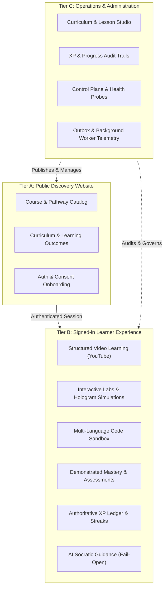
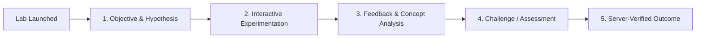

# GENIUSPHERE — PRODUCT PURPOSE, LEARNING EXPERIENCE & POLYGLOT ENGINEERING CONSTITUTION

**Document Version:** 1.0.0-PROD  
**Authority:** Supreme Architectural & Pedagogical Source of Truth  
**Target Environments:** Web / Node.js 20+ / PostgreSQL 16 / Python 3.10+ / Docker Compose  

---

## 1. Mission & Engineering Identity

Geniusphere is a production-oriented digital learning platform engineered to help learners acquire practical technology, financial literacy, and industry-relevant skills through structured video lessons, interactive simulations, real assessments, projects, and sustainable learning habits.

Geniusphere is **not** merely:
- A marketing website.
- A collection of embedded YouTube links.
- A gamified toy dashboard with arbitrary counters.
- A wrapper around a generative AI chatbot.

**Geniusphere is a complete, unified learning operating system that connects what a learner watches, what they practise, what they understand, what they achieve, and what they should learn next.**

All engineering decisions must preserve existing working functionality, maintain real-data integrity (no production mocks or fabricated progress), enforce least-privilege security, and ensure bounded resource governance on budget learner hardware.

---

## 2. Product Architecture: Three Connected Tiers

Geniusphere consists of three distinct yet tightly integrated product areas:

### A. Public Discovery Website
* **Course and learning-path discovery:** Clear, accessible overviews of Technology, Finance, and Professional courses without authentication walls.
* **Prerequisites & outcomes:** Explicit competency roadmaps showing what skills learners will demonstrably acquire.
* **Accessible chrome:** WCAG 2.1 AA responsive layouts adapting seamlessly from mobile touchscreens (360px) to ultra-wide displays.
* **Onboarding & Minor Protection:** DPDP Act 2023 compliant registration with verifiable age gating and parental/school proxy consent paths.

### B. Learner Application (Primary Signed-In Experience)
* **Authoritative server state:** A learner's dashboard must reflect actual server-persisted database records (`public.lesson_progress`, `public.xp_ledger`). Never populate dashboards with fabricated progress, random XP, or simulated course completions.
* **Unified learning loop:** Connects video lectures $\rightarrow$ guided notes $\rightarrow$ interactive lab practice $\rightarrow$ concept quizzes $\rightarrow$ code sandbox exercises $\rightarrow$ certified completion.

### C. Platform Operations & Administration
* **Separation of privilege:** Teacher and admin operations reside behind strict server-side authorization guards (`authenticateRequest` with `role = 'teacher' | 'admin' | 'superadmin'`). Never trust browser claims for roles, scores, or XP.
* **Observability & Health:** Deep `/health/readiness` and fast `/health/liveness` container probes, query latency tracking, queue depth statistics, and structured JSON audit trails.

---

## 3. Video-Based Learning Engine Contract

YouTube serves strictly as a high-bandwidth, global video delivery pipeline—**not** the platform's pedagogical source of truth.

### The Pedagogical Hierarchy
$$\text{Course} \longrightarrow \text{Modules} \longrightarrow \text{Lessons} \longrightarrow \text{Activities} \longrightarrow \text{Assessments} \longrightarrow \text{Verified Competency}$$

### Core Distinction
The system strictly distinguishes between four independent progression states:
1. **Video Playback State:** The learner's current timestamp, playback rate, and buffered intervals in the YouTube player.
2. **Lesson Activity Completion:** Active engagement with lesson notes, key takeaways, and interactive checkpoints.
3. **Assessment Performance:** Genuine submission and scoring of concept quizzes and coding challenges.
4. **Demonstrated Competency:** Verifiable skill acquisition recorded in the student's mastery profile.

> [!IMPORTANT]
> Merely launching a video or skipping to the final second does **not** equal comprehension. Consequential XP and pathway unlock events require verified activity engagement and assessment validation.

---

## 4. Interactive Labs & Simulation Specifications

The Labs system unifies 2D vector simulations, interactive coding terminals, dynamic canvas models, and advanced 3D visual experiences.

### Simulation Categories & Technical Choices
* **Visual Science & Technology (2D):** SVG / HTML5 Canvas / CSS transforms. Lightweight, zero WebAssembly overhead, 60 FPS on mobile.
* **Cybersecurity in Controlled Environments:** Sandboxed packet sniffers, SQL injection simulators, cryptographic cipher wheels, and firewall visualizers.
* **Systems & Cloud Architecture:** Interactive network topologies, microservice fault injection, and message queue backpressure simulators.
* **Economics & Financial Models:** Dynamic interest rate curves, portfolio volatility sliders, and supply-demand price discovery engines.
* **Hologram-Style Interactive 3D Visual Learning:** Multi-layered visual simulations featuring exploded component views, interactive rotational controls, layered depth buffers, and explanatory HUD overlays.

### Resource & Teardown Governance
* Every lab component must cleanly cancel `requestAnimationFrame`, dispose of WebGL buffers/textures, terminate Web Workers, and unbind window resize/keyboard listeners upon unmount.
* Fallback smoothly on low-end hardware or battery-saver modes with reduced-motion support.

---

## 5. Learning Progression, Authoritative XP Ledger & Streaks

Gamification must reward genuine learning habits rather than encourage superficial click-farming.

### Auditable XP Ledger
* The server (`public.xp_ledger`) is the sole authority for learner XP.
* Every XP grant is backed by an immutable ledger row containing:
  `id`, `user_id`, `amount`, `event_type`, `entity_id`, `idempotency_key`, and `created_at`.
* Idempotency keys (`hash(userId + eventType + entityId)`) guarantee that network retries or double clicks cannot award duplicate points.

### Streak Calculation Engine
* A **Qualifying Learning Day** requires at least one of:
  1. Passing an assessment quiz ($\ge 70\%$).
  2. Submitting a verified code sandbox challenge.
  3. Completing a verified lesson activity with $\ge 5$ minutes active engagement.
* Streak boundaries are computed against UTC (or user-configured timezone) with consistent day-break evaluation to eliminate clock-skew manipulation.

### Leaderboard Integrity
* Global, cohort, and weekly leaderboards are derived from aggregated `xp_ledger` SQL queries (`SUM(amount)` over window), never mutable in-memory state.
* Zero fake competitor accounts or synthetic bots; if a cohort has 3 learners, the leaderboard truthfully renders 3 learners.

---

## 6. AI-Assisted Learning Boundaries & Resilience

Geniusphere integrates Socratic AI assistance as an optional, enhancing capability—**never as a single point of failure**.

### Boundaries
* **Read-Only Advisory:** AI recommendations and hints can explain code or clarify misconceptions, but AI models can **never** directly mutate student XP, bypass course prerequisites, or alter grades.
* **Provider Agnosticism:** Pluggable adapter architecture supports private local models (Ollama with `llama3.2` / `deepseek-r1`) and cloud APIs (Google Gemini) through a unified `AIGateway`.
* **Fail-Open Curriculum Access:** In the event of an AI service outage, rate-limit exhaustion, or network interruption, the entire curriculum, video player, labs, sandbox, and assessments remain 100% operational.
* **Defensive Prompt Engineering:** Student queries and course context are sanitised against prompt injection and jailbreaks. PII is scrubbed before transmission.

---

## 7. Polyglot Engineering Responsibility Matrix

Geniusphere applies languages strictly where they provide maximum leverage, performance, and developer ergonomics:

| Language / Tech | Target Subsystems | Architectural Advantage & Responsibility |
|:---|:---|:---|
| **TypeScript (React 19 / Vite)** | `src/` Client Application | Type-safe component trees, lab registry, UI state contracts, mobile gesture handling. |
| **TypeScript (Fastify 5)** | `server/` Backend Services | High-throughput async REST API, WebSocket gateway, auth guards, transactional outbox dispatch. |
| **PostgreSQL 16 (SQL)** | `supabase/migrations/` | Relational integrity, foreign keys, ACID transactions, RLS policies, auditable XP ledger. |
| **Python 3.10+** | `tools/polyglot/` | Offline LLM evaluation, PII leak audits, prompt defense tests, psychometric item analysis ($p, D$). |
| **HTML5 / Canvas / SVG** | `src/labs/`, `src/components/` | Lightweight 60 FPS interactive visual simulations without heavy WebAssembly overhead. |
| **Bash & Docker** | `scripts/`, `docker-compose.yml` | Declarative container orchestration (Caddy, App, Postgres, Ollama), verified backup & restore drills. |

---

## 8. Whole-System Security, Privacy & Learner Protection

1. **Authentication:** Fail-closed JWT token verification with strict expiration, signature checking, and account status checks (`active` vs `suspended`).
2. **Authorization:** Server-side role validation (`learner`, `teacher`, `admin`, `superadmin`). UI element visibility is for convenience, not security.
3. **Data Integrity:** Parameterized SQL queries (`$1, $2`) across all endpoints; zero dynamic string concatenation into SQL statements.
4. **Minor Safety (DPDP 2023):** Zero behavioral advertising trackers, verifiable parent/institutional consent, and strict data minimization.

---

## 9. Performance & Resource Governance

* **Memory Safety:** Strict capacity caps on all in-memory collections (WS sockets: 5/user, WS channels: 30/socket, rate limiter cache: 2,000 buckets, outbox queue: 200 events).
* **Timer Safety:** All background polling intervals use `.unref()` and expose explicit `stop()` methods for graceful shutdown.
* **Bundle Efficiency:** Code-split lab workspaces and vendor libraries to maintain sub-5s initial load times on 4G networks.

---

## 10. Capability Inventory & Verification Baseline

| Capability | Current Status | Code Verification Anchor |
|:---|:---:|:---|
| **Course & Topic Catalog** | **Verified (Real)** | `src/data/curriculum.ts` (17 canonical topics, 170 lessons) |
| **Video Learning Engine** | **Verified (Real)** | `src/components/LessonPlayer.tsx` & `src/components/YouTubeLessonPlayer.tsx` |
| **Interactive Labs Engine** | **Verified (Real)** | `src/labs/registry.tsx` (15 interactive labs registered) |
| **Multi-Language Sandbox** | **Verified (Real)** | `src/utils/codeSandboxRunner.ts` (7 languages, eval-free) |
| **Real-time Bus & Gateway** | **Verified (Real)** | `src/backend/RealtimeBus.ts` & `server/services/websocketGateway.ts` |
| **Transactional Outbox** | **Verified (Real)** | `src/backend/TransactionalOutbox.ts` (bounded, idempotent) |
| **Authoritative DB Schema** | **Verified (Real)** | `supabase/migrations/` (11 migrations, 100% applied) |
| **Automated Test Coverage** | **Verified (Real)** | 495 tests passing (482 Vitest + 13 Pytest) |
