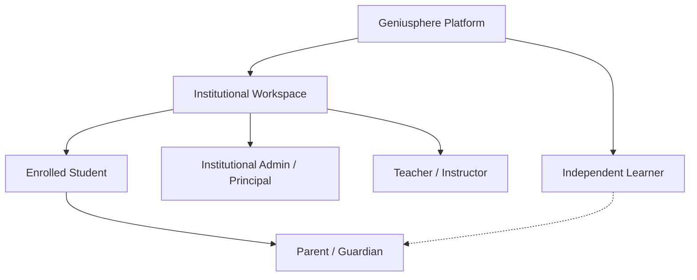
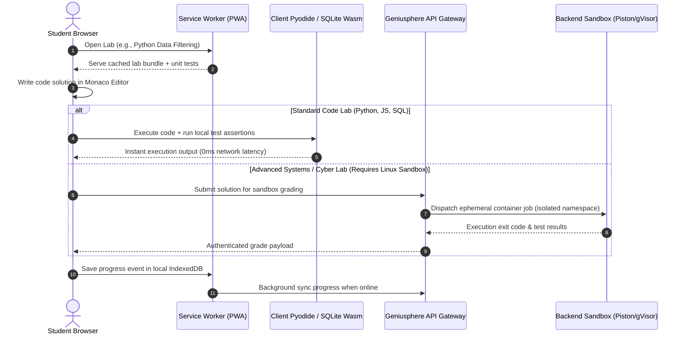

# Geniusphere — Product Specification (`PRODUCT_SPEC.md`)

*Document Version:* 1.0.0  
*Status:* Draft Proposal for Architectural Review  
*Target Launch Phase:* Pilot (Phase 1)  

---

## 1. Vision & Problem Statement

### 1.1. Core Mission
Geniusphere is an education technology platform engineered to make modern **Technology, Finance, and Professional Skills** accessible, engaging, and genuinely functional for independent learners and educational institutions, regardless of their background or hardware constraints.

### 1.2. The Core Problems
1. **The Practical Competency Gap:** Traditional education in emerging economies heavily relies on rote memorization and theoretical exams. Students graduate with degrees in computer science or commerce without ever having configured a firewall, queried a production database, or analyzed a balance sheet.
2. **Prohibitive Hardware & Infrastructure Barriers:** High-end virtual labs (e.g., Labster) demand powerful graphics hardware and high-speed broadband. Millions of Indian students rely on budget Android smartphones or entry-level laptops over intermittent 4G mobile data.
3. **Institutional Software Decay:** Educational institutions are caught between fragmented consumer apps (which offer no classroom oversight) and archaic, difficult-to-maintain legacy LMS platforms (e.g., Moodle) that lack modern hands-on technical labs.
4. **Predatory Billing & Dark Gamification:** Mainstream consumer ed-tech frequently locks users into surprise annual billing traps or implements punitive gamification (e.g., Duolingo "hearts" lockouts) that prioritize monetization over pedagogy.
5. **Evolving Child Privacy Standards:** Under India’s **DPDP Act 2023**, educational platforms must uphold verifiable parental consent, privacy-by-design, and zero behavioral ad-tracking for users under 18.

---

## 2. Target Personas & Stakeholder Profiles

### 2.1. Persona A: Independent Learner (Aarav, 19, Tier-2 Engineering Student)
- **Context:** Aspires to become a software engineer or cybersecurity analyst; college syllabus is outdated; accesses the platform primarily via a budget laptop and mobile phone hotspot.
- **Needs:** Self-paced, hands-on coding exercises, real-world scenario simulations, verifiable skill certificates to show employers, and low-latency interactive feedback.
- **Pain Points:** High international subscription costs, slow VPN connections to overseas VMs, and tutorials that hold hands too much without fostering problem-solving skills.

### 2.2. Persona B: School/College Teacher (Prof. Sunita, 42, Computer Science Faculty)
- **Context:** Teaches 120+ students across two sections; burdened by grading paper assignments and manually checking code printouts.
- **Needs:** Rapid class workspace creation, one-click assignment distribution, auto-graded coding labs, an anti-plagiarism overview, and a student progress gradebook.
- **Pain Points:** Moodle is cumbersome; Google Classroom lacks integrated interactive code execution; hard to identify struggling students early.

### 2.3. Persona C: Institutional Administrator (Dean/Principal Sharma, 54, Polytechnic Institute)
- **Context:** Needs to modernize institutional curriculum to boost graduate placement rates and fulfill NAAC / NBA accreditation requirements.
- **Needs:** Centralized dashboard for institutional analytics, teacher adoption metrics, department-level skill audits, secure multi-tenant isolation, and automated data exports.
- **Pain Points:** Enterprise software quotes are exorbitant;担心 student data compliance breaches under Indian IT and DPDP regulations.

### 2.4. Persona D: Parent/Guardian (Ramesh, 46, Father of Minor High School Student)
- **Context:** Wants his 15-year-old daughter to learn financial literacy and coding safely.
- **Needs:** Transparent, verifiable consent mechanism; read-only visibility into learning hours and achievements; guarantee of zero targeted ads, zero predatory lockouts, and strict child privacy.
- **Pain Points:** Opaque data tracking, fear of unauthorized credit card charges, and apps that turn learning into addictive screen-time traps.

---

## 3. Core User Journeys & End-to-End Workflows

### 3.1. Workflow 1: Minor Learner Onboarding & Verifiable Parental Consent (DPDP Compliant)
1. **Registration:** Learner enters email/phone and date of birth.
2. **Age-Gate Logic:**
   - If Age >= 18: Standard account creation proceeding to profile setup.
   - If Age < 18: Trigger Minor Protection Protocol (DPDP Section 9).
3. **Parent Verification:**
   - Minor provides Parent/Guardian email and mobile number.
   - System dispatches a localized, transparent consent notice detailing what data is stored (strictly educational progress) and confirming **zero tracking / zero ads**.
   - Parent verifies consent via a secure SMS OTP or time-limited verification link.
   - *Alternative Institutional Path:* If enrolled via a recognized educational institution with an executed Data Processing Agreement, the school acts as lawful proxy within educational scope.
4. **Activation:** Account is created with all telemetry/tracking strictly disabled at the database level.

### 3.2. Workflow 2: Interactive Technical Lab & Hands-on Coding

### 3.3. Workflow 3: Institutional Workspace & Class Assignment Distribution
1. **Workspace Setup:** Institutional Admin creates a verified Organization (`OrgID`) and assigns teachers (`Role: Teacher`).
2. **Classroom Provisioning:** Teacher creates a Course Section (e.g., "Intro to Cybersecurity — Batch 2026") and generates a 6-character enrollment join code or imports a roster CSV.
3. **Assignment Creation:** Teacher selects a modular lab from the Geniusphere Curriculum Library (or configures custom unit test criteria) and assigns a deadline.
4. **Student Completion:** Students complete the interactive lab. Submissions are auto-evaluated against defined assertions.
5. **Gradebook Review:** Teacher accesses live matrix: view submission timestamps, execution test passes, attempt counts, and code diffs. Teacher can leave targeted inline feedback.

### 3.4. Workflow 4: Offline Learning & Resilient Progress Sync
1. **Preparation:** Learner clicks "Save Track Offline" on home Wi-Fi.
2. **Caching:** The Service Worker stores course Markdown, visual SVGs, unit test criteria, and WebAssembly runtime files into `CacheStorage`.
3. **Offline Mode:** Learner works on a commute or during power cuts. Monaco Editor and Pyodide execute code locally. Progress events are appended to an IndexedDB transaction log (`sync_queue`).
4. **Reconnection:** Upon network recovery (`window.addEventListener('online')`), the Service Worker triggers background synchronization:
   - Client sends queued events with client-generated UUIDs and monotonic timestamps.
   - Backend evaluates idempotency keys, updates student skill progression, and returns a reconciliation acknowledgement.

---

## 4. Proposed Feature Scope: Phase 1 Pilot vs. Post-Pilot

| Module | Phase 1 Pilot Scope (Strictly Scoped) | Post-Pilot / Future Roadmap (Requires Explicit Approval) |
|---|---|---|
| **User & IAM** | Email/Password + OTP auth; RBAC (Student, Teacher, Admin, Parent); DPDP minor verification; School roster CSV import. | Single Sign-On (SAML/Google Workspace/Microsoft Edu); Biometric webauthn. |
| **Curriculum & Content** | 3 Foundational Tracks:  1. *Web Tech & Python Fundamentals*  2. *Cybersecurity Awareness & Defense*  3. *Financial Literacy & Business Math*. | Advanced DevOps, Cloud Architecture, Applied AI/ML training, Stock Trading Simulators. |
| **Interactive Labs** | In-browser WebAssembly execution (Pyodide Python, SQLite Wasm, JavaScript Worker); client-side interactive SVG simulations. | Full Linux microVM terminal sandboxes (Firecracker / Docker gVisor); live multi-node networking labs. |
| **Institutional LMS** | Organization creation, Teacher class builder, Assignment distribution, Auto-graded submissions, Student Gradebook. | Institutional ERP integration, custom white-label branding, automated proctoring. |
| **Gamification** | Ethical mechanics: Skill progression trees, daily streak with rest-day protection, mastery badges, modular quests. | School vs. School competitive leagues, public XP leaderboards, tokenized achievements. |
| **PWA & Offline** | Offline lesson reading, offline code execution (Wasm), local IndexedDB sync queue with idempotent merge. | Full background video pre-fetching, peer-to-peer classroom Wi-Fi mesh sync. |
| **Monetization** | **Excluded from Pilot.** 100% free pilot for partner institutions and initial cohort. | Tiered B2B institutional licensing, optional student pro certification fee via UPI/Razorpay. |

---

## 5. Acceptance Criteria & Pilot Verification Metrics

Every feature implemented during Phase 1 must satisfy these objective criteria:

1. **Security & Privacy:**
   - Zero third-party ad network or tracking scripts injected into any bundle.
   - Minor accounts (<18) cannot be converted to active without verified parent OTP or school proxy verification.
   - All tenant data queries enforce Organization ID boundary checks (PostgreSQL Row-Level Security).
2. **Performance & Responsiveness:**
   - First Contentful Paint (FCP) under **1.8s** on simulated 4G connection (Fast 3G/Regular 4G).
   - Time to Interactive (TTI) for coding labs under **3.5s**.
   - Fluid 60fps animations across all interactive SVG/Canvas modules on mobile viewport (360px–420px width).
3. **Reliability & Offline Capability:**
   - Fully accessible offline: reading previously loaded lessons and running Python/SQL Wasm labs without network connectivity.
   - Zero lost progress events when network drops during lab completion; successful reconciliation upon reconnect.
4. **Accessibility:**
   - 100% keyboard navigable with visible focus states.
   - Screen-reader friendly semantic headings and ARIA landmarks conforming to **WCAG 2.1 Level AA**.
