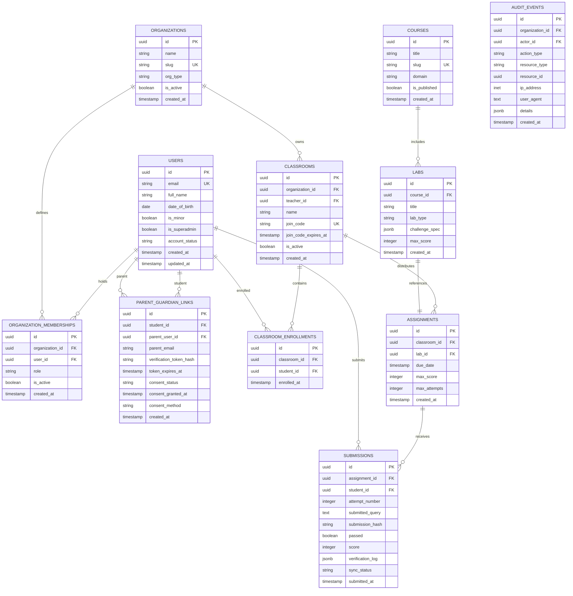

# Geniusphere — Technical Blueprint & Architecture (`TECHNICAL_BLUEPRINT.md`)

*Document Version:* 1.4.0  
*Status:* Corrected Specification (Pre-Implementation) — Awaiting Runtime Verification  
*Target Launch Phase:* Pilot (Phase 1)  
*Review Phase:* Phase 0.4 Final Blocker Review  

---

## 1. Architectural Philosophy & Guiding Principles

1. **Decoupled Identity & Complete Executable Authorization:** Personal user identity (`users`) is strictly decoupled from institutional tenant memberships (`organization_memberships`) and parent links (`parent_guardian_links`). All RLS policies provide executable `USING` and `WITH CHECK` clauses. All `SECURITY DEFINER` helpers are owned by `postgres`, have fixed `search_path = public`, check authenticated caller validity, and verify entity active states.
2. **Server-Authoritative Anti-Tamper Grading:** The client UI runs SQLite-Wasm locally for instant interactive feedback, but official grades, submission hashes, and attempt logs are computed and persisted exclusively by a serverless Edge Function running with `service_role` privileges after verifying classroom enrollment and attempt limits.
3. **Verified Parameter Binding Contract:** Lab 101 evaluates genuine parameter binding (`db.prepare().all(arg)`) rather than string concatenation or pseudo-parameterized string replacement. Parser checks handle comments, multi-statements, and semicolons.
4. **Execution Sandbox with Host Watchdog:** The execution timeout (1.0s) is enforced outside the worker thread in the host Edge Function process (`setTimeout(() => worker.terminate(), 1000)`). Runtime memory ceilings are marked as unverified until demonstrated in Milestone 1.
5. **Mobile-First & Bandwidth-Conscious:** Standardize on **CodeMirror 6 (~250KB)** and **SQLite-Wasm (~1.1MB)** to guarantee fluid performance on budget Android smartphones (1–2GB RAM) over Indian 4G cellular networks.
6. **Transparent Cost Ownership:** Standard pilot operating cost is constrained to **~$30.98/month (~₹2,600 INR)** using in-database audit logging. External S3 Log Drains ($60/mo add-on) are **strictly disabled** during the pilot to honor the $35/month spend ceiling.

---

## 2. Complete Relational Data Model (10 Core Tables + Audit Logs)



---

## 3. Product Scope Classification (Pilot vs Later vs Excluded)

To ensure the relational database and product architecture support the intended platform, all product domains are explicitly classified:

| Product Area | Pilot Core Scope (Milestone 1–4) | Post-Pilot Release Scope | Explicit Exclusion |
|---|---|---|---|
| **Identity & Access** | Decoupled `users` + `organization_memberships`, age-gated registration, parent email token. | Government tokenized identity (DigiLocker), institutional SSO (SAML/Google Workspace). | Unrestricted minor self-authorization without parent notice. |
| **Institutional Lifecycle** | Crockford Base32 join-code provisioning, teacher classroom creation, student enrollment. | CSV bulk student roster import, automated SIS integrations (Clever/OneRoster). | Public unmoderated classroom discoverability. |
| **Curriculum & Content** | Foundations of Web Security & SQL Defense (Lesson 1 & Lab 101). | Finance & Math modules, Professional Skills, Python/AI sandboxes. | Unsandboxed client code execution against production DB. |
| **Labs & Grading** | SQLite-Wasm in-browser runner + server-authoritative Deno Edge Grader. | Automated multi-stage CTF challenges, interactive web exploit visualizers. | Client-side self-awarded certificates or untrusted grades. |
| **Progression & Credentials** | "Defense Initiate" badge on Lab 101 pass, student gradebook entry, habit streak. | Cryptographically verifiable PDF certificates, skill tree branches, squad missions. | Commercial gaming IP clones (PUBG/Free Fire assets) or paywalled hearts. |
| **Monetization & Billing** | Zero billing infrastructure ($0 institutional grant/pilot tier). | Stripe / Razorpay institutional recurring invoicing and seat licenses. | In-app credit purchases or predatory microtransactions. |
| **Client Platforms** | Installable responsive PWA (CodeMirror 6, mobile viewport down to 360px). | Desktop desktop-enhanced layouts, offline lesson pack downloads. | Native iOS / Android app store binary builds. |

---

## 4. PostgreSQL 16 Schema Definition & Relational Invariants

```sql
-- 1. ORGANIZATIONS
CREATE TABLE public.organizations (
    id UUID PRIMARY KEY DEFAULT gen_random_uuid(),
    name VARCHAR(255) NOT NULL,
    slug VARCHAR(100) UNIQUE NOT NULL,
    org_type VARCHAR(50) NOT NULL CHECK (org_type IN ('school', 'college', 'university', 'independent_learning')),
    is_active BOOLEAN NOT NULL DEFAULT TRUE,
    created_at TIMESTAMPTZ NOT NULL DEFAULT NOW()
);

-- 2. USERS (Profiles - Decoupled Identity)
CREATE TABLE public.users (
    id UUID PRIMARY KEY REFERENCES auth.users(id) ON DELETE CASCADE,
    email VARCHAR(255) UNIQUE NOT NULL,
    full_name VARCHAR(255) NOT NULL,
    date_of_birth DATE NOT NULL,
    is_minor BOOLEAN NOT NULL DEFAULT FALSE,
    is_superadmin BOOLEAN NOT NULL DEFAULT FALSE,
    account_status VARCHAR(50) NOT NULL DEFAULT 'active' CHECK (account_status IN ('active', 'pending_parent_consent', 'suspended')),
    created_at TIMESTAMPTZ NOT NULL DEFAULT NOW(),
    updated_at TIMESTAMPTZ NOT NULL DEFAULT NOW()
);

-- Column-level privilege restriction: users can only update full_name
REVOKE UPDATE ON public.users FROM PUBLIC, anon, authenticated;
GRANT UPDATE (full_name) ON public.users TO authenticated;

-- 3. ORGANIZATION MEMBERSHIPS (Scoped Roles per Institution)
CREATE TABLE public.organization_memberships (
    id UUID PRIMARY KEY DEFAULT gen_random_uuid(),
    organization_id UUID NOT NULL REFERENCES public.organizations(id) ON DELETE CASCADE,
    user_id UUID NOT NULL REFERENCES public.users(id) ON DELETE CASCADE,
    role VARCHAR(50) NOT NULL CHECK (role IN ('learner', 'teacher', 'institution_admin', 'curriculum_author')),
    is_active BOOLEAN NOT NULL DEFAULT TRUE,
    created_at TIMESTAMPTZ NOT NULL DEFAULT NOW(),
    UNIQUE(organization_id, user_id, role)
);

-- Invariant Trigger: Prevent removal of the last institution_admin of an organization
CREATE OR REPLACE FUNCTION public.check_last_admin_removal()
RETURNS TRIGGER LANGUAGE plpgsql SECURITY DEFINER SET search_path = public AS $$
DECLARE
    admin_count INTEGER;
BEGIN
    IF OLD.role = 'institution_admin' AND (TG_OP = 'DELETE' OR NEW.is_active = FALSE OR NEW.role != 'institution_admin') THEN
        SELECT COUNT(*) INTO admin_count
        FROM public.organization_memberships
        WHERE organization_id = OLD.organization_id 
          AND role = 'institution_admin' 
          AND is_active = TRUE 
          AND id != OLD.id;
          
        IF admin_count = 0 THEN
            RAISE EXCEPTION 'Cannot remove or deactivate the last active institution_admin of organization %', OLD.organization_id
            USING ERRCODE = '23514'; -- check_violation
        END IF;
    END IF;
    RETURN COALESCE(NEW, OLD);
END;
$$;

CREATE TRIGGER trg_prevent_last_admin_removal
BEFORE UPDATE OR DELETE ON public.organization_memberships
FOR EACH ROW EXECUTE FUNCTION public.check_last_admin_removal();

-- 4. PARENT-GUARDIAN LINKS
CREATE TABLE public.parent_guardian_links (
    id UUID PRIMARY KEY DEFAULT gen_random_uuid(),
    student_id UUID NOT NULL REFERENCES public.users(id) ON DELETE CASCADE,
    parent_user_id UUID REFERENCES public.users(id) ON DELETE SET NULL,
    parent_email VARCHAR(255) NOT NULL,
    verification_token_hash VARCHAR(64),
    token_expires_at TIMESTAMPTZ,
    consent_status VARCHAR(50) NOT NULL DEFAULT 'pending' CHECK (consent_status IN ('pending', 'verified', 'revoked')),
    consent_granted_at TIMESTAMPTZ,
    consent_method VARCHAR(50) CHECK (consent_method IN ('email_verification_link', 'school_proxy_pilot')),
    created_at TIMESTAMPTZ NOT NULL DEFAULT NOW(),
    UNIQUE(student_id, parent_email)
);

-- 5. CLASSROOMS
CREATE TABLE public.classrooms (
    id UUID PRIMARY KEY DEFAULT gen_random_uuid(),
    organization_id UUID NOT NULL REFERENCES public.organizations(id) ON DELETE CASCADE,
    teacher_id UUID NOT NULL REFERENCES public.users(id) ON DELETE RESTRICT,
    name VARCHAR(255) NOT NULL,
    join_code VARCHAR(8) UNIQUE NOT NULL, -- 8-character Crockford Base32
    join_code_expires_at TIMESTAMPTZ NOT NULL,
    is_active BOOLEAN NOT NULL DEFAULT TRUE,
    created_at TIMESTAMPTZ NOT NULL DEFAULT NOW()
);

-- Invariant Trigger: Verify teacher belongs to the classroom's organization with role 'teacher' or 'institution_admin'
CREATE OR REPLACE FUNCTION public.check_teacher_org_membership()
RETURNS TRIGGER LANGUAGE plpgsql SECURITY DEFINER SET search_path = public AS $$
BEGIN
    IF NOT EXISTS (
        SELECT 1 FROM public.organization_memberships
        WHERE organization_id = NEW.organization_id 
          AND user_id = NEW.teacher_id 
          AND role IN ('teacher', 'institution_admin')
          AND is_active = TRUE
    ) THEN
        RAISE EXCEPTION 'Classroom teacher % must be an active teacher or admin in organization %', NEW.teacher_id, NEW.organization_id
        USING ERRCODE = '23514';
    END IF;
    RETURN NEW;
END;
$$;

CREATE TRIGGER trg_verify_classroom_teacher
BEFORE INSERT OR UPDATE ON public.classrooms
FOR EACH ROW EXECUTE FUNCTION public.check_teacher_org_membership();

-- 6. CLASSROOM ENROLLMENTS
CREATE TABLE public.classroom_enrollments (
    id UUID PRIMARY KEY DEFAULT gen_random_uuid(),
    classroom_id UUID NOT NULL REFERENCES public.classrooms(id) ON DELETE CASCADE,
    student_id UUID NOT NULL REFERENCES public.users(id) ON DELETE CASCADE,
    enrolled_at TIMESTAMPTZ NOT NULL DEFAULT NOW(),
    UNIQUE(classroom_id, student_id)
);

-- 7. COURSES
CREATE TABLE public.courses (
    id UUID PRIMARY KEY DEFAULT gen_random_uuid(),
    title VARCHAR(255) NOT NULL,
    slug VARCHAR(100) UNIQUE NOT NULL,
    domain VARCHAR(50) NOT NULL CHECK (domain IN ('technology', 'cybersecurity', 'finance', 'professional')),
    is_published BOOLEAN NOT NULL DEFAULT FALSE,
    created_at TIMESTAMPTZ NOT NULL DEFAULT NOW()
);

-- 8. LABS
CREATE TABLE public.labs (
    id UUID PRIMARY KEY DEFAULT gen_random_uuid(),
    course_id UUID NOT NULL REFERENCES public.courses(id) ON DELETE CASCADE,
    title VARCHAR(255) NOT NULL,
    lab_type VARCHAR(50) NOT NULL CHECK (lab_type IN ('sqlite_wasm', 'python_wasm', 'conceptual_quiz')),
    challenge_spec JSONB NOT NULL,
    max_score INTEGER NOT NULL DEFAULT 100,
    created_at TIMESTAMPTZ NOT NULL DEFAULT NOW()
);

-- 9. ASSIGNMENTS
CREATE TABLE public.assignments (
    id UUID PRIMARY KEY DEFAULT gen_random_uuid(),
    classroom_id UUID NOT NULL REFERENCES public.classrooms(id) ON DELETE CASCADE,
    lab_id UUID NOT NULL REFERENCES public.labs(id) ON DELETE RESTRICT,
    due_date TIMESTAMPTZ,
    max_score INTEGER NOT NULL DEFAULT 100,
    max_attempts INTEGER NOT NULL DEFAULT 10,
    created_at TIMESTAMPTZ NOT NULL DEFAULT NOW()
);

-- 10. SUBMISSIONS (Server-Authoritative Anti-Tamper)
CREATE TABLE public.submissions (
    id UUID PRIMARY KEY DEFAULT gen_random_uuid(),
    assignment_id UUID NOT NULL REFERENCES public.assignments(id) ON DELETE CASCADE,
    student_id UUID NOT NULL REFERENCES public.users(id) ON DELETE CASCADE,
    attempt_number INTEGER NOT NULL DEFAULT 1,
    submitted_query TEXT NOT NULL,
    submission_hash VARCHAR(64) NOT NULL,
    passed BOOLEAN NOT NULL DEFAULT FALSE,
    score INTEGER NOT NULL DEFAULT 0,
    verification_log JSONB NOT NULL DEFAULT '{}'::jsonb,
    sync_status VARCHAR(50) NOT NULL DEFAULT 'SERVER_CONFIRMED' CHECK (sync_status IN ('LOCAL_UNSYNCED', 'SYNCING', 'SERVER_CONFIRMED', 'SYNC_CONFLICT')),
    submitted_at TIMESTAMPTZ NOT NULL DEFAULT NOW(),
    UNIQUE(assignment_id, student_id, attempt_number)
);

-- Column grants: regular users cannot alter score, passed, verification_log, or sync_status
REVOKE UPDATE, INSERT ON public.submissions FROM PUBLIC, anon, authenticated;
GRANT INSERT (assignment_id, student_id, attempt_number, submitted_query, submission_hash) ON public.submissions TO authenticated;

-- 11. AUDIT EVENTS (180-Day Domestic Log)
CREATE TABLE public.audit_events (
    id UUID PRIMARY KEY DEFAULT gen_random_uuid(),
    organization_id UUID REFERENCES public.organizations(id) ON DELETE SET NULL,
    actor_id UUID REFERENCES public.users(id) ON DELETE SET NULL,
    action_type VARCHAR(100) NOT NULL,
    resource_type VARCHAR(100) NOT NULL,
    resource_id UUID,
    ip_address INET,
    user_agent TEXT,
    details JSONB,
    created_at TIMESTAMPTZ NOT NULL DEFAULT NOW()
);

-- Audit table is strictly append-only for authenticated callers
REVOKE UPDATE, DELETE ON public.audit_events FROM PUBLIC, anon, authenticated;
GRANT INSERT ON public.audit_events TO authenticated, service_role;
```

---

## 5. Hardened Non-Recursive Authorization Functions

All helper functions run with `SECURITY DEFINER`, fixed `search_path = public`, and explicit function execution privileges:

```sql
-- 1. Check Organization Role with Active Invariant
CREATE OR REPLACE FUNCTION public.has_org_role(target_org_id UUID, required_role VARCHAR)
RETURNS BOOLEAN LANGUAGE plpgsql STABLE SECURITY DEFINER SET search_path = public AS $$
BEGIN
    IF auth.uid() IS NULL THEN RETURN FALSE; END IF;
    RETURN EXISTS (
        SELECT 1 
        FROM public.organization_memberships om
        JOIN public.organizations o ON o.id = om.organization_id
        WHERE om.organization_id = target_org_id 
          AND om.user_id = auth.uid() 
          AND om.role = required_role
          AND om.is_active = TRUE
          AND o.is_active = TRUE
    );
END;
$$;
ALTER FUNCTION public.has_org_role(UUID, VARCHAR) OWNER TO postgres;
REVOKE ALL ON FUNCTION public.has_org_role(UUID, VARCHAR) FROM PUBLIC;
GRANT EXECUTE ON FUNCTION public.has_org_role(UUID, VARCHAR) TO authenticated, service_role;

-- 2. Check Classroom Teacher Authority
CREATE OR REPLACE FUNCTION public.is_classroom_teacher(target_class_id UUID)
RETURNS BOOLEAN LANGUAGE plpgsql STABLE SECURITY DEFINER SET search_path = public AS $$
BEGIN
    IF auth.uid() IS NULL THEN RETURN FALSE; END IF;
    RETURN EXISTS (
        SELECT 1 
        FROM public.classrooms c
        WHERE c.id = target_class_id 
          AND c.teacher_id = auth.uid()
          AND c.is_active = TRUE
    );
END;
$$;
ALTER FUNCTION public.is_classroom_teacher(UUID) OWNER TO postgres;
REVOKE ALL ON FUNCTION public.is_classroom_teacher(UUID) FROM PUBLIC;
GRANT EXECUTE ON FUNCTION public.is_classroom_teacher(UUID) TO authenticated, service_role;

-- 3. Check Classroom Enrollment
CREATE OR REPLACE FUNCTION public.is_enrolled_student(target_class_id UUID)
RETURNS BOOLEAN LANGUAGE plpgsql STABLE SECURITY DEFINER SET search_path = public AS $$
BEGIN
    IF auth.uid() IS NULL THEN RETURN FALSE; END IF;
    RETURN EXISTS (
        SELECT 1 
        FROM public.classroom_enrollments ce
        JOIN public.classrooms c ON c.id = ce.classroom_id
        WHERE ce.classroom_id = target_class_id 
          AND ce.student_id = auth.uid()
          AND c.is_active = TRUE
    );
END;
$$;
ALTER FUNCTION public.is_enrolled_student(UUID) OWNER TO postgres;
REVOKE ALL ON FUNCTION public.is_enrolled_student(UUID) FROM PUBLIC;
GRANT EXECUTE ON FUNCTION public.is_enrolled_student(UUID) TO authenticated, service_role;

-- 4. Check Verified Guardian Authority
CREATE OR REPLACE FUNCTION public.is_verified_parent(target_student_id UUID)
RETURNS BOOLEAN LANGUAGE plpgsql STABLE SECURITY DEFINER SET search_path = public AS $$
BEGIN
    IF auth.uid() IS NULL THEN RETURN FALSE; END IF;
    RETURN EXISTS (
        SELECT 1 
        FROM public.parent_guardian_links pgl
        WHERE pgl.student_id = target_student_id 
          AND pgl.parent_user_id = auth.uid() 
          AND pgl.consent_status = 'verified'
    );
END;
$$;
ALTER FUNCTION public.is_verified_parent(UUID) OWNER TO postgres;
REVOKE ALL ON FUNCTION public.is_verified_parent(UUID) FROM PUBLIC;
GRANT EXECUTE ON FUNCTION public.is_verified_parent(UUID) TO authenticated, service_role;

-- 5. Check Teacher of Student Authority
CREATE OR REPLACE FUNCTION public.is_teacher_of_student(target_student_id UUID)
RETURNS BOOLEAN LANGUAGE plpgsql STABLE SECURITY DEFINER SET search_path = public AS $$
BEGIN
    IF auth.uid() IS NULL THEN RETURN FALSE; END IF;
    RETURN EXISTS (
        SELECT 1 
        FROM public.classroom_enrollments ce
        JOIN public.classrooms c ON c.id = ce.classroom_id
        WHERE ce.student_id = target_student_id 
          AND c.teacher_id = auth.uid()
          AND c.is_active = TRUE
    );
END;
$$;
ALTER FUNCTION public.is_teacher_of_student(UUID) OWNER TO postgres;
REVOKE ALL ON FUNCTION public.is_teacher_of_student(UUID) FROM PUBLIC;
GRANT EXECUTE ON FUNCTION public.is_teacher_of_student(UUID) TO authenticated, service_role;

-- 6. Check Platform Superadmin Authority
CREATE OR REPLACE FUNCTION public.is_platform_superadmin()
RETURNS BOOLEAN LANGUAGE plpgsql STABLE SECURITY DEFINER SET search_path = public AS $$
BEGIN
    IF auth.uid() IS NULL THEN RETURN FALSE; END IF;
    RETURN EXISTS (
        SELECT 1 
        FROM public.users u
        WHERE u.id = auth.uid() 
          AND u.is_superadmin = TRUE
    );
END;
$$;
ALTER FUNCTION public.is_platform_superadmin() OWNER TO postgres;
REVOKE ALL ON FUNCTION public.is_platform_superadmin() FROM PUBLIC;
GRANT EXECUTE ON FUNCTION public.is_platform_superadmin() TO authenticated, service_role;
```

---

## 6. Complete Executable RLS Policies (`USING` and `WITH CHECK`)

Every table is protected with `ENABLE ROW LEVEL SECURITY` and explicit policies:

```sql
-- Enable RLS across all 11 tables
ALTER TABLE public.organizations ENABLE ROW LEVEL SECURITY;
ALTER TABLE public.users ENABLE ROW LEVEL SECURITY;
ALTER TABLE public.organization_memberships ENABLE ROW LEVEL SECURITY;
ALTER TABLE public.parent_guardian_links ENABLE ROW LEVEL SECURITY;
ALTER TABLE public.classrooms ENABLE ROW LEVEL SECURITY;
ALTER TABLE public.classroom_enrollments ENABLE ROW LEVEL SECURITY;
ALTER TABLE public.courses ENABLE ROW LEVEL SECURITY;
ALTER TABLE public.labs ENABLE ROW LEVEL SECURITY;
ALTER TABLE public.assignments ENABLE ROW LEVEL SECURITY;
ALTER TABLE public.submissions ENABLE ROW LEVEL SECURITY;
ALTER TABLE public.audit_events ENABLE ROW LEVEL SECURITY;

-- 1. ORGANIZATIONS POLICIES
CREATE POLICY org_select ON public.organizations FOR SELECT TO authenticated
USING (is_active = TRUE OR public.is_platform_superadmin());

CREATE POLICY org_insert ON public.organizations FOR INSERT TO authenticated
WITH CHECK (public.is_platform_superadmin());

CREATE POLICY org_update ON public.organizations FOR UPDATE TO authenticated
USING (public.has_org_role(id, 'institution_admin') OR public.is_platform_superadmin())
WITH CHECK (public.has_org_role(id, 'institution_admin') OR public.is_platform_superadmin());

CREATE POLICY org_delete ON public.organizations FOR DELETE TO authenticated
USING (public.is_platform_superadmin());

-- 2. USERS POLICIES
CREATE POLICY users_select ON public.users FOR SELECT TO authenticated
USING (
    id = auth.uid() 
    OR public.is_teacher_of_student(id)
    OR public.is_verified_parent(id)
    OR public.is_platform_superadmin()
);

CREATE POLICY users_update ON public.users FOR UPDATE TO authenticated
USING (id = auth.uid() OR public.is_platform_superadmin())
WITH CHECK (id = auth.uid() OR public.is_platform_superadmin());

-- Direct client inserts into users denied; handled via handle_new_user() trigger
CREATE POLICY users_insert ON public.users FOR INSERT TO authenticated
WITH CHECK (public.is_platform_superadmin());

CREATE POLICY users_delete ON public.users FOR DELETE TO authenticated
USING (public.is_platform_superadmin());

-- 3. ORGANIZATION MEMBERSHIPS POLICIES
CREATE POLICY org_mem_select ON public.organization_memberships FOR SELECT TO authenticated
USING (
    user_id = auth.uid() 
    OR public.has_org_role(organization_id, 'institution_admin')
    OR public.has_org_role(organization_id, 'teacher')
    OR public.is_platform_superadmin()
);

CREATE POLICY org_mem_insert ON public.organization_memberships FOR INSERT TO authenticated
WITH CHECK (
    public.has_org_role(organization_id, 'institution_admin')
    OR public.is_platform_superadmin()
);

CREATE POLICY org_mem_update ON public.organization_memberships FOR UPDATE TO authenticated
USING (
    public.has_org_role(organization_id, 'institution_admin')
    OR public.is_platform_superadmin()
)
WITH CHECK (
    public.has_org_role(organization_id, 'institution_admin')
    OR public.is_platform_superadmin()
);

CREATE POLICY org_mem_delete ON public.organization_memberships FOR DELETE TO authenticated
USING (
    user_id = auth.uid() 
    OR public.has_org_role(organization_id, 'institution_admin')
    OR public.is_platform_superadmin()
);

-- 4. PARENT GUARDIAN LINKS POLICIES
CREATE POLICY pgl_select ON public.parent_guardian_links FOR SELECT TO authenticated
USING (student_id = auth.uid() OR parent_user_id = auth.uid() OR public.is_platform_superadmin());

CREATE POLICY pgl_insert ON public.parent_guardian_links FOR INSERT TO authenticated
WITH CHECK (student_id = auth.uid() OR public.is_platform_superadmin());

CREATE POLICY pgl_update ON public.parent_guardian_links FOR UPDATE TO authenticated
USING (parent_user_id = auth.uid() OR public.is_platform_superadmin())
WITH CHECK (parent_user_id = auth.uid() OR public.is_platform_superadmin());

CREATE POLICY pgl_delete ON public.parent_guardian_links FOR DELETE TO authenticated
USING (public.is_platform_superadmin());

-- 5. CLASSROOMS POLICIES
CREATE POLICY classrooms_select ON public.classrooms FOR SELECT TO authenticated
USING (
    teacher_id = auth.uid() 
    OR public.is_enrolled_student(id)
    OR public.has_org_role(organization_id, 'institution_admin')
    OR public.is_platform_superadmin()
);

CREATE POLICY classrooms_insert ON public.classrooms FOR INSERT TO authenticated
WITH CHECK (
    (public.has_org_role(organization_id, 'teacher') AND teacher_id = auth.uid())
    OR public.has_org_role(organization_id, 'institution_admin')
    OR public.is_platform_superadmin()
);

CREATE POLICY classrooms_update ON public.classrooms FOR UPDATE TO authenticated
USING (teacher_id = auth.uid() OR public.has_org_role(organization_id, 'institution_admin') OR public.is_platform_superadmin())
WITH CHECK (teacher_id = auth.uid() OR public.has_org_role(organization_id, 'institution_admin') OR public.is_platform_superadmin());

CREATE POLICY classrooms_delete ON public.classrooms FOR DELETE TO authenticated
USING (teacher_id = auth.uid() OR public.has_org_role(organization_id, 'institution_admin') OR public.is_platform_superadmin());

-- 6. CLASSROOM ENROLLMENTS POLICIES
CREATE POLICY enroll_select ON public.classroom_enrollments FOR SELECT TO authenticated
USING (
    student_id = auth.uid() 
    OR public.is_classroom_teacher(classroom_id)
    OR public.is_platform_superadmin()
);

-- Direct client inserts denied; must call public.enroll_in_classroom(join_code) RPC
CREATE POLICY enroll_insert ON public.classroom_enrollments FOR INSERT TO authenticated
WITH CHECK (student_id = auth.uid() OR public.is_classroom_teacher(classroom_id) OR public.is_platform_superadmin());

CREATE POLICY enroll_delete ON public.classroom_enrollments FOR DELETE TO authenticated
USING (student_id = auth.uid() OR public.is_classroom_teacher(classroom_id) OR public.is_platform_superadmin());

-- 7. COURSES POLICIES
CREATE POLICY courses_select ON public.courses FOR SELECT TO authenticated
USING (is_published = TRUE OR public.is_platform_superadmin());

CREATE POLICY courses_insert ON public.courses FOR INSERT TO authenticated
WITH CHECK (public.is_platform_superadmin());

CREATE POLICY courses_update ON public.courses FOR UPDATE TO authenticated
USING (public.is_platform_superadmin())
WITH CHECK (public.is_platform_superadmin());

CREATE POLICY courses_delete ON public.courses FOR DELETE TO authenticated
USING (public.is_platform_superadmin());

-- 8. LABS POLICIES
CREATE POLICY labs_select ON public.labs FOR SELECT TO authenticated
USING (
    EXISTS (SELECT 1 FROM public.courses c WHERE c.id = course_id AND c.is_published = TRUE)
    OR public.is_platform_superadmin()
);

CREATE POLICY labs_insert ON public.labs FOR INSERT TO authenticated
WITH CHECK (public.is_platform_superadmin());

CREATE POLICY labs_update ON public.labs FOR UPDATE TO authenticated
USING (public.is_platform_superadmin())
WITH CHECK (public.is_platform_superadmin());

CREATE POLICY labs_delete ON public.labs FOR DELETE TO authenticated
USING (public.is_platform_superadmin());

-- 9. ASSIGNMENTS POLICIES
CREATE POLICY assign_select ON public.assignments FOR SELECT TO authenticated
USING (
    public.is_enrolled_student(classroom_id) 
    OR public.is_classroom_teacher(classroom_id)
    OR public.is_platform_superadmin()
);

CREATE POLICY assign_insert ON public.assignments FOR INSERT TO authenticated
WITH CHECK (public.is_classroom_teacher(classroom_id) OR public.is_platform_superadmin());

CREATE POLICY assign_update ON public.assignments FOR UPDATE TO authenticated
USING (public.is_classroom_teacher(classroom_id) OR public.is_platform_superadmin())
WITH CHECK (public.is_classroom_teacher(classroom_id) OR public.is_platform_superadmin());

CREATE POLICY assign_delete ON public.assignments FOR DELETE TO authenticated
USING (public.is_classroom_teacher(classroom_id) OR public.is_platform_superadmin());

-- 10. SUBMISSIONS POLICIES
CREATE POLICY sub_select ON public.submissions FOR SELECT TO authenticated
USING (
    student_id = auth.uid() 
    OR EXISTS (SELECT 1 FROM public.assignments a WHERE a.id = assignment_id AND public.is_classroom_teacher(a.classroom_id))
    OR public.is_verified_parent(student_id)
    OR public.is_platform_superadmin()
);

-- Submissions are persisted by Edge Function via service_role; client direct insert draft restricted
CREATE POLICY sub_insert ON public.submissions FOR INSERT TO authenticated
WITH CHECK (
    student_id = auth.uid() 
    AND EXISTS (SELECT 1 FROM public.assignments a WHERE a.id = assignment_id AND public.is_enrolled_student(a.classroom_id))
);

-- Client updates to submissions strictly denied
CREATE POLICY sub_update ON public.submissions FOR UPDATE TO authenticated
USING (FALSE);

CREATE POLICY sub_delete ON public.submissions FOR DELETE TO authenticated
USING (FALSE);

-- 11. AUDIT EVENTS POLICIES
CREATE POLICY audit_select ON public.audit_events FOR SELECT TO authenticated
USING (
    (organization_id IS NOT NULL AND public.has_org_role(organization_id, 'institution_admin'))
    OR public.is_platform_superadmin()
);

CREATE POLICY audit_insert ON public.audit_events FOR INSERT TO authenticated
WITH CHECK (actor_id = auth.uid());

CREATE POLICY audit_update ON public.audit_events FOR UPDATE TO authenticated
USING (FALSE);

CREATE POLICY audit_delete ON public.audit_events FOR DELETE TO authenticated
USING (FALSE);
```

---

## 7. Precise SQL Grader Contract & Runtime Sandbox Specifications

### 7.1. Exact Input and Output Schema

#### Edge Function Endpoint: `POST /functions/v1/grade-sql-lab`

**Request Headers:**
```http
Authorization: Bearer <STUDENT_JWT>
Content-Type: application/json
x-region: ap-south-1
```

**Request JSON Schema:**
```json
{
  "$schema": "http://json-schema.org/draft-07/schema#",
  "title": "GradeSqlLabRequest",
  "type": "object",
  "required": ["assignment_id", "sql_query"],
  "additionalProperties": false,
  "properties": {
    "assignment_id": {
      "type": "string",
      "format": "uuid",
      "description": "Unique identifier of the target assignment"
    },
    "sql_query": {
      "type": "string",
      "minLength": 1,
      "maxLength": 300,
      "description": "Student SQL query template with positional parameter '?'"
    }
  }
}
```

**Response JSON Schema (HTTP 200 OK):**
```json
{
  "$schema": "http://json-schema.org/draft-07/schema#",
  "title": "GradeSqlLabResponse",
  "type": "object",
  "required": ["submission_id", "passed", "score", "attempt_number", "execution_time_ms", "test_results"],
  "properties": {
    "submission_id": { "type": "string", "format": "uuid" },
    "passed": { "type": "boolean" },
    "score": { "type": "integer", "minimum": 0, "maximum": 100 },
    "attempt_number": { "type": "integer", "minimum": 1 },
    "execution_time_ms": { "type": "number" },
    "details": { "type": "string" },
    "test_results": {
      "type": "array",
      "items": {
        "type": "object",
        "required": ["case_id", "description", "passed"],
        "properties": {
          "case_id": { "type": "integer" },
          "description": { "type": "string" },
          "passed": { "type": "boolean" },
          "diagnostic": { "type": "string" }
        }
      }
    }
  }
}
```

**Error States & HTTP Mappings:**
- `400 Bad Request`: Query exceeds 300 characters, syntax error, contains forbidden DDL/DML, multi-statement detected, or attempts limit exceeded.
- `401 Unauthorized`: Missing or invalid student JWT.
- `403 Forbidden`: Student is not enrolled in the classroom to which the assignment belongs, or account is `pending_parent_consent`.
- `408 Request Timeout`: Execution exceeded 1,000ms; host terminated worker thread.
- `500 Internal Server Error`: Edge Function runner failure.

---

### 7.2. Parameter Binding Demonstration in SQLite Runtime (`deno.land/x/sqlite`)

The fundamental vulnerability taught in Lab 101 is string interpolation vs genuine parameterization:

```python
# VULNERABLE INSECURE CODE (Demonstrated in lesson):
# User input: "' OR '1'='1"
# Resulting query: SELECT * FROM challenge_users WHERE username = '' OR '1'='1' AND account_status = 'active'
# Result: Evaluates to TRUE for all records; dumps table!
```

**How Parameter Binding Actually Works in the Grader:**
```typescript
import { DB } from 'https://deno.land/x/sqlite/mod.ts';

// 1. Prepare statement once from student's query template
// studentQuery: "SELECT id, username, role FROM challenge_users WHERE username = ? AND account_status = 'active'"
const stmt = db.prepare(studentQuery);

// 2. Execute with challenge payload
const attackPayload = "' OR '1'='1";
const rows = stmt.all(attackPayload);

// 3. Why this defeats SQL Injection:
// SQLite's query planner compiles the query structure into bytecode BEFORE the input is supplied.
// The parameter placeholder '?' tells SQLite to treat the entire input as a single literal string data value.
// SQLite searches challenge_users for a user whose literal username is: "' OR '1'='1".
// Because no user has that exact 10-character name, exactly 0 rows are returned.
// Returning 0 rows proves the injection payload failed to alter SQL grammar!
```

---

### 7.3. Synthetic Challenge Schema & Server-Controlled Assertions

The in-memory SQLite database (`:memory:`) is seeded with controlled challenge records:
```sql
CREATE TABLE challenge_users (
    id INTEGER PRIMARY KEY,
    username TEXT NOT NULL UNIQUE,
    role TEXT NOT NULL,
    account_status TEXT NOT NULL
);
INSERT INTO challenge_users VALUES
(1, 'alice', 'learner', 'active'),
(2, 'bob', 'teacher', 'active'),
(3, 'charlie', 'learner', 'suspended');
```

The grader executes five authoritative test cases:
1. **Case 1 (Legitimate Active User):** Input `'alice'`.
   - *Expected:* Exactly 1 row: `[{ id: 1, username: 'alice', role: 'learner' }]`.
2. **Case 2 (Classic SQL Injection):** Input `"' OR '1'='1"`.
   - *Expected:* Exactly 0 rows. (Injection payload treated as literal string; attack defeated).
3. **Case 3 (Stacked Query & Drop Attempt):** Input `"alice'; DROP TABLE challenge_users; --"`.
   - *Expected:* Exactly 0 rows; `challenge_users` table remains intact.
4. **Case 4 (Suspended User Filtering):** Input `'charlie'`.
   - *Expected:* Exactly 0 rows. (Enforces `account_status = 'active'` filter).
5. **Case 5 (Special Characters & Apostrophes):** Input `"O'Reilly"`.
   - *Expected:* Clean execution without syntax error; 0 rows.

---

### 7.4. Sandbox Boundaries & Execution Watchdog

1. **Parser & Statement Boundaries:**
   - *Lexical Tokenizer vs AST Parser:* Lexical tokenization checks tokens; AST parsing checks grammar. The Edge Grader combines lexical validation (rejecting comments `--`, `/*`, and semicolons `;`) with SQLite `prepare()` verification.
   - *Trailing Statement Handling:* SQLite `prepare()` compiles only the *first* statement. The grader trims whitespace and asserts that the string contains zero semicolons followed by non-whitespace tokens to prevent uncompiled trailing execution.
2. **Execution Watchdog (Parent Process Timer):**
   - Synchronous SQLite WASM execution blocks the executing thread.
   - **Critical Architecture:** The timeout watchdog timer runs in the **parent Edge Function process**, completely outside the worker thread:
     ```typescript
     const worker = new Worker(new URL('./worker.ts', import.meta.url).href, { type: 'module' });
     const timeoutId = setTimeout(() => {
       worker.terminate(); // Force-kill blocked worker from host
       resolve({ error: 'TIMEOUT_EXCEEDED', execution_time_ms: 1000 });
     }, 1000);
     ```
3. **Memory Limits Reality (Unverified Status):**
   - Deno CLI supports `--v8-flags=--max-old-space-size`, but **Supabase Edge Functions / Deno Deploy do not expose custom V8 memory flags**.
   - **Honest Classification:** A hard 16MB worker heap memory ceiling **cannot be guaranteed by Deno Deploy configuration and is marked UNVERIFIED**.
   - *Defense-in-Depth Mitigations:* Query length capped at 300 characters; AST rejects recursive expressions (`WITH RECURSIVE`); result buffers capped at 25 rows / 32KB; worker is terminated on timeout.

---

## 8. Transparent Operating Cost Model & Estimates

```
PILOT COHORT SIZING ASSUMPTIONS:
- 1 Partner School (150 students, 3 teachers) + 100 Independent Learners = 250 Total Enrolled.
- DAU: ~80 learners | Peak Concurrency: ~35 concurrent users (bursts to ~100 during tests).
- Asset Storage: 2GB of text, SVGs, Wasm binaries | Bandwidth: ~25GB outbound.
- Transactional Emails: ~800 emails/month (parent verification, onboarding).
```

| Component | Minimum Development Burn | Real Pilot Operating Cost (In-DB Logging) | Pilot with External S3 Log Drain Add-on | Current Pricing Basis (October 2026) |
|---|---|---|---|---|
| **Supabase Base Subscription** | $0.00 (Free Tier) | $25.00 / month | $25.00 / month | Supabase Pro Plan (includes 8GB DB, 100k MAU, connection pooler, daily backups). |
| **Supabase Log Drain Add-on** | $0.00 (Disabled) | **$0.00 (DISABLED)** | $60.00 / month | Official Add-on ($0.0822/hr = $60/mo flat fee). **Disabled for pilot to honor budget cap.** |
| **Cloudflare Pages & R2** | $0.00 | $0.00 | $0.00 | Free tiers (unlimited bandwidth, 10GB storage, **$0 egress fees**). |
| **Transactional Email (Resend/SES)**| $0.00 | $0.00 | $0.00 | Free tier covers up to 3,000 emails/month. |
| **AWS S3 Domestic Log Archive** | $0.00 | $0.00 | ~$0.50 / month | AWS Mumbai S3 storage (`$0.023/GB`). |
| **Domain Registration (`geniusphere.tech`)** | ~$1.25 / month | ~$1.25 / month | ~$1.25 / month | ~$15.00 / year amortized monthly. |
| **Indian GST (18%)** | $0.00 | ~$4.73 / month | ~$15.62 / month | Mandatory 18% GST on cloud services in India. |
| **Total Monthly Operating Cost** | **~$1.25 / month** | **~$30.98 / month (~₹2,600 INR)** | **~$102.37 / month (~₹8,600 INR)** | **Planning estimates subject to usage validation.** |

**Hard Budget Spending Controls:**
- Hard spending limit configured in Supabase dashboard: **$35.00 / month**.
- External Log Drains remain **disabled** during the pilot.
- Pre-pilot development is conducted **100% locally** with zero paid cloud resource provisioning.
