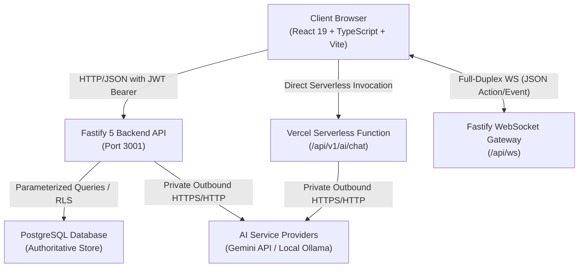
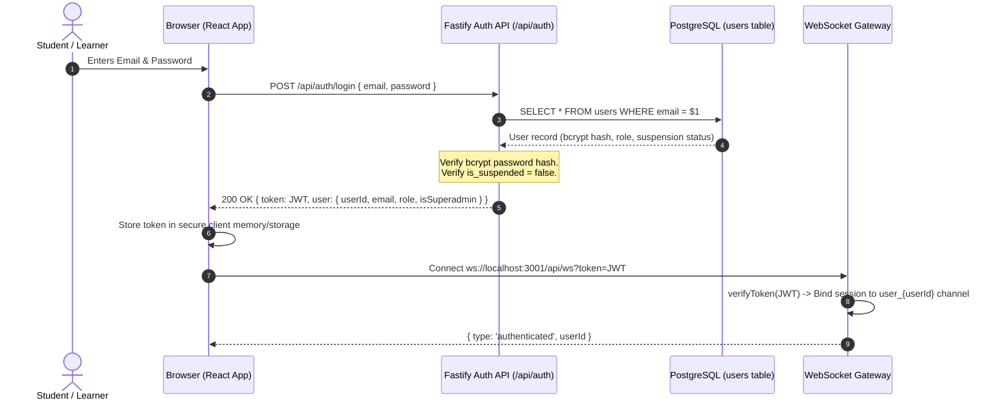
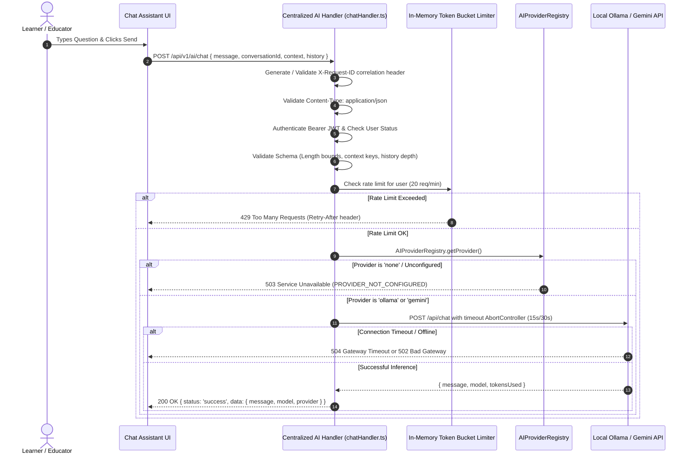
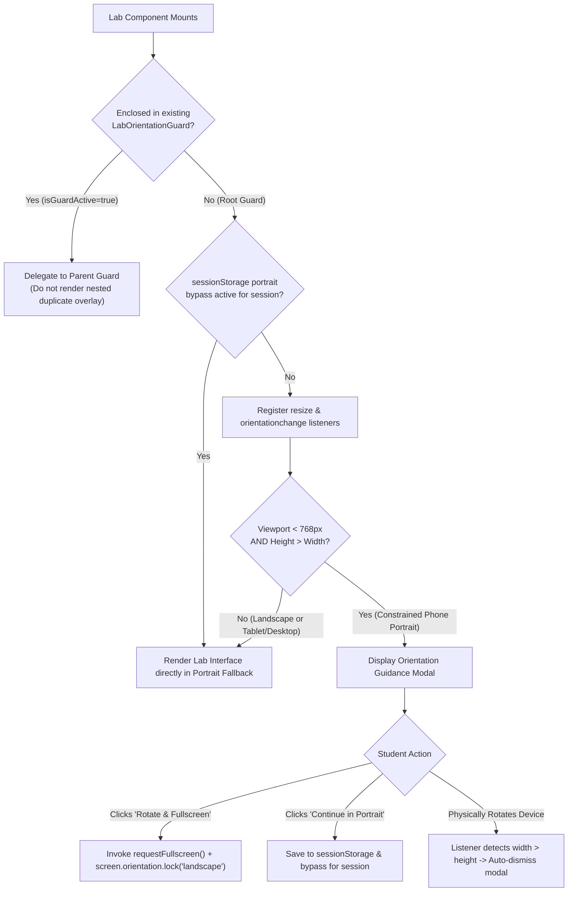

# Geniusphere Architecture: End-to-End Data Flow

This document details the lifecycle, validation boundaries, and persistence pipelines of data across the Geniusphere platform.

---

## 1. High-Level Communication Architecture



---

## 2. Authentication & Session Flow



### Authorization Boundaries:
1. **Bearer Token Verification:** All protected Fastify routes execute `verifyToken(token)` before reaching controller handlers.
2. **Suspension Check:** Suspended accounts are immediately rejected with `HTTP 403 Forbidden` (`ACCOUNT_SUSPENDED`).
3. **Role-Based Guards:** Administrative operations (`isSuperadmin: true`) are verified server-side; hiding client UI controls is never considered sufficient authorization.

---

## 3. Learning Progress & Real-Time Sync Pipeline

```mermaid
sequenceDiagram
    autonumber
    actor Learner as Learner (Browser Tab 1)
    participant UI1 as Tab 1 (LessonPlayer / SharedWorkspace)
    participant API as Fastify API (/api/progress)
    participant DB as PostgreSQL (enrollments, user_progress)
    participant WSS as WebSocket Hub
    participant UI2 as Tab 2 / Mobile Device (Browser Tab 2)

    Learner->>UI1: Completes Lab Step / Lesson Quiz
    UI1->>UI1: Optimistic UI update (progress meter, achievement preview)
    UI1->>API: POST /api/progress/complete-lesson { courseId, lessonId, xpGained }
    Note over API: Authenticate JWT; validate lessonId exists in course.<br/>Idempotent write check.
    API->>DB: INSERT / UPDATE user_progress ON CONFLICT DO UPDATE
    DB-->>API: Confirmed persisted progress record
    API->>WSS: Broadcast to channel `user_${userId}`: { type: 'LESSON_COMPLETED', lessonId, xp }
    API-->>UI1: 200 OK { status: 'success', progressPercent, xp }
    WSS-->>UI2: { type: 'LESSON_COMPLETED', lessonId, xp }
    UI2->>UI2: Re-render state synchronously across devices
```

### Integrity Controls:
- **Idempotency:** Repeated clicks or network retries check for existing completed state before awarding XP or certificates.
- **Offline / Disconnect Behavior:** If the network drops during save, the client marks progress as `pending_sync`, displays an honest warning badge, and retries with backoff. It **never** displays a false "Server Confirmed" indicator while unconfirmed.

---

## 4. Production AI Service Request Flow



### Educational Simulator vs. Real AI Boundary
| Capability | Educational AI Simulator (`AILabFull.tsx`) | Production AI Service (`/api/v1/ai/chat`) |
| :--- | :--- | :--- |
| **Execution Realm** | 100% Client-Side In-Browser Engine | Server-Side Fastify / Vercel API Gateway |
| **Underlying Logic** | Deterministic illustrative math (`educationalAiMath.ts`) | Real configured LLM (Google Gemini or Local Ollama) |
| **Truth-in-Labeling** | Explicitly labeled as an educational simulator | Real LLM responses with provider/model metadata |
| **Failure Mode** | Safe UI fallback via `LabErrorBoundary` | HTTP 502/503/504 with structured error envelope |
| **Database Access** | None | Read-only context; no direct write to user XP or grades |

---

## 5. Mobile Orientation & Layout Data Flow


