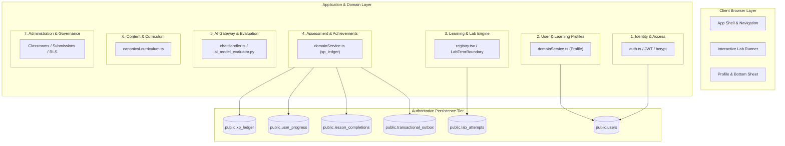

# Geniusphere Domain Ownership & State Authority Specification

This document defines the architectural boundaries, authoritative state ownership, business rules, interface contracts, and failure semantics for each core functional domain in Geniusphere.

---

## 1. Executive Domain Architecture

---

## 2. Comprehensive Domain Registry

### Domain 1: Identity & Access Management (IAM)
* **Responsibilities:** User registration, password hashing (bcrypt 10 rounds), token issuance (HMAC-SHA256 JWT, 7-day TTL), active session verification, and account status validation.
* **Non-Responsibilities:** Managing classroom rosters, awarding XP, or grading student work.
* **Authoritative Data Store:** `public.users` (columns: `id`, `email`, `password_hash`, `account_status`, `is_superadmin`).
* **Authoritative Business Rules:**
  1. Emails are unique and case-insensitive (`LOWER(email)`).
  2. Passwords require min 8 characters, hashed with bcrypt.
  3. Accounts with `account_status = 'suspended'` are immediately rejected (`HTTP 403 Forbidden`) at both login and in `authenticateRequest` middleware, regardless of valid JWT signature.
* **Public Interfaces:** `POST /api/auth/login`, `GET /api/auth/me`.
* **Failure Behavior:** Returns `401 Unauthorized` for bad credentials/expired tokens; returns `403 Forbidden` (`ACCOUNT_SUSPENDED`) for suspended accounts.
* **Verification Tests:** `tests/first-api-slice.test.tsx` (Test B), `tests/ai-endpoint.test.ts` (Tests 3 & 4), `tests/rls-authorization.test.ts`.

---

### Domain 2: User & Learning Profiles
* **Responsibilities:** Student profile customization (`full_name`, avatar, grade level), preference tracking, and multi-tab profile synchronization.
* **Non-Responsibilities:** Authenticating passwords or directly incrementing XP.
* **Authoritative Data Store:** `public.users` and `public.user_progress`.
* **Authoritative Business Rules:**
  1. Students can update their own profile; teachers can view assigned students; superadmins can update any account.
  2. Updates to profile immediately emit a real-time WebSocket event (`user.profile_updated`) scoped strictly to the user's connection channel (`user_${userId}`).
* **Public Interfaces:** `GET /api/profile`, `PATCH /api/profile`.
* **Failure Behavior:** Invalid payload returns `400 Bad Request`; non-existent profile returns `404 Not Found`.
* **Verification Tests:** `tests/student-profile-and-sync.test.ts`, `tests/production-acceptance.test.ts` (Scenario C).

---

### Domain 3: Interactive Learning & Lab Engine
* **Responsibilities:** Single authoritative registry for all 15 standalone simulation labs, lab initialization, orientation guard policy, lifecycle cleanup, step progression, and error recovery.
* **Non-Responsibilities:** Storing financial transaction records or calculating course completion certificates.
* **Authoritative Data Store:**
  - Client state: Component memory / React state.
  - Runtime errors: Caught by `LabErrorBoundary.tsx`.
  - Persisted attempts: `public.lab_attempts` (columns: `id`, `user_id`, `lab_slug`, `score`, `status`, `details`, `created_at`).
* **Authoritative Business Rules:**
  1. Labs must resolve deterministically via `getStandaloneLab(identifier)`.
  2. An outer `LabOrientationGuard` takes precedence; descendant nested guards must suppress duplicate modals via `LabOrientationContext`.
  3. WebGL contexts, canvas animation loops, and timers must be released upon unmount.
  4. Runtime render exceptions are intercepted by `LabErrorBoundary` without crashing the application shell.
* **Public Interfaces:** `POST /api/labs/attempt`, `getStandaloneLab()`.
* **Failure Behavior:** Unregistered lab slugs render fallback UI (`UnknownLab`); runtime simulation crashes display "Lab Encountered an Issue" with reload control.
* **Verification Tests:** `tests/cross-system-edge-cases.test.tsx`, `tests/labs-workflow.test.ts`, `tests/standalone-labs-mapping.test.ts`.

---

### Domain 4: Assessment, XP Ledger & Gamification
* **Responsibilities:** Authoritative evaluation of quiz answers, transactional reward disbursement, streak calculation, and idempotency guarantees.
* **Non-Responsibilities:** Storing video assets or authenticating passwords.
* **Authoritative Data Store:** `public.xp_ledger` (authoritative source of truth for all XP) and `public.user_progress` (reconciled denormalized cache).
* **Authoritative Business Rules:**
  1. **Strict Idempotency:** Every reward disbursement requires an immutable `reward_key` (e.g. `lesson_complete:<userId>:<courseId>:<lessonId>`).
  2. The unique constraint `UNIQUE (reward_key)` in `public.xp_ledger` guarantees that repeated clicks, network retries, or concurrent duplicate requests can **never** award XP twice.
  3. Total XP is authoritatively computed via `SUM(amount) FROM public.xp_ledger`.
  4. Daily learning streaks increment if completed today, remain unchanged on repeat completions today, increment by 1 if completed on consecutive days, and reset to 1 if a day is skipped.
* **Public Interfaces:** `POST /api/courses/:id/lessons/:lessonId/complete`, `POST /api/labs/attempt`.
* **Failure Behavior:** Duplicate attempts return HTTP 200 with `xpEarned: 0` without altering ledger balance or corrupting streak.
* **Verification Tests:** `tests/lab-integration-end-to-end.test.ts`, `tests/production-acceptance.test.ts` (Scenario D).

---

### Domain 5: AI Gateway & Capability Evaluation
* **Responsibilities:** Unified routing between local Ollama and hosted Google Gemini APIs, request rate limiting, input validation, context window sanitization, PII redaction, and offline model benchmarking.
* **Non-Responsibilities:** Directly updating database records, altering grades, or awarding course completion.
* **Authoritative Data Store:** `public.ai_rate_limits` table (PostgreSQL sliding window counter) + ephemeral memory buckets for local testing.
* **Authoritative Business Rules:**
  1. Maximum 20 requests per minute per authenticated user (enforced server-side with `Retry-After` header).
  2. Local Ollama instances are probed via `/api/tags` with a 2500ms timeout.
  3. If provider is unreachable, return explicit HTTP 502/504 errors. **Never fabricate simulated text as live inference.**
  4. Educational neural math demonstrations (`AILabFull.tsx`) run deterministically in browser and are explicitly labeled as illustrative educational simulations.
* **Public Interfaces:** `POST /api/v1/ai/chat`, `POST /api/ai/chat`, `tools.polyglot.ai_model_evaluator`.
* **Failure Behavior:** Unconfigured provider returns HTTP 503; timeout returns HTTP 504; rate limit returns HTTP 429.
* **Verification Tests:** `tests/ai-endpoint.test.ts`, `tests/python/test_ai_model_evaluator.py`, `tests/hybrid-ai-gateway.test.ts`.

---

### Domain 6: Content & Canonical Curriculum
* **Responsibilities:** 40 canonical courses, 170 curated educational lessons, topic inventories, video metadata, and domain categorizations across Technology, Finance, and Professional Skills.
* **Non-Responsibilities:** Managing student grades or tracking active user sessions.
* **Authoritative Data Store:** `public.courses` in PostgreSQL (seeded from `src/data/canonical-curriculum.ts`).
* **Authoritative Business Rules:**
  1. Published courses (`is_published = TRUE`) are readable by all authenticated learners.
  2. Unpublished/draft courses are strictly restricted to users with `is_superadmin = TRUE`.
  3. Every course has an immutable `slug` matching its canonical curriculum specification.
* **Public Interfaces:** `GET /api/courses`, `GET /api/courses/:identifier`.
* **Failure Behavior:** Unrecognized course slug returns `404 Course not found`.
* **Verification Tests:** `tests/canonical-curriculum.test.ts`, `tests/canonical-170-labs-deep-audit.test.ts`, `tests/canonical-video-integrity.test.ts`.

---

### Domain 7: Administration, Classrooms & Governance
* **Responsibilities:** Multi-tenant classroom roster management, teacher grading of assignments, parent-guardian consent linking under India's DPDP Act 2023, and immutable security audit logging.
* **Non-Responsibilities:** Running client-side simulation physics.
* **Authoritative Data Store:** `public.classrooms`, `public.classroom_enrollments`, `public.assignments`, `public.submissions`, `public.parent_guardian_links`, and `public.audit_events`.
* **Authoritative Business Rules:**
  1. Teachers can only grade submissions from students enrolled in classrooms they own (`sub.teacher_id === actor.userId` or `actor.isSuperadmin`).
  2. Students under 18 require a verified parent-guardian link (`parent_guardian_links.consent_status = 'verified'`).
  3. Every sensitive administrative action inserts an immutable record into `public.audit_events`.
* **Public Interfaces:** `GET /api/classrooms`, `POST /api/submissions/:id/grade`.
* **Failure Behavior:** Unauthorized grading attempts return `HTTP 403 Forbidden`.
* **Verification Tests:** `tests/rls-authorization.test.ts`, `tests/production-integration.test.ts` (Tests 5 & 6).
