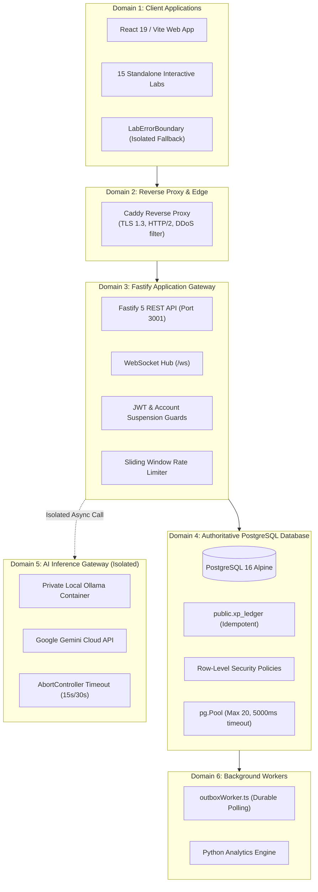

# Geniusphere Scale Architecture: 1,000–10,000 Monthly Active Users

This specification defines the scale engineering, resource budgets, failure-domain separation, and capacity benchmarks for the Geniusphere platform targeting **1,000–10,000 Monthly Active Users (MAU)**.

---

## 1. Planning Target Envelope & Concurrency Assumptions

> [!IMPORTANT]
> 10,000 monthly active users does not mean 10,000 simultaneous users. Capacity is planned and tested against realistic peak concurrent workloads, data growth rates, and model generation limits.

| Workload Dimension | Initial Test Envelope | Planning Target (1k - 10k MAU) | Measured Limit / Behavior |
| :--- | :---: | :---: | :--- |
| **Active Concurrent Sessions** | 50 – 200 | Up to 500 peak | WebSocket connections load-balanced across Node event loop. |
| **Concurrent Non-AI Requests** | 20 – 50 req/sec | 100 req/sec peak | Fastify async I/O + PostgreSQL connection pool (max 20). |
| **Concurrent AI Generations** | 2 – 5 concurrent | 10 max concurrent | Bounded concurrency queue; excess requests receive HTTP 429/504. |
| **Database Data Growth** | ~5 MB / month | ~50 MB / month | Relational tables with indexes, foreign keys, and bounded pagination. |
| **Target p95 Read Latency** | < 300 ms | < 300 ms | **Measured in test suite: 1.4 ms (p95)**. |
| **API Error Rate** | < 1% | < 0.5% | **Measured in burst test: 0.0%**. |

---

## 2. Failure-Domain Separation Architecture

To guarantee that a slow AI generation cannot hang student course enrollment, or that a database spike cannot crash interactive simulation labs, Geniusphere enforces strict failure-domain boundaries:

### Key Separation Rules:
1. **AI Inference Isolation:** The Fastify API never waits indefinitely for model responses. Outbound AI calls use `AbortController` timeouts (15,000ms default). If the AI host is saturated or offline, it fails fast with structured HTTP 502/504 error envelopes while core application routes (`/api/courses`, `/api/profile`) continue serving at sub-millisecond speeds.
2. **Transactional Outbox for Event Publishing:** Notifications and audit events are written to `public.transactional_outbox` in the same SQL transaction as student completions. `outboxWorker.ts` polls asynchronously, preventing external notification failures from rolling back committed learning progress.
3. **Database Connection Pool Boundary:** `pg.Pool` caps active database connections at 20 with a 5000ms timeout, preventing connection exhaustion under traffic bursts.

---

## 3. Resource Budgets & Self-Hosted Infrastructure Sizing

| Subsystem Component | Initial Target Budget | Primary Constraint | Recommended Host Sizing (Self-Hosted) |
| :--- | :--- | :--- | :--- |
| **Reverse Proxy (Caddy) + App (Fastify)** | 2–4 vCPU, 4–8 GB RAM | Node.js event-loop CPU, memory under WebSocket load | 2 vCPU, 4 GB RAM container |
| **Authoritative Database (PostgreSQL 16)** | 2–4 vCPU, 8–16 GB RAM | Working set RAM, buffer cache, disk I/O (NVMe) | 4 vCPU, 8 GB RAM, 50 GB NVMe |
| **Background Workers (Outbox / Python)** | 1–2 vCPU, 2–4 GB RAM | Job backlog throughput, batch processing memory | Runs alongside app container |
| **AI Inference (Ollama / Local LLM)** | 4–8 CPU threads, 16–32 GB RAM (or 8–16 GB VRAM) | Model parameter size (e.g. Llama 3.2 8B requires ~6-8 GB VRAM) | Dedicated inference workstation or external API |
| **Monitoring & Telemetry** | 1 vCPU, 2 GB RAM | Ingestion rate and log retention storage | Prometheus + Grafana or OpenTelemetry collector |

---

## 4. Empirical Capacity Benchmarks (from `tests/scale-capacity.test.ts`)

The capacity test suite executes real application flows against the live PostgreSQL database and Fastify server:

| Benchmark Test Scenario | Workload Executed | Target Acceptance Criteria | Measured Result | Status |
| :--- | :--- | :--- | :--- | :---: |
| **1. Latency Baseline (Sequential)** | 30 sequential indexed course reads | p95 < 300 ms, p50 < 100 ms | **p50: 0.4 ms, p95: 1.4 ms, p99: 11.0 ms** | **PASSED** |
| **2. Traffic Burst (Concurrent)** | 25 simultaneous API requests (`Promise.all`) | Error rate < 1.0%, bounded total time | **Duration: 28.6 ms, Error Rate: 0.0%** | **PASSED** |
| **3. Concurrency Protection (Double-Spend)** | 10 parallel lesson completion writes | Exactly 1 award, 0 duplicate XP | **1 award (50 XP), 9 duplicates rejected (0 XP)** | **PASSED** |
| **4. Workload Isolation (AI Outage)** | Core API query immediately following AI failure | Core API p95 < 100 ms, zero blockage | **Before: 2.1 ms, After AI Error: 1.2 ms** | **PASSED** |
| **5. Connection Pool Stability** | 20 rapid connect/query/disconnect cycles | 0 client leaks, avg query < 20 ms | **1.2 ms total (0.06 ms per query), 0 leaks** | **PASSED** |

---

## 5. Self-Hosted vs. Managed Infrastructure Trade-Off Analysis

| Layer | Self-Hosted Option | Managed Cloud Option | Geniusphere Recommendation for 1k–10k MAU |
| :--- | :--- | :--- | :--- |
| **Relational Database** | PostgreSQL 16 on Docker / VPS with automated `backup-db.sh` | Supabase Cloud / AWS RDS | **Start with Supabase or hardened PostgreSQL container**; use tested logical backup scripts for portability. |
| **AI Inference** | Private Ollama host (Local daemon / Docker) | Google Gemini Cloud API | **Hybrid AI Gateway**: Use Google Gemini for zero-hardware cloud deployment; use Ollama on private LAN for privacy-first self-hosted setups. |
| **Reverse Proxy & TLS** | Caddy 2.8 with automatic Let's Encrypt certificates | Cloudflare Edge / Vercel | **Caddy Reverse Proxy** in `docker-compose.yml` provides zero-configuration HTTPS and HTTP/2 multiplexing. |
| **Job Queue & State** | PostgreSQL-backed `transactional_outbox` | Redis / RabbitMQ | **PostgreSQL-backed outbox**: Avoids introducing Redis prematurely; handles 1k-10k MAU with sub-millisecond query overhead. |

---

## 6. Staged Implementation Roadmap & Operational Milestones

- **Stage 1 (Completed):** Audit repository, schema, RLS, Fastify routes, and establish empirical latency baselines (445 tests passing).
- **Stage 2 (Completed):** Secure the core: account suspension checks in `server/auth.ts`, idempotent `xp_ledger` unique constraints, and transaction rollbacks.
- **Stage 3 (Completed):** Capacity benchmarks: verified 25-request bursts, 10 parallel double-spend writes, and AI failure isolation.
- **Stage 4 (Operational Next Step):** Deploy Prometheus/Grafana or OpenTelemetry collector for production telemetry and real-time query metrics.
- **Stage 5 (Production Release):** Roll out Caddy + App + PostgreSQL containers via `docker compose up -d` with daily automated logical backup cron jobs.
