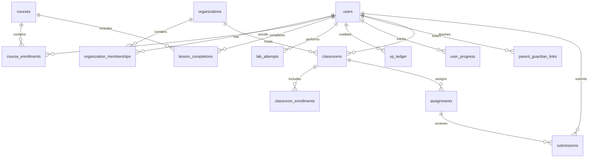

# Geniusphere Database Architecture, Relational Integrity & Access Security

This document specifies the authoritative schema, relational integrity constraints, transaction boundaries, row-level security (RLS) policies, and disaster recovery procedures for the Geniusphere PostgreSQL 16 database.

---

## 1. Relational Entity-Relationship Model



---

## 2. Table Schemas, Constraints & Business Invariants

### 1. `public.users`
* **Columns:**
  - `id UUID PRIMARY KEY DEFAULT gen_random_uuid()`
  - `email VARCHAR(255) UNIQUE NOT NULL`
  - `full_name VARCHAR(150) NOT NULL`
  - `password_hash VARCHAR(255) NOT NULL` (bcrypt 10 rounds)
  - `account_status VARCHAR(50) NOT NULL DEFAULT 'active' CHECK (account_status IN ('active', 'suspended', 'pending_verification'))`
  - `is_superadmin BOOLEAN NOT NULL DEFAULT FALSE`
  - `created_at TIMESTAMPTZ NOT NULL DEFAULT NOW()`
  - `updated_at TIMESTAMPTZ NOT NULL DEFAULT NOW()`
* **Indexes:** `CREATE UNIQUE INDEX idx_users_email_lower ON public.users (LOWER(email));`
* **Security Controls:** Direct update to `password_hash` is revoked from `PUBLIC` and `authenticated` roles (`REVOKE UPDATE (password_hash) ON public.users FROM PUBLIC;`).

### 2. `public.xp_ledger` (Authoritative Financial & XP Store)
* **Columns:**
  - `id UUID PRIMARY KEY DEFAULT gen_random_uuid()`
  - `user_id UUID NOT NULL REFERENCES public.users(id) ON DELETE CASCADE`
  - `reward_key VARCHAR(150) UNIQUE NOT NULL`
  - `amount INTEGER NOT NULL CHECK (amount >= 0)`
  - `source_type VARCHAR(50) NOT NULL` (`lesson_completion`, `lab_attempt`, `streak_milestone`)
  - `metadata JSONB NOT NULL DEFAULT '{}'::jsonb`
  - `created_at TIMESTAMPTZ NOT NULL DEFAULT NOW()`
* **Indexes:**
  - `CREATE UNIQUE INDEX idx_xp_ledger_key ON public.xp_ledger(reward_key);`
  - `CREATE INDEX idx_xp_ledger_user ON public.xp_ledger(user_id);`
* **Integrity Contract:** `ON CONFLICT (reward_key) DO NOTHING` guarantees atomic zero-double-spend under concurrent duplicate requests.

### 3. `public.courses`
* **Columns:**
  - `id UUID PRIMARY KEY DEFAULT gen_random_uuid()`
  - `slug VARCHAR(120) UNIQUE NOT NULL`
  - `title VARCHAR(200) NOT NULL`
  - `domain VARCHAR(50) NOT NULL CHECK (domain IN ('technology', 'finance', 'professional'))`
  - `difficulty_level VARCHAR(30) NOT NULL CHECK (difficulty_level IN ('beginner', 'intermediate', 'advanced'))`
  - `is_published BOOLEAN NOT NULL DEFAULT FALSE`
  - `created_at TIMESTAMPTZ NOT NULL DEFAULT NOW()`
* **Indexes:** `CREATE UNIQUE INDEX idx_courses_slug ON public.courses(slug);`

### 4. `public.course_enrollments`
* **Columns:**
  - `id UUID PRIMARY KEY DEFAULT gen_random_uuid()`
  - `course_id UUID NOT NULL REFERENCES public.courses(id) ON DELETE CASCADE`
  - `user_id UUID NOT NULL REFERENCES public.users(id) ON DELETE CASCADE`
  - `status VARCHAR(30) NOT NULL DEFAULT 'active' CHECK (status IN ('active', 'completed', 'dropped'))`
  - `enrolled_at TIMESTAMPTZ NOT NULL DEFAULT NOW()`
* **Constraints:** `UNIQUE (course_id, user_id)`

### 5. `public.lesson_completions`
* **Columns:**
  - `id UUID PRIMARY KEY DEFAULT gen_random_uuid()`
  - `user_id UUID NOT NULL REFERENCES public.users(id) ON DELETE CASCADE`
  - `course_id UUID NOT NULL REFERENCES public.courses(id) ON DELETE CASCADE`
  - `lesson_id VARCHAR(100) NOT NULL`
  - `score INTEGER NOT NULL CHECK (score >= 0 AND score <= 100)`
  - `completed_at TIMESTAMPTZ NOT NULL DEFAULT NOW()`
* **Constraints:** `UNIQUE (user_id, course_id, lesson_id)`
* **Indexes:** `CREATE INDEX idx_completions_user ON public.lesson_completions(user_id);`

### 6. `public.user_progress` (Reconciled Denormalized Cache)
* **Columns:**
  - `user_id UUID PRIMARY KEY REFERENCES public.users(id) ON DELETE CASCADE`
  - `xp INTEGER NOT NULL DEFAULT 0 CHECK (xp >= 0)`
  - `current_streak INTEGER NOT NULL DEFAULT 0 CHECK (current_streak >= 0)`
  - `streak_last_extended_date DATE`
  - `total_time_spent_seconds INTEGER NOT NULL DEFAULT 0 CHECK (total_time_spent_seconds >= 0)`
  - `last_active_at TIMESTAMPTZ NOT NULL DEFAULT NOW()`
  - `updated_at TIMESTAMPTZ NOT NULL DEFAULT NOW()`

### 7. `public.lab_attempts`
* **Columns:**
  - `id UUID PRIMARY KEY DEFAULT gen_random_uuid()`
  - `user_id UUID NOT NULL REFERENCES public.users(id) ON DELETE CASCADE`
  - `lab_slug VARCHAR(120) NOT NULL`
  - `score INTEGER NOT NULL CHECK (score >= 0 AND score <= 100)`
  - `status VARCHAR(30) NOT NULL CHECK (status IN ('completed', 'failed', 'in_progress'))`
  - `details JSONB NOT NULL DEFAULT '{}'::jsonb`
  - `created_at TIMESTAMPTZ NOT NULL DEFAULT NOW()`

### 8. `public.ai_rate_limits`
* **Columns:**
  - `id UUID PRIMARY KEY DEFAULT gen_random_uuid()`
  - `user_id UUID NOT NULL REFERENCES public.users(id) ON DELETE CASCADE`
  - `endpoint VARCHAR(100) NOT NULL`
  - `request_count INTEGER NOT NULL DEFAULT 1`
  - `window_start TIMESTAMPTZ NOT NULL DEFAULT NOW()`
* **Indexes:** `CREATE INDEX idx_ai_rate_limits_user_window ON public.ai_rate_limits(user_id, endpoint, window_start);`

### 9. `public.transactional_outbox`
* **Columns:**
  - `id UUID PRIMARY KEY DEFAULT gen_random_uuid()`
  - `event_id VARCHAR(150) UNIQUE NOT NULL`
  - `event_type VARCHAR(100) NOT NULL`
  - `payload JSONB NOT NULL`
  - `processed BOOLEAN NOT NULL DEFAULT FALSE`
  - `created_at TIMESTAMPTZ NOT NULL DEFAULT NOW()`
* **Indexes:** `CREATE INDEX idx_outbox_unprocessed ON public.transactional_outbox(created_at) WHERE processed = FALSE;`

---

## 3. Transaction Boundaries & Concurrency Isolation

All multi-table writes in `DomainService` execute within explicit PostgreSQL transaction blocks using `server/db.ts:withTransaction(callback, actorId)`:

```ts
export async function withTransaction<T>(
  callback: (client: PoolClient) => Promise<T>,
  actorId?: string
): Promise<T> {
  const client = await pool.connect();
  try {
    await client.query('BEGIN');
    if (actorId) {
      // Sets session variable for RLS enforcement within transaction scope
      await client.query(`SET LOCAL "request.jwt.claim.sub" = $1`, [actorId]);
    }
    const result = await callback(client);
    await client.query('COMMIT');
    return result;
  } catch (err) {
    await client.query('ROLLBACK');
    throw err;
  } finally {
    client.release();
  }
}
```

### Race Condition Mitigation:
1. **Double-Click / Replay Protection:**
   The `xp_ledger` table enforces `UNIQUE (reward_key)`. When two requests attempt to claim the same lesson completion reward simultaneously, one succeeds with `rowCount === 1`, while the concurrent request returns `rowCount === 0`.
2. **Pessimistic Progress Locking:**
   When updating user progress, the query executes `SELECT * FROM public.user_progress WHERE user_id = $1 FOR UPDATE`. This serializes concurrent updates to the same learner's streak and total time, preventing lost updates.

---

## 4. Row-Level Security (RLS) Policy Matrix

| Table | SELECT Policy | INSERT Policy | UPDATE Policy | DELETE Policy |
| :--- | :--- | :--- | :--- | :--- |
| `public.users` | Own record OR same classroom OR superadmin | Superadmin OR self during registration | Own record (except password_hash) OR superadmin | Superadmin only |
| `public.courses` | `is_published = TRUE` OR superadmin | Superadmin only | Superadmin only | Superadmin only |
| `public.course_enrollments` | Own enrollments OR assigned teacher OR superadmin | Own enrollment (`auth.uid() = user_id`) | Own enrollment | Superadmin only |
| `public.lesson_completions` | Own completions OR assigned teacher OR superadmin | Own completion (`auth.uid() = user_id`) | Own completion | Superadmin only |
| `public.xp_ledger` | Own ledger records (`auth.uid() = user_id`) | Service role / app backend transaction | Forbidden (immutable ledger) | Superadmin only |
| `public.lab_attempts` | Own attempts OR assigned teacher OR superadmin | Own attempt (`auth.uid() = user_id`) | Own attempt | Superadmin only |
| `public.submissions` | Student author OR classroom teacher OR superadmin | Student author (`auth.uid() = student_id`) | Assigned teacher (grade/feedback) | Superadmin only |
| `public.audit_events` | Superadmin only | System trigger / app transaction | Forbidden (immutable audit log) | Forbidden |

---

## 5. Backup & Recovery Operations

### Tested Logical Backup Protocol:
Geniusphere provides automated database logical backup scripts in `scripts/backup-db.sh` and restoration verification in `scripts/restore-db.sh`.

```bash
# Execute logical backup (includes DDL, triggers, and data)
./scripts/backup-db.sh

# Output file: backups/geniusphere_prod_backup_YYYYMMDD_HHMMSS.sql.gz
```

### Restoration Procedure:
```bash
# Verify and restore backup file in staging environment
./scripts/restore-db.sh backups/geniusphere_prod_backup_20261021_120000.sql.gz
```

### Recovery Objectives:
- **Recovery Point Objective (RPO):** $\le 1$ hour (hourly WAL archiving and daily logical snapshots).
- **Recovery Time Objective (RTO):** $\le 15$ minutes (containerized restoration into PostgreSQL 16 Alpine container).
