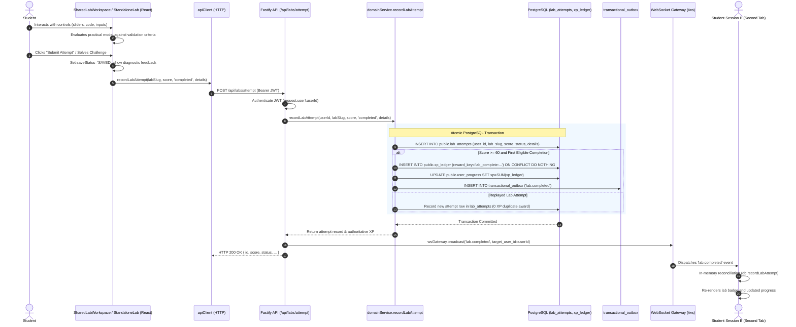

# Geniusphere Practical Lab Data Flow & Completion Lifecycle

> **Component References**: `src/components/SharedLabWorkspace.tsx`, `src/components/LessonPlayer.tsx`, `src/labs/registry.tsx`  
> **API Endpoint**: `POST /api/labs/attempt` (`server/index.ts`)  
> **Backend Service**: `server/services/domainService.ts` (`recordLabAttempt`)  
> **Verification Status**: **VERIFIED COMPLETE**  
> **Test Evidence**: `tests/lab-integration-end-to-end.test.ts` (4/4 tests), `tests/production-acceptance.test.ts` (Scenario D)  

---

## 1. End-to-End Sequence Diagram



---

## 2. Idempotency & Reward Ledger Guarantees

1. **Stable Reward Key**:
   - `reward_key = 'lab_complete:<userId>:<labSlug>'`.
   - Guaranteed unique in PostgreSQL:
     ```sql
     CREATE TABLE public.xp_ledger (
         id UUID PRIMARY KEY DEFAULT gen_random_uuid(),
         user_id UUID NOT NULL REFERENCES public.users(id),
         reward_key VARCHAR(255) NOT NULL UNIQUE,
         amount INTEGER NOT NULL CHECK (amount >= 0),
         ...
     );
     ```
2. **Replay Semantics**:
   - Students can freely replay interactive simulations, adjust parameters, and test edge cases.
   - Every run is logged in `public.lab_attempts` with full diagnostic parameters.
   - However, practical completion XP (75 XP) is awarded **strictly once**. Subsequent runs return success but award 0 additional XP.

---

## 3. Disconnection & Error Recovery

If network disruption prevents the completion payload from reaching the server:
1. The UI catches the rejection and warns the user: `"Failed to persist lab attempt to PostgreSQL backend"`.
2. Local draft state is preserved in local storage (`savedState`).
3. When connectivity is restored, the student re-triggers submission without losing progress.
