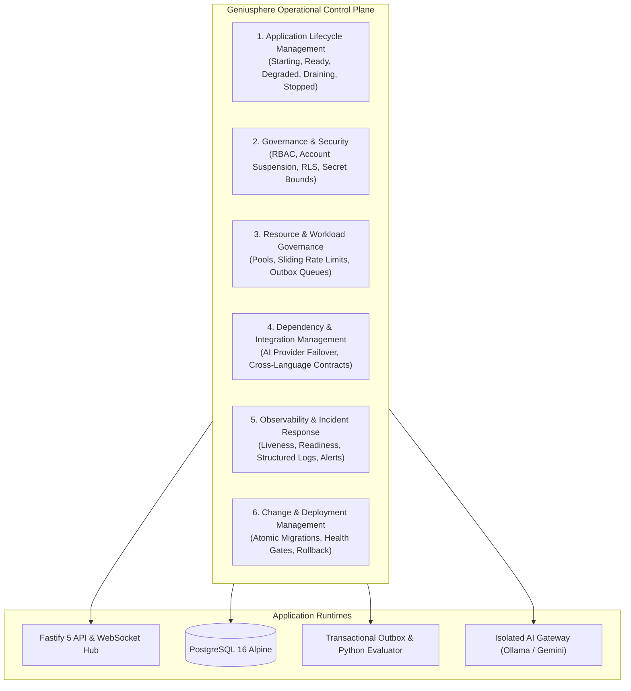
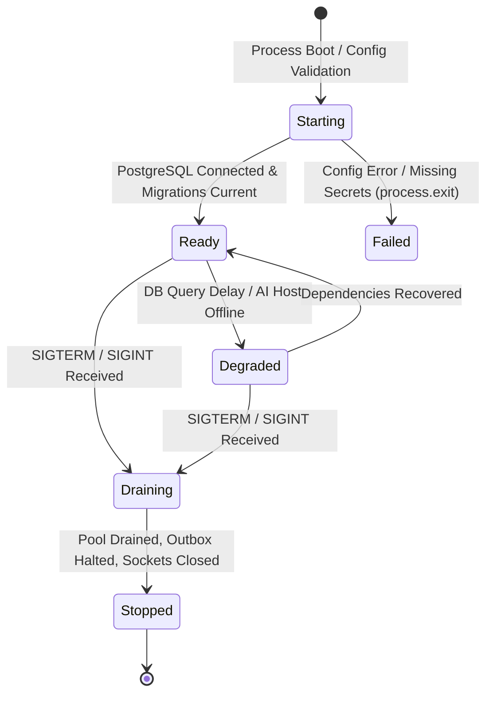

# Geniusphere Operational Control Plane & Whole-System Governance Specification

This specification establishes the architectural rules, runtime mechanisms, lifecycle state machine, and administrative telemetry of the **Geniusphere Operational Control Plane**.

---

## 1. The Six Coordinated Management Systems

Rather than managing database records, AI inference, and frontend pages in isolation, the Operational Control Plane coordinates six core management disciplines across the platform:



---

## 2. Complete Component Lifecycle Model

Every major service, background worker, and interactive learning lab follows an explicit, governed lifecycle:



### Lifecycle States Defined:
1. **`starting`:** Process booted. Validates production environment variables (`DATABASE_URL`, `JWT_SECRET`), runs pending atomic database migrations, seeds canonical curriculum, and constructs HTTP/WebSocket server.
2. **`ready`:** Fastify server listening; PostgreSQL connection pool healthy; background `outboxWorker` active; AI provider probed. Accepts student traffic.
3. **`degraded`:** Core API operational, but one or more optional external dependencies (e.g., local Ollama daemon or live push delivery) is unresponsive. Non-blocking error envelopes returned without crashing learning journeys.
4. **`draining`:** Received shutdown signal (`SIGTERM`/`SIGINT`). Stops accepting new inbound HTTP requests; pauses background outbox ingestion; allows active in-flight requests to complete.
5. **`stopped`:** WebSocket connections disconnected with clean `1001 Going Away` frames; database connection pool terminated (`pool.end()`); process terminates cleanly with code 0.
6. **`failed`:** Fatal startup error (e.g., unreachable database, missing encryption secrets). Exits immediately with error code 1.

---

## 3. Operational Probes & Telemetry Interfaces

The control plane exposes four explicit endpoints with dedicated operational purposes:

| Endpoint | Security Boundary | Purpose | Response Behavior |
| :--- | :--- | :--- | :--- |
| **`GET /health`** | Public (No auth) | High-level server heartbeat | Returns `{ status: 'healthy', state: 'ready', server: '...', timestamp: ... }`. |
| **`GET /health/liveness`** | Public (Container Probe) | Fast container process liveness check | Zero DB queries. Returns HTTP 200 `{ status: 'alive' }` while running; HTTP 503 if draining. |
| **`GET /health/readiness`** | Public (Traffic Gate) | Deep dependency health verification | Tests PostgreSQL connection (`SELECT 1`), verifies outbox worker loop, and probes AI provider. Returns HTTP 200 if ready; HTTP 503 if database down. |
| **`GET /api/control-plane/telemetry`** | Administrative (`superadmin` / `teacher`) | Complete operational telemetry | Returns real-time JSON metrics covering memory, pool utilization, queue depths, and model readiness. |

### Sample Control Plane Telemetry Output:
```json
{
  "server": {
    "name": "geniusphere-backend-production",
    "version": "2.0.0",
    "lifecycleState": "ready",
    "uptimeSeconds": 1420,
    "nodeVersion": "v25.8.0",
    "pid": 78241
  },
  "resources": {
    "memory": {
      "rssMb": 84.2,
      "heapUsedMb": 48.6,
      "heapTotalMb": 62.1,
      "externalMb": 4.1
    },
    "databasePool": {
      "totalConnections": 3,
      "idleConnections": 3,
      "waitingRequests": 0,
      "maxConnections": 20
    }
  },
  "workloads": {
    "outboxQueue": {
      "running": true,
      "pending": 0,
      "published": 142,
      "failed": 0
    },
    "activeWebSocketClients": 1
  },
  "aiGateway": {
    "activeProvider": "none",
    "model": "llama3.2",
    "available": false,
    "timeoutMs": 15000
  }
}
```

---

## 4. Resource & Workload Governance

1. **Database Connection Pool Ceiling:**
   - PostgreSQL connection pool is strictly bounded to `max: 20` with a `connectionTimeoutMillis: 5000` limit.
   - Prevents spike concurrency from exhausting database file descriptors or memory.
2. **Sliding Window Rate Limiting:**
   - Expensive AI endpoints are bounded by `public.ai_rate_limits` to 20 requests per minute per authenticated student.
   - Excess requests receive `HTTP 429 Too Many Requests` with a calculated `Retry-After` header.
3. **Outbox Batch Bounding:**
   - Background worker processes at most 20 events per poll iteration (`LIMIT 20 FOR UPDATE SKIP LOCKED`), preventing event storm spikes.
4. **Client-Side Simulation Isolation:**
   - Interactive simulation labs execute within `LabErrorBoundary`, preventing WebGL or canvas engine crashes from affecting the parent application shell.

---

## 5. Incident Management & Recovery Runbooks

### Runbook A: PostgreSQL Database Outage
* **Detection:** `/health/readiness` probe returns HTTP 503 with `"postgresql": "unhealthy"`.
* **Containment:** Fastify stops routing writes; queries return structured HTTP 503 errors.
* **Recovery:** When PostgreSQL restarts, `pg.Pool` automatically re-establishes connections on the next poll. `outboxWorker` resumes unprocessed events from the last committed transaction.

### Runbook B: AI Host Offline or Overloaded
* **Detection:** `/api/v1/ai/chat` requests encounter `AbortController` timeout (15,000ms) or provider probe returns `available: false`.
* **Containment:** System returns explicit HTTP 502/504 errors. **Zero fabricated or mock text is presented to students.**
* **Recovery:** Core learning platform operates with full fidelity. Once the AI daemon re-registers, traffic resumes automatically.

### Runbook C: Emergency Credential Rotation
* **Trigger:** Secret leak suspected for `JWT_SECRET` or `DATABASE_URL`.
* **Execution:**
  1. Update secret in `.env.production`.
  2. Reload container: `docker compose restart app`.
  3. Effect: All active JWT tokens are immediately invalidated, forcing re-authentication across all sessions.
