# Geniusphere Production Readiness Assessment & Operational Sign-Off

This document provides the authoritative engineering sign-off, risk assessment, and release verification for the Geniusphere platform across all five architectural layers.

---

## 1. Five-Layer Architecture Readiness Assessment

```mermaid
flowchart TD
    subgraph L1 ["1. User Experience Layer"]
        UX1["Responsive Mobile Grid (min-w-0)"]
        UX2["LabOrientationGuard (Deduplicated)"]
        UX3["LabErrorBoundary (Accessible Fallback)"]
        UX4["Mobile Bottom Sheet User Menu"]
    end

    subgraph L2 ["2. Application & Domain Layer"]
        D1["DomainService (Authoritative State)"]
        D2["Authoritative xp_ledger (Zero Double-Spend)"]
        D3["Centralized Lab Registry (15 Modules)"]
        D4["Account Suspension Guards"]
    end

    subgraph L3 ["3. API & Integration Layer"]
        A1["Fastify 5 REST & WebSocket Gateway"]
        A2["Token-Bucket Rate Limiter (20 req/min)"]
        A3["Dual-Engine AI Gateway (Ollama / Gemini)"]
        A4["Correlation IDs (x-request-id)"]
    end

    subgraph L4 ["4. Data & Security Layer"]
        S1["PostgreSQL 16 Relational Schema"]
        S2["Row-Level Security (RLS) on all 11 Tables"]
        S3["Least-Privilege Role Grants (geniusphere_app)"]
        S4["Atomic SQL Migration Transactions"]
    end

    subgraph L5 ["5. Operations & Reliability Layer"]
        O1["Caddy Reverse Proxy (TLS 1.3, HTTP/2)"]
        O2["Docker Compose Self-Hosted Topology"]
        O3["Tested Backup/Restore Scripts"]
        O4["Python Model Evaluator & Analytics"]
    end

    L1 --> L2 --> L3 --> L4 --> L5
```

---

## 2. Layer-by-Layer Verification Audit

| Architectural Layer | Evaluation Criteria | Verified Implementation | Status |
| :--- | :--- | :--- | :---: |
| **1. User Experience Layer** | Mobile layout responsiveness, touch interactions, error boundaries, and orientation guards. | - Grid columns use `min-w-0` and responsive breakpoints (`grid-cols-1 md:grid-cols-12`). - `LabOrientationGuard` deduplicates nested overlays via React Context. - `LabErrorBoundary` intercepts WebGL/Canvas crashes with reload/exit actions. - User profile menu converted to native mobile bottom sheet. | **PRODUCTION READY** |
| **2. Application & Domain Layer** | Authoritative business rules, streak mathematics, scoring, and identity lifecycle. | - `DomainService` owns all multi-step workflows. - `xp_ledger` enforces `UNIQUE (reward_key)` to guarantee atomic idempotency. - Daily streaks computed deterministically from calendar dates. - `authenticateRequest` verifies `account_status != 'suspended'`. | **PRODUCTION READY** |
| **3. API & Integration Layer** | Schema validation, timeouts, rate limits, correlation tracking, and AI gateways. | - Request bodies validated at runtime with 64 KB limit. - Sliding window rate limiter enforces 20 req/min in PostgreSQL. - Outbound AI calls use `AbortController` timeouts (15s/30s). - Local Ollama health probes verify daemon before token generation. | **PRODUCTION READY** |
| **4. Data & Security Layer** | Relational constraints, RLS policies, least privilege, and transaction boundaries. | - Foreign keys enforce `ON DELETE CASCADE` or `RESTRICT`. - RLS policies on all 11 tables prevent cross-student record leaks. - Sensitive columns (`password_hash`, `is_superadmin`) protected by SQL REVOKE. - Multi-table writes wrapped in `withTransaction()` with automatic rollback. | **PRODUCTION READY** |
| **5. Operations & Reliability Layer** | Container topology, secret separation, health checks, backup/restore, and rollback. | - Docker Compose isolates PostgreSQL and Ollama on private network. - Health endpoint `/health` validates database connection and uptime. - Logical backup and restore scripts verified in staging. - Python AI capability evaluator audits prompts and models offline. | **PRODUCTION READY** |

---

## 3. Release Blockers & Risk Resolution Status

| Category | Potential Blocker / Defect | Remediation & Evidence | Status |
| :--- | :--- | :--- | :---: |
| **Security** | Active JWT tokens could be used after an administrator suspends an account. | `server/auth.ts:authenticateRequest` queries `public.users.account_status` on every request, immediately returning `403 Forbidden`. | **RESOLVED** |
| **Data Integrity** | Rapid double-clicks or retries could disburse completion XP multiple times. | Implemented `public.xp_ledger` with unique reward keys and atomic `ON CONFLICT DO NOTHING`. | **RESOLVED** |
| **UI Resiliency** | WebGL or rendering crash in complex labs collapsed the entire course player. | Implemented `LabErrorBoundary` wrapping standalone and embedded lab containers. | **RESOLVED** |
| **Mobile UX** | Nested orientation guards created stacked duplicate modals on mobile devices. | Introduced `LabOrientationContext` and `sessionStorage` bypass persistence. | **RESOLVED** |
| **AI Reliability** | Offline Ollama daemon could hang requests or fabricate mock responses. | Health probe via `/api/tags`, explicit timeouts, and strict zero-mock error envelopes. | **RESOLVED** |

---

## 4. Final Operational Sign-Off

- **Automated Tests:** **444 / 444 passed** (431 Vitest + 13 Pytest).
- **TypeScript Compilation:** Zero errors (`tsc --noEmit`).
- **Production Build:** Clean bundle generated in `dist/` in **4.68s**.
- **Security Audit:** Zero committed secrets; all database operations parameterized; least-privilege SQL grants in place.
- **Verdict:** The Geniusphere platform is verified, architecturally coherent, hardened against edge-case failures, and **READY FOR STAGED PRODUCTION DEPLOYMENT**.
