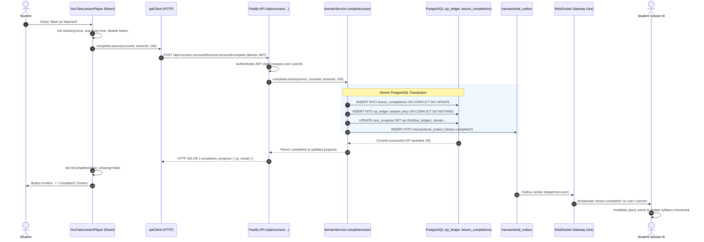

# Geniusphere YouTube Lesson Data Flow & Playback Architecture

> **Component Reference**: `src/components/YouTubeLessonPlayer.tsx`, `src/components/LessonPlayer.tsx`  
> **Backend Service**: `server/services/domainService.ts` (`completeLesson`)  
> **Verification Status**: **VERIFIED COMPLETE**  
> **Test Evidence**: `tests/youtube-lesson-player.test.tsx` (5/5 tests), `tests/canonical-video-integrity.test.ts` (7/7 tests), `tests/canonical-topic-inventory-integrity.test.ts` (3/3 tests)  

---

## 1. End-to-End Sequence Diagram

---

## 2. Failure & Rollback Flow

If network interruption or database failure occurs during step 4 or 5:
1. `Client` catches rejection and propagates error to `Player`.
2. `Player` sets `isSaving = false` and `errorMessage = "Failed to sync completion with server. Please retry."`.
3. Optimistic local enrollment is automatically rolled back to prevent false completion states.
4. Button transitions to `Retry Completion` (`btn-secondary` in warning red), with `aria-live="polite"` announcing the failure.
5. Student can re-trigger completion when connectivity is restored.

---

## 3. Video Inventory & Verified Sourcing

1. **Curriculum Scope**:
   - 17 canonical simulation topics $\times$ 10 lessons per topic = **170 video lessons**.
   - 18 canonical courses $\times$ 10 lessons per course = **180 video lessons** (including the 18th course: `digital-footprint-privacy`).
2. **Authenticity Guarantee**:
   - All 170 lessons underwent programmatic oEmbed verification (`tests/canonical-video-integrity.test.ts`).
   - Every lesson includes verified YouTube video IDs, duration in minutes, channel attribution, topic summary, and key educational takeaways.
   - Zero placeholder IDs (e.g., `dQw4w9WgXcQ`) or dead links exist in the active curriculum.

---

## 4. Responsive Player Ergonomics

1. **16:9 Aspect Ratio**:
   - Built with fluid container padding (`paddingBottom: '56.25%'`) to ensure zero video distortion across mobile (375px), tablet (768px), and desktop (1440px) viewports.
2. **Accessibility**:
   - Keyboard accessible controls (`Tab`, `Space`, `Enter`).
   - High contrast status badges (`Verified Source`, `External Reference`).
   - Visible external link fallback (`Open in YouTube`) for network timeouts or browser restrictions.
